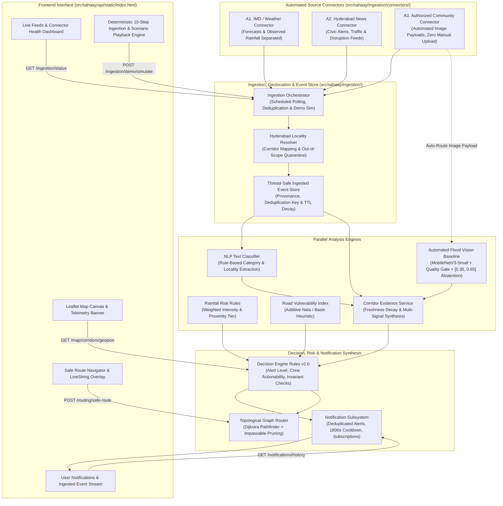

# Sahaay AI: Predict. Prevent. Protect.
### Hyderabad-Focused Flood Intelligence Hackathon Prototype

[-10b981?style=flat-square)](tools/release_gate.py)
[](#8-demo-data-and-connectivity)
[](#10-safety-and-intended-use)
[-64748b?style=flat-square)](#12-project-status-and-future-work)

---

## 1. Project Overview

**Sahaay AI** is a modular, Hyderabad-first flood intelligence prototype designed to address urban waterlogging and storm emergency coordination. 

During intense monsoon cloudbursts in metropolitan Hyderabad, emergency response and citizen navigation suffer from **fragmented, conflicting, and delayed information**:
- Rainfall telemetry stations may be kilometers away from local street catchments.
- Citizen smartphone photos provide localized evidence but lack standardized depth or passability verification.
- Chronically vulnerable roads (adjacent to open stormwater *nalas*, low-lying lake basins, or choked drains) flood repeatedly even during moderate rainfall.
- Standard navigation engines often route vehicles through inundated underpasses or disconnected corridors because static maps lack flood risk context.

Sahaay AI integrates **rainfall accumulation, road vulnerability heuristics, citizen image analysis with safety gating, corridor evidence synthesis, and risk-aware topological routing** into an explainable, unified decision framework.

---

## 2. Solution & Core Architecture

Sahaay AI follows a modular monolith architecture with strict domain boundaries, ensuring that modeled forecasts, static susceptibility, citizen reports, automated community/news feeds, and field-verified responder observations remain cleanly separated.



---

## 3. Feature Matrix: Implemented vs. Demonstration vs. Future

| Capability | Status | Implementation Details / Artifact Reference |
|---|---|---|
| **Automated Source Ingestion** | **IMPLEMENTED** | Modular connectors for weather, Hyderabad civic news, and authorized community feeds with health tracking and deduplication ([`src/sahaay/ingestion/connectors/`](src/sahaay/ingestion/connectors/)). |
| **Automated Image Analysis** | **IMPLEMENTED** | Automatically routes incoming community images to MobileNetV3-Small with luminance/blur quality gating and `[0.35, 0.65]` abstention band; **no manual user upload required** ([`src/sahaay/ingestion/image_pipeline.py`](src/sahaay/ingestion/image_pipeline.py)). |
| **News & Text NLP Classifier** | **IMPLEMENTED** | Rule-based classification (`REPORTED_FLOODING`, `WEATHER_WARNING`, `ROAD_CLOSURE_DISRUPTION`, etc.) and Hyderabad locality resolver with out-of-scope quarantine ([`src/sahaay/ingestion/text_pipeline.py`](src/sahaay/ingestion/text_pipeline.py)). |
| **Event Store & Provenance** | **IMPLEMENTED** | Thread-safe in-memory store tracking provenance, observed/retrieved timestamps, deduplication by `(source, item_id)`, and TTL expiration ([`src/sahaay/ingestion/event_store.py`](src/sahaay/ingestion/event_store.py)). |
| **User Notification Subsystem** | **IMPLEMENTED** | Thread-safe notification service with 1800s cooldown deduplication, corridor subscriptions, and strict separation between forecast warnings and verified hazards ([`src/sahaay/notifications/`](src/sahaay/notifications/)). |
| **FastAPI REST Service** | **IMPLEMENTED** | High-performance asynchronous backend with CORS, OpenAPI schemas, and lifecycle hooks ([`src/sahaay/api/main.py`](src/sahaay/api/main.py)). |
| **Interactive Map Dashboard** | **IMPLEMENTED** | Vanilla CSS/JS Leaflet map, mobile responsive sidebar, accessible tabs, live status styling, and new `📡 Live Feeds` monitoring tab ([`src/sahaay/api/static/index.html`](src/sahaay/api/static/index.html)). |
| **Road Network Catalog & GeoJSON** | **IMPLEMENTED** | 22 seed road segments covering ~25 km of Hyderabad arterial corridors ([`src/sahaay/road_network/store.py`](src/sahaay/road_network/store.py)). |
| **Flood Vision Baseline** | **IMPLEMENTED** | MobileNetV3-Small transfer learning classifier with luminance/blur quality gating and `[0.35, 0.65]` abstention band ([`src/sahaay/vision/`](src/sahaay/vision/)). |
| **Corridor Evidence Synthesis** | **IMPLEMENTED** | Aggregation of visual evidence, image deduplication via SHA-256 content hashes, and freshness decay tracking ([`src/sahaay/corridor_evidence/`](src/sahaay/corridor_evidence/)). |
| **Decision Engine Synthesis** | **IMPLEMENTED** | Multi-factor rule synthesis mapping evidence to `CLEAR`, `ADVISORY`, `WATCH`, or `WARNING` alerts ([`src/sahaay/decision/`](src/sahaay/decision/)). |
| **Topological Safe Routing** | **IMPLEMENTED** | Directed graph Dijkstra pathfinding; hard-prunes verified-impassable roads; flags disconnected topology ([`src/sahaay/routing/`](src/sahaay/routing/)). |
| **Security Hardening** | **IMPLEMENTED** | Cryptographic HMAC-SHA256 Bearer tokens, standby secret rotation, sliding-window rate limiting, and PII log redaction ([`src/sahaay/security/`](src/sahaay/security/)). |
| **Deterministic Scenario Playback** | **DEMONSTRATION** | 10 pre-calibrated scenario fixtures in [`data/phase5_demo/`](data/phase5_demo/) and full 10-step automated ingestion demo via UI button and `/api/v1/ingestion/demo/simulate`. |
| **Emergency Destinations Layer** | **DEMONSTRATION** | 7 synthetic demonstration hospital/shelter fixtures labeled with prominent prototype warning notices ([`src/sahaay/emergency_destinations/`](src/sahaay/emergency_destinations/)). |
| **Live Telemetry Stream (IMD/TSDPS)** | **SIMULATED / MOCK** | Operating in offline mock/fallback mode; zero real-time external API connections configured ([`src/sahaay/adapters/`](src/sahaay/adapters/)). |
| **Citywide Road Topology** | **FUTURE WORK** | Full Greater Hyderabad coverage beyond the 22 seed corridors requires municipal GIS integration. |
| **V4 Local Vision Model Training** | **FUTURE WORK** | Model training on local, rights-cleared Hyderabad monsoon flood imagery gated behind Phase 14 protocol. |
| **Municipal Dispatch Integration** | **FUTURE WORK** | Autonomous dispatch is permanently barred; field crew integration requires formal institutional agreement. |

---

## 4. AI Methods, Heuristics & Critical Limitations

### A. Rainfall Risk Engine (Deterministic Rules)
- **Method:** The rainfall engine does **not** use a trained machine learning model. It evaluates a transparent, deterministic accumulation formula:
  $$\text{Immediate Intensity} = \text{rain}_{\text{1h}} + (0.8 \times \text{forecast}_{\text{1h}})$$
  $$\text{Sustained Accumulation} = \text{rain}_{\text{3h}} \times 0.4$$
  $$\text{Score} = \min(1.0, (\text{Immediate Intensity} \times 0.02) + (\text{Sustained Accumulation} \times 0.01))$$
- **Proximity Discounting:** Telemetry stations are tagged with proximity tiers (`LOCAL_URBAN`, `DISTRICT_REGIONAL`, `UNKNOWN`). If proximity is `UNKNOWN`, the Decision Engine strictly discounts the telemetry to an `ADVISORY` and withholds actionable crew dispatch (`WATCH`).
- **Non-Silent Missingness:** Missing or stale rainfall inputs trigger an explicit `INSUFFICIENT_DATA` state. Missing data is **never** treated as zero rainfall or proof of safe passage.
- **Limitation:** Configured accumulation thresholds (>35 mm/h cloudburst, >15 mm/h heavy) are design parameters reflecting Hyderabad municipal guidelines, not empirical predictive flood thresholds.

### B. Road Segment Vulnerability (Static Heuristic Index)
- **Method:** Road vulnerability is computed via an additive heuristic scoring system ([`src/sahaay/vulnerability/contracts.py`](src/sahaay/vulnerability/contracts.py)):
  - Base baseline score: `0.10`
  - Historical waterlogging frequency (past 3 years): $+0.35$ ($\ge 5$ events) or $+0.20$ ($\ge 2$ events)
  - Low-lying topographic basin: $+0.25$
  - Proximity to major stormwater canal (*nala*): $+0.20$ ($\le 100\text{m}$) or $+0.10$ ($\le 250\text{m}$)
  - Active reported drain inlet blockage: $+0.15$
  - Verified municipal drain desilting discount: $-0.15$ ($\le 30$ days) or $-0.08$ ($\le 90$ days)
- **Limitation:** The resulting score (bounded $[0.05, 1.0]$) represents long-term physical susceptibility. It **never** indicates current standing water, dynamic water depth, or passability.

### C. Flood Vision AI Baseline (MobileNetV3-Small)
- **Architecture:** `mobilenet_v3_small` linear classifier trained on 3,000 public street images (`roham1/flood-classification-dataset`). Checkpoint: `models/vision/v3/model_v3_monsoon.pt` (17.6 MB).
- **Known Dataset Confounding:** The public benchmark exhibits dataset-source confounding and shortcut learning (flooded and non-flooded images originated from distinct camera sets and environments). The 100% held-out test accuracy reported in early research reflects benchmark-specific artifacts and **does not establish real-world generalization to Hyderabad monsoon flood conditions**.
- **Image Quality Gate:** Before inference, all uploads are screened:
  - Underexposed / pitch-black images (mean luminance $< 10.0$) are rejected.
  - Overexposed / whiteout images (mean luminance $> 245.0$) are rejected.
  - Image size must be $\ge 64\times 64$ pixels and $\le 15\text{ MB}$.
  - Corrupted or non-image payloads return HTTP 400/415/422.
- **Abstention Band:** Model scores falling in the ambiguity window $[0.35, 0.65]$ are strictly mapped to `inconclusive` (`is_inconclusive: true`).
- **Safety Directive:** Image classification alone **never** asserts water depth, current velocity, vehicle passability, or certified road clearance.

---

## 5. Demonstration Walkthrough (Judge / Presenter Guide)

The prototype includes two complementary demonstration workflows:

### A. Automated 10-Step Hyderabad Flood Intelligence Demonstration
Accessible via the dashboard sidebar **"📡 Live Feeds"** tab by clicking **"▶ Run Automated Ingestion Demo (10 Steps)"**, or programmatically via `POST /api/v1/ingestion/demo/simulate`:

| Step | Pipeline Stage | Event Action & Verification |
|---|---|---|
| **1** | Source Ingestion | IMD Weather forecast & telemetry arrives for Hyderabad (separating forecast horizon from observed rainfall). |
| **2** | Text Classification & Geolocation | Hyderabad civic news / traffic report ingested; rule-based NLP classifies `ROAD_CLOSURE_DISRUPTION` at Malakpet (`HYD-LOC-005`). |
| **3** | Community Ingestion | Authorized community post arrives with an attached image; **auto-enqueued without requiring user upload**. |
| **4** | Vision AI Analysis | MobileNetV3-Small screens image through quality gate (luminance, blur) and evaluates `[0.35, 0.65]` abstention band; outputs unverified evidence. |
| **5** | Evidence Fusion & Risk Rules | Decision Engine synthesizes rainfall, vulnerability heuristic, and image evidence into an explainable `WATCH` alert. |
| **6** | Map & Corridor Status Update | Authorized responder inspection transitions `HYD-LOC-005` to `VERIFIED_IMPASSABLE` with full audit provenance. |
| **7** | Notification Subsystem | Deduplicated user alert generated for subscribers of Malakpet corridor; 1800s cooldown prevents alert fatigue. |
| **8** | Risk-Aware Safe Routing | Dijkstra pathfinder recalculates route from Tolichowki to Malakpet, **dynamically excluding** the flooded corridor `HYD-LOC-005`. |
| **9** | Degraded Feed Handling | Simulates stale/offline telemetry for Uppal (`HYD-LOC-016`); status transitions honestly to `INSUFFICIENT_DATA`, never assuming safe passage. |
| **10** | Disconnected Topology | Requesting route to disconnected node (`NODE_OUT_OF_SCOPE`) fails honestly with `TOPOLOGY_UNSUPPORTED`, refusing to fabricate synthetic road links. |

### B. Pre-Calibrated Scenario Playback
Accessible from the dashboard dropdown (`#scenarioSelect`):

```
+----------------------------------------------------------------------------------------------------+
|  TELEMETRY MODE: LOCAL MOCK / FALLBACK FIXTURES (ZERO LIVE DATA CONNECTIVITY)                      |
+----------------------------------------------------------------------------------------------------+
|  [Select Test Scenario: Scenario 2: Heavy Rain + High Vulnerability (Watch)                     v]  |
+----------------------------------------------------------------------------------------------------+
```

- **Scenario 2: Heavy Rain Surge Anticipation (Predicted Risk):** Corridor `HYD-LOC-001` (Tolichowki Flyover Underpass). Heavy rain (28.5 mm/h) escalates to `WATCH` alert (`hazard_nature: PREDICTED_RISK`).
- **Scenario 5: Verified Responder Flood Inundation (Observed Hazard):** Corridor `HYD-LOC-005` (Malakpet RUB). Field responder reports 45 cm standing flood water (`KNEE_DEEP`). Route navigation strictly excludes `HYD-LOC-005`.
- **Scenario 6: Stale or Unavailable Rainfall Telemetry (Missing Data):** Corridor `HYD-LOC-016` (Uppal). Offline telemetry enters `INSUFFICIENT_DATA` state: *"Absence of telemetry data must NOT be interpreted as zero rainfall."*

---

## 6. Quickstart & Local Execution

### Prerequisites
- Windows 10/11 (PowerShell) or Linux / macOS
- Python 3.12 (CPython) in local virtual environment `.venv`
- Offline execution (no external network access or package downloads required)

### Step 1: Launch Backend API & Static Dashboard
From the repository root in PowerShell:
```powershell
# Set PYTHONPATH to include src and root
$env:PYTHONPATH="src;."

# Launch Uvicorn server on port 8000
.\.venv\Scripts\python.exe -m uvicorn sahaay.api.main:app --host 127.0.0.1 --port 8000
```
*(On Linux/macOS: `PYTHONPATH=src:. .venv/bin/python -m uvicorn sahaay.api.main:app --host 127.0.0.1 --port 8000`)*

### Step 2: Access the Application
- **Interactive Map Dashboard:** Open [`http://127.0.0.1:8000/dashboard`](http://127.0.0.1:8000/dashboard) (or root `http://127.0.0.1:8000/` which redirects automatically).
- **Interactive OpenAPI Documentation:** Open [`http://127.0.0.1:8000/docs`](http://127.0.0.1:8000/docs).
- **Connector Health Probe:** [`http://127.0.0.1:8000/api/v1/ingestion/status`](http://127.0.0.1:8000/api/v1/ingestion/status)
- **User Notification History:** [`http://127.0.0.1:8000/api/v1/notifications/history`](http://127.0.0.1:8000/api/v1/notifications/history)
- **Liveness Probe:** [`http://127.0.0.1:8000/api/v1/health`](http://127.0.0.1:8000/api/v1/health)
- **Operational Readiness Probe:** [`http://127.0.0.1:8000/api/v1/readiness`](http://127.0.0.1:8000/api/v1/readiness)

### Step 3: Trigger the 10-Step Automated Pipeline Simulation
In PowerShell:
```powershell
Invoke-RestMethod -Method Post http://127.0.0.1:8000/api/v1/ingestion/demo/simulate | ConvertTo-Json -Depth 4
```

### Step 4: Run Targeted Ingestion & Pipeline Tests
```powershell
$env:PYTHONPATH="src;."
.\.venv\Scripts\python.exe -m pytest tests/test_automated_ingestion_and_pipeline.py -v
```

### Step 5: Run Deterministic Runtime Smoke Test
```powershell
$env:PYTHONPATH="src;."
.\.venv\Scripts\python.exe tools/smoke_test.py
```
*(Executes 19 in-memory and HTTP validation checks covering root redirects, GeoJSON generation, vision quality gating, impassable pruning, and role-based security).*

### Step 6: Run the Complete Release Gate
```powershell
.\.venv\Scripts\python.exe tools/release_gate.py
```
*(Executes secrets hygiene checks, safety invariant validation, 5 targeted regression test suites, and the full repository test suite across 41 test files).*

---

## 7. Demo Data & Connectivity Disclosures

1. **Local Mock Telemetry:** The application currently runs in **offline mock/fallback mode**. Telemetry values (rainfall accumulation, sensor observations) are populated from local fixtures; no live network connection to IMD AWS or TSDPS is active.
2. **Synthetic Emergency Facilities:** The 7 hospitals and relief shelters rendered on the map layer are **synthetic seed fixtures** for interface validation. They are marked with `is_synthetic_fixture: true` and amber warning notices.
3. **Sparse Road Graph:** The road network contains **22 seed road segments** (~25 centerline km) connecting key vulnerable junctions in Hyderabad (Tolichowki, Shaikpet, Begumpet, Malakpet, Panjagutta, Gachibowli, Lakdikapul, Uppal, etc.). Navigation across disconnected areas returns `TOPOLOGY_UNSUPPORTED` without fabricating synthetic road connections.
4. **Community & News Ingestion:** Running via deterministic local fixtures; no private platform APIs are scraped or unauthorized channels accessed.

---

## 8. Safety, Governance & Intended Use

> [!WARNING]
> **HACKATHON PROTOTYPE NOTICE:**
> Sahaay AI is an engineering research prototype developed for hackathon demonstration. It is **NOT** an operational emergency response dispatch system and is **NOT** integrated into municipal 911/112 command centers.

- **Informational Advisories Only:** Alerts and navigation recommendations are advisory. They do **not** guarantee safe passage or clear water depths.
- **Disarmed Actuation:** Autonomous crew dispatch, automated public sirens, and robotic road closures are permanently disarmed in application configuration (`autonomous_dispatch_enabled: false`).
- **Human Authority Required:** All escalation actions require formal human supervisor authorization via cryptographically verified Bearer tokens.
- **Obey On-Ground Directives:** Citizens and vehicle operators must obey on-ground traffic police directives and official disaster management authorities (GHMC / NDRF).

---

## 9. Verification & Test Evidence

As recorded in the comprehensive demo verification report ([`tools/release_gate.py`](tools/release_gate.py)):

- **Total Test Suite:** **625 passed, 0 failed, 7 non-critical warnings** across 41 test files in 10.23s.
- **Automated Ingestion Test Suite:** **11 passed, 0 failed** in 5.48s ([`tests/test_automated_ingestion_and_pipeline.py`](tests/test_automated_ingestion_and_pipeline.py)).
- **Runtime Smoke Test:** **19 passed, 0 failed** across all core HTTP and domain workflows ([`tools/smoke_test.py`](tools/smoke_test.py)).
- **Automated Browser Automation Status:** Automated Playwright browser context initialization was halted because the sandbox network isolation restricted external driver zip downloads (`playwright-1.57.0-win32_x64.zip` returned 404). Dashboard rendering and API contracts were verified via live HTTP requests (`StatusCode: 200`, `78,826 bytes`) and local test clients.
- **Historical Regressions Resolved:** All historical test failures (borderline luminance rejection, decision engine synthesis, modeled vs observed risk, and responder road verification) were cleanly resolved with verified proximity tier contracts and direct quality gate assertions.

---

## 10. Project Status & Future Roadmap

```
+------------------------------------------------------------------------------------------+
|  HACKATHON READINESS: READY FOR DEMONSTRATION (LOCAL MOCK MODE)                         |
|  FIELD PILOT READINESS: BLOCKED_NOT_READY_FOR_LIVE_PILOT (5 MANDATORY EXTERNAL GATES)   |
+------------------------------------------------------------------------------------------+
```

Before this system could be piloted in live municipal operations, the following external non-software prerequisites must be satisfied:
1. **Institutional Agreement (PREREQ_01):** Formal research data-sharing MoU with GHMC and Hyderabad Traffic Police.
2. **Designated Safety Leads (PREREQ_02):** Formal appointment of authorized Field Lead and Safety Officers.
3. **Site Safety Surveys (PREREQ_03):** Daytime physical hazard and railing inspections at elevated vantage points.
4. **Certified Equipment (PREREQ_04):** Calibration of physical staff gauges and procurement of EN ISO 20471 Class 2 PPE.
5. **DPDP Compliance (PREREQ_05):** Public deployment of Digital Personal Data Protection (DPDP) Act 2023 consent notices and 3-decimal GPS coarsening staging sign-off.
6. **Authoritative Feeds:** Integration of approved IMD AWS and TSDPS telemetry credentials.
7. **Citywide GIS Expansion:** Ingestion of Greater Hyderabad municipal road topology beyond seed test corridors.
