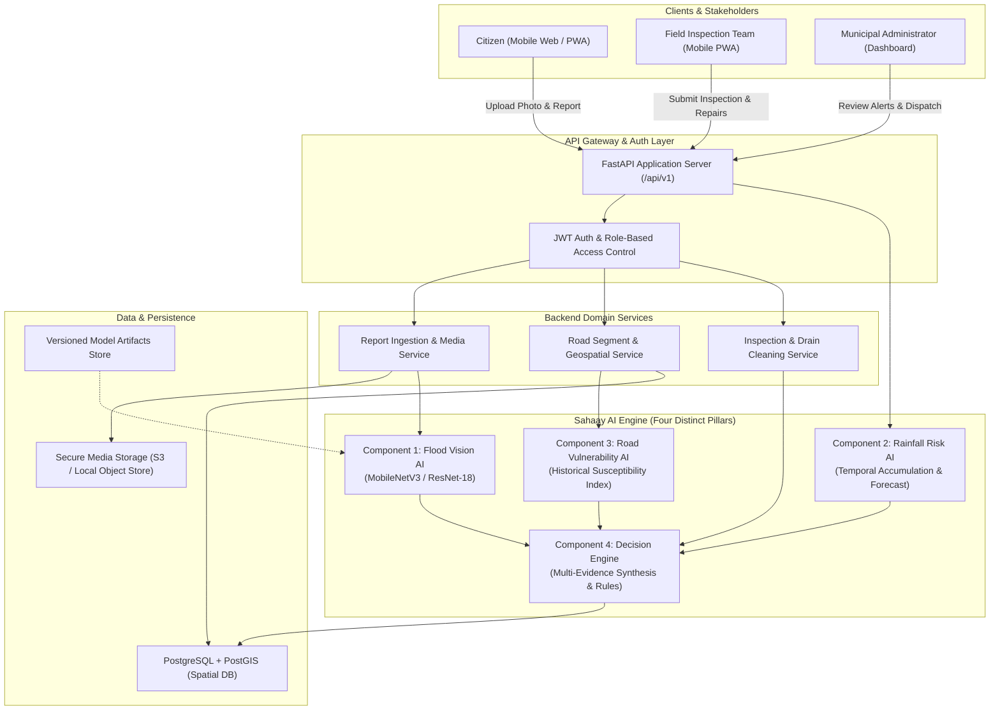

# Sahaay AI — System Architecture Specification
**Platform:** Sahaay AI — Predict. Prevent. Protect.  
**Focus:** Production-Ready AI Flood Intelligence Platform for Hyderabad  
**Version:** 1.0.0-draft  
**Authors:** Senior AI/ML Engineer (Team Member A), in collaboration with Frontend (Team Member B) and Backend/Integration (Team Member C)

---

## 1. Executive Summary & Purpose

Urban flooding in Indian metropolitan cities like Hyderabad develops rapidly due to intense, localized monsoon cloudbursts, stormwater canal bottlenecks (nalas), low-lying topography, and blocked drains.

**Sahaay AI** is a modular, Hyderabad-first flood intelligence and early-warning platform that synthesizes:
1. Citizen-submitted smartphone imagery analyzed by Computer Vision.
2. Verified municipal field inspection and drainage desilting logs.
3. Real-time and forecast rainfall observations.
4. Geospatial road vulnerability indices.
5. An explainable, rule-driven Decision Engine.

### Fundamental Safety Principles
> **CRITICAL SAFETY DIRECTIVE:**
> 1. **No False Proof of Safety:** A prediction of "no visible flooding" from an image model **MUST NEVER** be interpreted or displayed as proof that a road or area is safe. Subsurface currents, upstream surge, poor lighting, or occlusions can hide hazards.
> 2. **Explicit Uncertainty:** The system strictly distinguishes between an **Observed Hazard** (verified visual evidence), a **Predicted Risk** (statistical/rainfall projection), an **Unverified Community Report**, and an **Official Emergency Alert**.
> 3. **Non-Authoritative Prototype Notice:** Prototype predictions must be clearly labeled to prevent confusion with official GHMC/NDRF disaster alerts.

---

## 2. Overall Logical Architecture

The platform follows a clean **modular monolith** backend architecture, preventing unnecessary microservice operational complexity while maintaining strict domain separation.



---

## 3. The Four Core AI/System Components

The four components have strictly partitioned responsibilities:

| Component | Responsibility | Inputs | Primary Output | Safety & Integrity Constraint |
| :--- | :--- | :--- | :--- | :--- |
| **1. Flood Vision AI** | Classify visual evidence of street waterlogging from user photos | Decoded RGB image (citizen/field mobile capture) | `flooded` vs `not_flooded`, confidence score, model version | Rejects corrupt images. Never asserts road safety on negative class. |
| **2. Rainfall Risk AI** | Estimate future waterlogging likelihood over a time horizon | Observed rainfall (last 1h, 3h, 24h), forecast accumulation (next 1h, 3h), season | `risk_category` (LOW, MEDIUM, HIGH), horizon | Zero temporal leakage. Does not use future data as inputs. |
| **3. Road Vulnerability AI** | Estimate baseline long-term susceptibility of specific road segments | Elevation, slope, nala proximity, historical waterlogging frequency, maintenance history | `vulnerability_score` (0.0 to 1.0), evidence breakdown | Recent repairs discount vulnerability conservatively; never mark safe permanently. |
| **4. Decision Engine** | Synthesize all evidence, timestamps, and report validity into human-readable alerts | Outputs of Vision AI, Rainfall AI, Road Vulnerability AI, verification flags, timestamps | Unified `AlertLevel`, evidence chain, human-readable rationale | Explicit ruleset. Stale data decays in weight. Does not multiply raw probabilities blindly. |

---

## 4. Component 1 — Flood Vision AI Architecture

Flood Vision AI is the visual gatekeeper.

### Pipeline Details
1. **Input Validation:**
   - File size ceiling: 15 MB.
   - Allowed MIME types: `image/jpeg`, `image/png`, `image/webp`.
   - Magic byte verification and PIL integrity check.
   - Rejection of truncated, empty, or unparseable files with HTTP 400/422.
2. **Preprocessing Pipeline (`src/sahaay/vision/transforms.py`):**
   - Inference: Resize to 256x256, CenterCrop to 224x224, Normalize via ImageNet mean `[0.485, 0.456, 0.406]` and std `[0.229, 0.224, 0.225]`.
   - Training: RandomResizedCrop(224, scale=(0.8, 1.0)), RandomHorizontalFlip(), ColorJitter(brightness=0.2, contrast=0.2), Normalization.
3. **Model Backbone (`src/sahaay/vision/model.py`):**
   - Primary production architecture: **MobileNetV3-Small** (optimized for low-latency CPU/edge inference and lightweight deployment, <15ms latency, <10MB artifact).
   - High-capacity alternative: **ResNet-18** (ImageNet pretrained backbone with custom 2-class linear head).
4. **Output Structure:**
   - Softmax probabilities over `["not_flooded", "flooded"]`.
   - Confidence thresholding: If confidence is below 0.65, flagged as `ambiguous` with review recommendation.
   - Embedded model version metadata and disclaimer.

---

## 5. API Contracts

### Vision Inference Endpoint
- **Route:** `POST /api/v1/vision/predict`
- **Content-Type:** `multipart/form-data`
- **Request Parameters:**
  - `file`: Binary image file (required).
  - `latitude`: Float (optional).
  - `longitude`: Float (optional).
  - `report_id`: String (optional).

#### Success Response Schema (`200 OK`)
```json
{
  "prediction_id": "vis_pred_9a8f27c8",
  "predicted_class": "flooded",
  "confidence": 0.942,
  "class_scores": {
    "not_flooded": 0.058,
    "flooded": 0.942
  },
  "is_ambiguous": false,
  "model_name": "mobilenet_v3_small_flood",
  "model_version": "1.0.0",
  "inference_latency_ms": 11.4,
  "created_at": "2026-10-25T11:45:00Z",
  "warnings": [
    "Experimental prototype: Visual evidence only. Does not constitute official emergency advice.",
    "A negative prediction does not guarantee road passability or absence of flood hazard."
  ]
}
```

---

## 6. Team Ownership & Interface Boundaries

To enable seamless parallel development across our 3-person team:

### Team Member A (AI/ML Engineer — Self)
- Dataset audit, normalization, and manifest generation.
- Model training, validation, checkpointing, and evaluation metrics.
- Flood Vision inference module (`src/sahaay/vision/`).
- Formal contracts and mock services for Rainfall Risk, Road Vulnerability, and Decision Engine (`src/sahaay/decision/contracts.py`, etc.).
- Model cards and ML documentation.

### Team Member B (Frontend Engineer)
- Citizen PWA: Photo capture, GPS auto-fill, report submission, and prediction feedback modal.
- Map View: Geospatial heatmaps of road segments, color-coded alert zones (Green/Yellow/Orange/Red), and active citizen pins.
- Admin & Field Portal: Work order checklist (desilting, drain inspection, pothole patching).
- Strictly consumes `/api/v1/` endpoints. Uses provided mock contracts while models are training.

### Team Member C (Backend & Integration Engineer)
- Database migrations, PostGIS schemas for `road_segments`, `flood_reports`, `maintenance_events`.
- Secure file upload handling and object storage persistence.
- Integration of `src/sahaay/vision/inference.py` into FastAPI route handlers.
- Decision Engine execution on incoming reports and scheduled rainfall updates.

---

## 7. Quality, Testing, and Verification Plan

1. **Unit Tests:** Preprocessing, image decoding errors, transform invariants, model forward pass shapes, inference score calibration.
2. **API Contract Tests:** Endpoint schema validation, HTTP error codes on invalid uploads.
3. **Reproducibility:** Pinned dependencies in virtual environment, deterministic random seeds (`torch.manual_seed(42)`), versioned checkpoints in `models/vision/`.
4. **Data Freshness & Decay:** Decision engine penalizes reports older than 4 hours unless re-verified by field teams or continuous rainfall.
