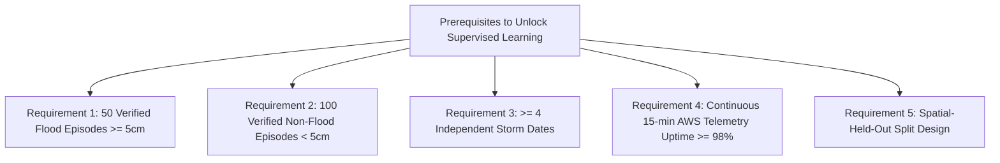

# Sahaay AI — Phase 10: Data Suitability & Supervised Learning Feasibility Audit

## 1. Executive Summary

This document presents the data suitability and machine learning feasibility audit for **Sahaay AI Phase 10**.

Its primary objective is to determine whether the available hydrological, geospatial, and meteorological datasets contain valid target labels and continuous feature observations to support supervised machine learning.

### Primary Audit Verdict
1. **Supervised Flood Prediction (Task B):** **`INFEASIBLE / NOT_RUN`**. Zero timestamped flood outcome labels exist. Static KML placemarks represent chronic spatial recurrence without dates or water depths.
2. **Rainfall Forecasting (Task A):** **`INFEASIBLE / NOT_RUN`**. Available regional rain gauge telemetry suffers from $>90\%$ temporal transmission gaps (up to 141.6 consecutive days with no data), mixed time intervals, and 50.82% bucket accumulator counters. No stations exist within the GHMC urban core.
3. **Road Vulnerability & Risk Classification (Tasks C & D):** **`NOT_RUN FOR ML`**. Training an ML algorithm to predict heuristic vulnerability indices or IMD piecewise thresholds measures rule imitation / formula distillation, not predictive accuracy.
4. **Operational Recommendation:** Maintain the validated rules-based engines as transparent, explainable operational baselines until genuine timestamped ground truth is collected.

---

## 2. In-Depth Audit Across Four Prospective ML Tasks

### 2.1 Task A — Rainfall Estimation or Forecasting
- **Objective:** Predict future rainfall accumulation ($t + 1\text{h}, t + 3\text{h}$) from antecedent telemetry time series.
- **Empirical Audit of Raw Telemetry:**
  - **Dataset:** [`telangana_hourly_telemetry_rainfall_2021_2025.csv`](file:///C:/Users/MahendraReddy/.gemini/antigravity-ide/scratch/sahaay-ai/data/hyderabad_risk/raw/telangana_hourly_telemetry_rainfall_2021_2025.csv) (72,223 records across 38 stations).
  - **Station Distribution:** Stations are located in rural irrigation and reservoir basins (e.g. Sanga Reddy, Medak, Vikarabad, Nalgonda). **Zero stations are situated within the GHMC urban core.** The nearest station (Kondapochamma Reservoir) is $35\text{--}50\text{ km}$ north of Hyderabad.
  - **Bucket Accumulator Confusion:** $36,702$ records ($50.82\%$) report values $> 250\text{ mm}$ (up to $3,406\text{ mm}$). Stations alternate unpredictably between reporting incremental hourly rainfall and seasonal cumulative bucket counters.
  - **Severe Temporal Discontinuity:** Inspection of station reporting intervals proves extreme missingness:
    - `AKBR Station`: 1,101 records spanning Nov 2023 to Dec 2025 (effective temporal coverage $< 7\%$). Maximum transmission gap = **141.6 consecutive days**. Contains 155 duplicate timestamps and 137 five-minute reporting bursts.
    - `Kondapochamma Station`: 932 records spanning Nov 2023 to Dec 2025 (effective temporal coverage $< 6\%$). Maximum transmission gap = **71.3 consecutive days**. Contains 206 duplicate timestamps.
  - **Scientific Consequence:** Training an autoregressive, recurrent, or sequence model on this telemetry requires either silently imputing 141 days of missing hours as zero rain (violating non-negotiable data rules and causing catastrophic underestimation) or skipping multi-month gaps as adjacent hours. Live forecasting on this telemetry is scientifically unviable.

### 2.2 Task B — Flood Occurrence Prediction (Binary / Depth)
- **Objective:** Predict whether a road corridor experiences standing water inundation ($\text{depth} \ge 5\text{ cm}$) given rainfall intensity and physical road susceptibility.
- **Audit of Prospective Target Labels:**
  - `flooding_locations.kml`: Contains 23 placemarks representing historical chronic waterlogging locations. **It contains zero timestamps, zero event dates, and zero water depth measurements.**
  - `reports/phase8/first_observation_quality.json`: Confirms that exactly **`0` real-world observations** have been acquired. The Phase 8 activation gate truthfully remains `BLOCKED_NOT_READY_FOR_LIVE_PILOT`.
  - **Target Leakage Hazard:** If an engineer labels the 23 static hotspot corridors as `flood = 1` and other corridors as `flood = 0`, an ML model will simply memorize the static spatial coordinates of the KML file. It will achieve near-perfect training accuracy while possessing zero ability to predict *when* a flood occurs.
  - **Scientific Consequence:** Supervised flood occurrence prediction cannot be executed. Training is formally **`NOT_RUN`**.

### 2.3 Task C — Road Vulnerability Ranking
- **Objective:** Rank urban road corridors by physical flood susceptibility.
- **Empirical Nature:** The vulnerability index is an explainable multi-criteria heuristic:
  $$v = 0.45 \cdot s_{\text{hotspot}} + 0.35 \cdot s_{\text{drain}} + 0.20 \cdot s_{\text{waterbody}}$$
- **Scientific Consequence:** Training an ML regressor (e.g. Ridge Regression or Random Forest) to predict $v$ from proximity features is **formula distillation / rule imitation**. The model merely approximates linear weights that are already explicitly computed. Without independent empirical flood damage outcomes, ML adds computational overhead and opacity without predictive validity.

### 2.4 Task D — Rainfall-Risk Classification
- **Objective:** Classify rainfall intensity into risk tiers (`LOW`, `MEDIUM`, `HIGH`, `CRITICAL`).
- **Empirical Nature:** Categories in `evaluate_rainfall_risk_engine` are deterministic step functions derived from IMD operational thresholds ($7.5, 15.0, 35.0\text{ mm/hr}$).
- **Scientific Consequence:** Training a classifier to predict these categories from rainfall inputs is redundant rule approximation. The deterministic engine executes in $< 0.1\text{ ms}$, guarantees $100\%$ monotonicity, and handles edge cases without probabilistic uncertainty.

---

## 3. Official Feature Data Dictionary Summary

The complete feature dictionary is published in [`reports/phase10/feature_data_dictionary.csv`](file:///C:/Users/MahendraReddy/.gemini/antigravity-ide/scratch/sahaay-ai/reports/phase10/feature_data_dictionary.csv). Below is an overview of core features:

| Feature Name | Source | Units | Type | Missing-Value Semantics | Potential Leakage Pathways |
| :--- | :--- | :---: | :---: | :--- | :--- |
| `location_id` | Corridor Register | String | Derived | Disallowed (Primary Key) | None |
| `dist_to_flood_hotspot_m` | `flooding_locations.kml` | Meters | Derived | Defaults to $99999.0\text{ m}$ (UNKNOWN) | Target leakage if used as flood outcome label. |
| `dist_to_nearest_drain_m` | `hyderabad_drains.kml` | Meters | Derived | Defaults to $99999.0\text{ m}$ (UNKNOWN) | None (Static proximity feature). |
| `dist_to_nearest_waterbody_m` | `greater_hyderabad_waterbodies` | Meters | Derived | Defaults to $99999.0\text{ m}$ (UNKNOWN) | None (Static proximity feature). |
| `vulnerability_index` | Vulnerability Engine | $[0.0, 1.0]$ | Heuristic | Defaults to subscore baselines | Rule distillation if predicted via ML. |
| `rain_1h_mm` | Telemetry Rain Gauge | Millimeters | Observed | **Explicit None $\implies$ UNKNOWN (conf=0.10)** | Silently filling 0.0mm causes extreme underestimation. |
| `rain_3h_mm` | Telemetry Rolling Sum | Millimeters | Derived | Explicit None $\implies$ Excluded from surge check | Lookahead leakage if future hours included. |
| `rain_24h_mm` | Telemetry Rolling Sum | Millimeters | Derived | Explicit None $\implies$ Excluded from saturation | Lookahead leakage if future hours included. |
| `hist_month_mean_mm` | IMD Gridded Monthly | Millimeters | Historical | Static monthly mean | Conflating monthly climatology with live forecast. |
| `hist_month_p90_mm` | IMD Gridded Monthly | Millimeters | Historical | Static 90th percentile | None (Contextual benchmark). |
| `nearest_station_dist_km` | Spatial Pairing | Kilometers | Derived | Defaults to $50.0\text{ km}$ | None (Quality discount factor). |
| `telemetry_freshness_hours` | Telemetry Timestamp | Hours | Derived | Defaults to $999.0\text{ h}$ (Stale) | None (Quality discount factor). |

---

## 4. Ground-Truth Data Prerequisites to Unlock Supervised Learning

To transition from rules-based baselines to defensible supervised machine learning, the following empirical requirements must be fulfilled through authorized field pilot operations:

1. **Preregistered Sample Thresholds:**
   - At least 50 verified flood episodes with measured water depth $\ge 5\text{ cm}$.
   - At least 100 verified non-flood wet-road episodes with water depth $< 5\text{ cm}$.
   - Distributed across at least 4 independent monsoon storm dates.
2. **Synchronized Telemetry:**
   - Dedicated Automated Rain Gauge (ARG) telemetry within $5\text{ km}$ of monitored corridors with $\ge 98\%$ uptime and automated counter differencing.
3. **Partition Independence:**
   - Spatial-held-out corridor splitting (e.g. training on Central/North zones, testing on West/East zones) to verify spatial generalization.
