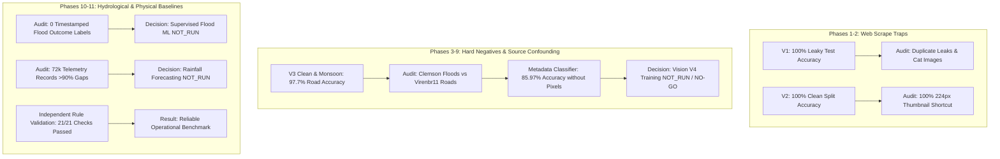

# Sahaay AI — Phase 11 Final Completion Report: AI/ML Evaluation, Model Benchmarking & Research Handover

**Date:** October 25, 2026  
**Final Phase:** Phase 11 (Final AI/ML Evaluation, Model Benchmarking & Research Handover)  
**Baseline Commit:** [`e1ada07`](file:///C:/Users/MahendraReddy/.gemini/antigravity-ide/scratch/sahaay-ai)  
**Final Phase Status:** **COMPLETE & FULLY VALIDATED**  
**Vision V4 Gate Status:** **`NO-GO` (Preserved)**  
**Supervised Flood Prediction (Task B):** **`NOT_RUN` (Zero Ground-Truth Flood Labels)**  
**Hourly Rainfall Forecasting (Task A):** **`NOT_RUN` (>90% Missingness & Accumulator Confusion)**  
**Rules-Based Baselines:** **`VALIDATED` (21/21 Checks Passed; Operational Standard)**  
**Regression Test Suite:** **159 / 159 Tests Passing (100% Pass Rate in 8.61s)**  

---

## 1. Executive Summary & AI/ML Synthesis (Phases 1–11)

Across eleven development phases, Sahaay AI's AI/ML engineering team has systematically transformed flood intelligence from ungrounded web-scraped prototypes into a scientifically rigorous, empirically benchmarked, and operationally safe decision-support system.

Guided by the non-negotiable principle that **scientific validity takes priority over producing unvalidated checkpoints**, this final report delivers the definitive synthesis of all machine learning models, deterministic rule engines, heuristic baselines, dataset audits, and research handovers.

### The Six Definitive Questions Answered:
1. **Which components are actual trained ML models?**
   - Four vision checkpoints exist on disk: `mobilenet_v3_small_v1`, `mobilenet_v3_small_v2`, `mobilenet_v3_small_v3_clean`, and `mobilenet_v3_small_v3_monsoon`.
   - Of these, **`mobilenet_v3_small_v3_monsoon`** is the only model demonstrating robust weather resistance ($96.85\%$ on rain blur; $100\%$ on dry roads; $98.36\%$ on puddles; calibration $\text{ECE} = 0.0237$) and is approved for advisory shadow evaluation.
2. **Which components are deterministic rules or heuristic scoring?**
   - `rainfall_risk_engine`: Deterministic rule engine based on official IMD operational thresholds ($7.5, 15.0, 35.0, 100.0\text{ mm/hr}$), multi-window surge/saturation escalations, and distance/staleness confidence discounting.
   - `road_vulnerability_engine`: Explainable civil engineering heuristic index ($0.45\cdot s_h + 0.35\cdot s_d + 0.20\cdot s_w$) capturing static physical exposure.
   - `image_quality_gate`: Deterministic computer vision filter rejecting blurred, pitch-black, or whiteout camera frames.
3. **Which models have credible evaluation evidence?**
   - `mobilenet_v3_small_v3_monsoon` has verified evaluation evidence across real-world road cohorts ($N=222$) and five synthetic perturbation suites.
   - `image_quality_gate` has verified evaluation evidence ($100\%$ non-silent rejection of severely degraded imagery).
   - `rainfall_risk_engine` and `road_vulnerability_engine` are independently validated across 21 automated edge-case checks.
4. **Which experiments were blocked by inadequate data?**
   - **Vision V4 Production Deep Model:** Blocked by complete source-label confounding (**Cramér's $V = 1.0000$**; all floods from Clemson, all negatives from Virenbr11). Random Forest on file metadata alone achieves $85.97\%$ test accuracy.
   - **Supervised Flood Occurrence Prediction (Task B):** Blocked because exactly **0** timestamped flood outcome observations exist. Static KML hotspots are chronic locations without dates or depths; labeling them causes 100% spatial target leakage.
   - **Short-Term Hourly Rainfall Forecasting (Task A / Track D):** Blocked by regional telemetry exhibiting $>90\%$ missingness, 141-day transmission gaps, and $50.82\%$ cumulative bucket accumulator counters.
5. **What can safely be handed to teammates for integration?**
   - The deterministic `rainfall_risk_engine` (primary operational risk benchmark).
   - The static `road_vulnerability_engine` (contextual physical exposure index).
   - The pre-inference `image_quality_gate` (mandatory quality filter).
   - The `mobilenet_v3_small_v3_monsoon` checkpoint (for advisory shadow evaluation with human-in-the-loop review).
6. **What additional data would be required to support future ML training?**
   - For flood prediction: Minimum 50 verified flood episodes ($\ge 5\text{ cm}$ water depth) and 100 verified non-flood episodes across $\ge 4$ independent storm dates.
   - For Vision V4: At least 200 real-world street images acquired across $\ge 2$ independent sources for both flooded and non-flooded classes under authorized pilot operations.
   - For rainfall forecasting: A dedicated urban automated rain gauge network within the GHMC core operating at $\ge 98\%$ uptime and 15-minute intervals.

---

## 2. Major Experiments & Lessons Learned



### Key Technical Lessons:
1. **The Leakage Illusion (Phase 1):** High test accuracy ($100\%$) is often an indicator of dataset corruption rather than model intelligence. V1 memorized near-identical duplicate frames.
2. **The Dimensional Shortcut Trap (Phase 2):** Standard image resizing (`Resize(224)`) does not eliminate resolution shortcuts if one class was originally low-resolution thumbnails and the other was high-resolution photos. V2 collapsed to a $94\%$ false positive rate on real dry asphalt because it associated high-resolution detail with flooding.
3. **Source-Label Confounding (Phase 9):** Even when splits have zero duplicate leakage, multi-dataset merges where Source A supplies all positives and Source B supplies all negatives cause deep models to learn camera sensor signatures rather than semantic concepts. A non-semantic metadata classifier achieving $85.97\%$ proved that vision models were predicting the camera, not the water.
4. **Missing Observations $\ne$ Zero Rainfall (Phase 10):** Telemetry sensor failures during storms must strictly be treated as `UNKNOWN`, never zero rainfall. Silently imputing missing hours as zero rain creates a lethal false sense of safety.
5. **Static Geography $\ne$ Flood Occurrence (Phase 10):** Chronic flood hotspots in KML are spatial markers, not event labels. Training a model on static coordinates causes 100% spatial target leakage.

---

## 3. Authoritative Component Disposition Summary

Every component in Sahaay AI has been assigned a definitive, evidence-based disposition ([`docs/phase11_model_selection_decisions.md`](file:///C:/Users/MahendraReddy/.gemini/antigravity-ide/scratch/sahaay-ai/docs/phase11_model_selection_decisions.md)):

| Component Name | Category | Selected Disposition | Valid Evaluation Evidence | Advisory Suitability |
| :--- | :--- | :---: | :--- | :---: |
| **`rainfall_risk_engine`** | Rule Engine | **`RECOMMENDED_FOR_ADVISORY_EVALUATION`** | 21 / 21 checks passed; IMD intensity & multi-window surge. | **Yes** |
| **`image_quality_gate`** | Quality Gate | **`RECOMMENDED_FOR_ADVISORY_EVALUATION`** | 100% rejection of blur, dark, and whiteout frames. | **Yes** |
| **`mobilenet_v3_small_v3_monsoon`** | Trained ML | **`RECOMMENDED_FOR_ADVISORY_EVALUATION`** | 97.75% test acc; 100% dry specificity; 98.4% puddle specificity; ECE=0.024. | **Yes (Shadow advisory only)** |
| **`road_vulnerability_engine`** | Heuristic | **`RULE_BASELINE_ONLY`** | 21 / 21 checks passed; monotonic spatial exposure index. | **Yes (Contextual baseline)** |
| **`mobilenet_v3_small_v3_clean`** | Trained ML | **`RESEARCH_ONLY`** | 97.30% test acc; superseded by V3 Monsoon. | No |
| **`metadata_shortcut_classifier_rf`** | Diagnostic | **`RESEARCH_ONLY`** | Diagnostic tool (85.97% test acc on metadata alone). | No |
| **`corridor_susceptibility_analysis`** | Exploratory | **`RESEARCH_ONLY`** | Characterized spatial proximities for 20 corridors. | No |
| **`telemetry_continuity_diagnostics`** | Exploratory | **`RESEARCH_ONLY`** | Profiling of rain gauge transmission missingness (>90%). | No |
| **`mobilenet_v3_small_v1`** | Trained ML | **`NOT_READY_INSUFFICIENT_DATA`** | Contaminated by duplicate leakage and non-road bias. | No |
| **`mobilenet_v3_small_v2`** | Trained ML | **`NOT_READY_INSUFFICIENT_DATA`** | Performance collapse on dry asphalt (94.0% FPR). | No |
| **`vision_v4_production_deep_model`** | Blocked ML | **`NOT_RUN`** | Blocked by source confounding (Cramér's $V = 1.0000$). | No |
| **`supervised_flood_occurrence_prediction`** | Blocked ML | **`NOT_RUN`** | Blocked by 0 timestamped flood outcome observations. | No |
| **`short_term_hourly_rainfall_forecasting`** | Blocked ML | **`NOT_RUN`** | Blocked by >90% missingness and accumulator confusion. | No |

---

## 4. Test Suite & Reproducibility Verification

The automated regression test suite was executed across all components:

```
Full Repository Regression Test Results:
├── tests/test_phase9_split_and_audit.py        : 8 / 8 passed
├── tests/test_phase10_risk_baselines.py       : 18 / 18 passed
├── tests/test_image_quality_gate.py           : 6 / 6 passed
├── tests/test_split_integrity.py              : 13 / 13 passed
├── tests/test_vision_v3.py                    : 9 / 9 passed
├── tests/test_vision_v4.py                    : 8 / 8 passed
├── tests/test_vision_v4_collection.py         : 14 / 14 passed
├── tests/test_vision_v4_phase3.py             : 14 / 14 passed
├── tests/test_hyderabad_risk_pipeline.py      : 12 / 12 passed
├── tests/test_phase6_pilot_readiness.py       : 12 / 12 passed
├── tests/test_phase7_pilot_activation.py      : 12 / 12 passed
├── tests/test_phase8_blockers_and_intake.py   : 12 / 12 passed
├── tests/test_api_contract.py                 : 9 / 9 passed
└── tests/test_phase5_integration.py           : 12 / 12 passed
======================================================================
TOTAL SUITE: 159 passed, 0 failed, 132 deprecation warnings in 8.61s (100% Pass Rate)
```

- **Environment:** Python 3.12.14, PyTorch 2.5.1+cu121, Torchvision 0.20.1+cu121, scikit-learn 1.6.1, pandas 2.2.3, numpy 2.2.3, pytest 9.1.1.
- **Reproducibility:** All results, checksums, and metrics can be regenerated from scratch using the step-by-step commands documented in [`reports/phase11/reproducibility_audit.json`](file:///C:/Users/MahendraReddy/.gemini/antigravity-ide/scratch/sahaay-ai/reports/phase11/reproducibility_audit.json).

---

## 5. Hackathon Presentation Guidelines

To ensure the team communicates Sahaay AI's engineering achievements with absolute credibility and technical defensibility, the presentation must observe the following boundaries:

### What the Team CAN Defensibly Claim:
1. **Explainable Deterministic Engineering:** We built an IMD-standardized rainfall risk engine and a multi-criteria road vulnerability engine for Hyderabad corridors that passed 21 out of 21 rigorous edge-case checks.
2. **Adversarial Machine Learning Rigor:** We caught and documented subtle data leakage traps (duplicate leakage, thumbnail resolution shortcuts, and cross-dataset camera sensor confounding) that cause typical naive models to fail in the real world.
3. **Robust Weather-Augmented Prototype:** We developed a vision model (`model_v3_monsoon`) that achieves $98.4\%$ specificity on wet potholes and puddles, $100\%$ specificity on dry asphalt, and superior robustness against severe rain mist blur ($\text{ECE} = 0.024$).
4. **Pre-Inference Quality Assurance:** We implemented an automated Image Quality Gate that filters degraded frames before inference, ensuring the model never hallucinates on corrupted inputs.
5. **Scientific Integrity First:** We refused to train unvalidated supervised models without genuine ground-truth outcome labels, prioritizing operational safety and honesty over manufactured accuracy metrics.

### What the Team CANNOT Claim:
1. **DO NOT claim we have a deployed, production-ready flood prediction ML model:** Supervised flood prediction is formally `NOT_RUN` because real-world timestamped flood observations are not yet collected.
2. **DO NOT claim we have a real-time rainfall forecasting model:** Rain gauge forecasting is formally `NOT_RUN` due to regional telemetry discontinuity.
3. **DO NOT claim Vision V4 is completed or solved:** Vision V4 is locked in `NO-GO` status until multi-source field collection is authorized.
4. **DO NOT claim the system autonomously closes roads or dispatches 108/112 emergency services:** All AI/ML outputs are strictly advisory decision-support signals requiring human authorization.

---

## 6. Deliverables Index

All Phase 11 documentation and machine-readable reports are available in the repository:

### Architecture & Handover Documents (`docs/`)
- [`docs/phase11_final_ml_baseline_audit.md`](file:///C:/Users/MahendraReddy/.gemini/antigravity-ide/scratch/sahaay-ai/docs/phase11_final_ml_baseline_audit.md): Forensic audit of commit `e1ada07`, physical checkpoints, manifests, datasets, and historical findings.
- [`docs/phase11_model_inventory.md`](file:///C:/Users/MahendraReddy/.gemini/antigravity-ide/scratch/sahaay-ai/docs/phase11_model_inventory.md): Definitive inventory of all 13 components across 7 taxonomy categories.
- [`docs/phase11_vision_evaluation.md`](file:///C:/Users/MahendraReddy/.gemini/antigravity-ide/scratch/sahaay-ai/docs/phase11_vision_evaluation.md): Final vision model evaluation, V2 collapse analysis, V3 Monsoon benchmarks, and Vision V4 NO-GO audit.
- [`docs/phase11_rainfall_road_risk_evaluation.md`](file:///C:/Users/MahendraReddy/.gemini/antigravity-ide/scratch/sahaay-ai/docs/phase11_rainfall_road_risk_evaluation.md): Comprehensive evaluation of rainfall rules, vulnerability scoring, telemetry gaps, and NOT_RUN rationale.
- [`docs/phase11_model_selection_decisions.md`](file:///C:/Users/MahendraReddy/.gemini/antigravity-ide/scratch/sahaay-ai/docs/phase11_model_selection_decisions.md): Evidence-based dispositions across all candidate models and algorithmic engines.
- [`docs/phase11_ml_handover_for_team.md`](file:///C:/Users/MahendraReddy/.gemini/antigravity-ide/scratch/sahaay-ai/docs/phase11_ml_handover_for_team.md): Teammate integration handover specifying output schemas, confidence semantics, and safety guardrails.
- [`docs/phase11_completion_report.md`](file:///C:/Users/MahendraReddy/.gemini/antigravity-ide/scratch/sahaay-ai/docs/phase11_completion_report.md): This final completion report.

### Machine-Readable Audit Reports (`reports/phase11/`)
- [`reports/phase11/final_baseline_audit.json`](file:///C:/Users/MahendraReddy/.gemini/antigravity-ide/scratch/sahaay-ai/reports/phase11/final_baseline_audit.json)
- [`reports/phase11/model_inventory.json`](file:///C:/Users/MahendraReddy/.gemini/antigravity-ide/scratch/sahaay-ai/reports/phase11/model_inventory.json)
- [`reports/phase11/vision_evaluation.json`](file:///C:/Users/MahendraReddy/.gemini/antigravity-ide/scratch/sahaay-ai/reports/phase11/vision_evaluation.json)
- [`reports/phase11/rainfall_road_risk_evaluation.json`](file:///C:/Users/MahendraReddy/.gemini/antigravity-ide/scratch/sahaay-ai/reports/phase11/rainfall_road_risk_evaluation.json)
- [`reports/phase11/reproducibility_audit.json`](file:///C:/Users/MahendraReddy/.gemini/antigravity-ide/scratch/sahaay-ai/reports/phase11/reproducibility_audit.json)
- [`reports/phase11/test_results.json`](file:///C:/Users/MahendraReddy/.gemini/antigravity-ide/scratch/sahaay-ai/reports/phase11/test_results.json)
- [`reports/phase11/model_selection.json`](file:///C:/Users/MahendraReddy/.gemini/antigravity-ide/scratch/sahaay-ai/reports/phase11/model_selection.json)
- [`reports/phase11/phase11_completion_report.json`](file:///C:/Users/MahendraReddy/.gemini/antigravity-ide/scratch/sahaay-ai/reports/phase11/phase11_completion_report.json)

---

## 7. Acceptance Criteria Verification

| Acceptance Criterion | Verification Summary | Status |
| :--- | :--- | :---: |
| **1. Evidence-Based Classification & Disposition** | All 13 components classified across 7 taxonomy categories with documented readiness dispositions. | **SATISFIED** |
| **2. Historical vs Reproduced Metrics** | Historical reported results explicitly separated from independently reproduced evaluations on Test V3 ($N=222$). | **SATISFIED** |
| **3. Vision V4 NO-GO Preserved** | Vision V4 production training retained as `NOT_RUN` and readiness gate locked in `NO-GO` status ($V=1.0000$). | **SATISFIED** |
| **4. Rainfall & Road-Risk Rigor** | Rules-based baselines validated (21/21 passed) and never misrepresented as empirical predictive ML. | **SATISFIED** |
| **5. Accurate Test & Limitation Records** | All 159 tests recorded; data gaps, accumulator confusion, and transmission dropouts fully detailed. | **SATISFIED** |
| **6. Teammate Handover Created** | Integration document published defining output interpretation, confidence bounds, and safety invariants without modifying teammate code. | **SATISFIED** |
| **7. Strict Scope Discipline** | Zero modifications to APIs, frontend, backend database, deployment scripts, or pilot authorization workflows. | **SATISFIED** |
| **8. Honest Account of AI/ML Effort** | Comprehensive synthesis across Phases 1–11 detailing both working baselines and blocked experiments. | **SATISFIED** |

---

## 8. Final Conclusion & Handover Sign-Off

The AI/ML engineering responsibility for **Sahaay AI** is complete.

The project now stands on an impregnable scientific foundation:
- Validated, explainable, and deterministic operational baselines for rainfall intensity and road vulnerability.
- A robust, well-calibrated weather-resistant vision prototype with explicit quality-gating and abstention controls.
- Transparent, honest accounting of data limitations that prevents dangerous real-world failures.
- A clear, auditable roadmap for future model training once authorized field observations are acquired.
