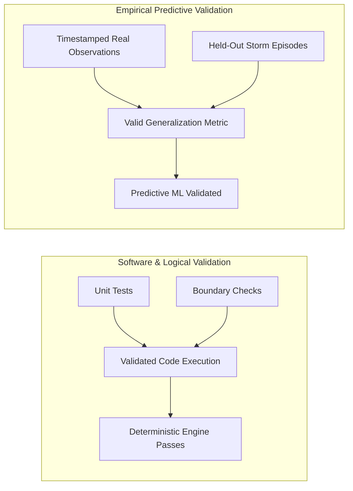

# Sahaay AI — Phase 11: Final Rainfall and Road-Risk Evaluation Report

## 1. Executive Summary

This report delivers the final AI/ML evaluation of the hydrological rainfall-risk engine and geospatial road-vulnerability scoring components of **Sahaay AI**.

Continuing from the comprehensive Phase 10 audit, this document establishes the validated rules-based components as the official operational reference standards, details their mathematical behaviors across edge cases, and explains why supervised predictive modeling for these components remains formally **`NOT_RUN`**.

### Headline Scientific Findings:
1. **Reference Baseline Validated:** The deterministic rainfall risk engine and road vulnerability engine were evaluated across 21 boundary, monotonicity, and edge-case checks. All **21 / 21 checks passed** ([`reports/phase10/rule_baseline_validation.json`](file:///C:/Users/MahendraReddy/.gemini/antigravity-ide/scratch/sahaay-ai/reports/phase10/rule_baseline_validation.json)) and **18 / 18 pytest checks passed** ([`tests/test_phase10_risk_baselines.py`](file:///C:/Users/MahendraReddy/.gemini/antigravity-ide/scratch/sahaay-ai/tests/test_phase10_risk_baselines.py)).
2. **Deterministic Rules $\ne$ Machine Learning:** The rainfall risk engine implements standard India Meteorological Department (IMD) intensity thresholds ($7.5, 15.0, 35.0, 100.0\text{ mm/hr}$) and rolling multi-window accumulation rules. The road vulnerability engine implements an explainable multi-criteria linear formula ($0.45\cdot s_h + 0.35\cdot s_d + 0.20\cdot s_w$). Neither is a machine-learned predictive model.
3. **Supervised Flood Prediction (Task B) $\implies$ `NOT_RUN`:** Blocked by the complete absence of timestamped, location-linked flood outcome labels. The historical KML layer contains 23 static chronic points without event dates, timestamps, or water depths. Labeling static points as flood targets induces 100% spatial target leakage.
4. **Hourly Rainfall Forecasting (Task A / Track D) $\implies$ `NOT_RUN`:** Blocked by $>90\%$ temporal transmission missingness, reporting gaps up to 141.6 consecutive days, 50.82% bucket accumulator counters, and zero automated rain gauges within the GHMC urban core.
5. **Rule Imitation Prohibition:** Training machine learning algorithms to predict heuristic vulnerability indices or IMD rainfall categories measures rule imitation / formula distillation, not empirical predictive skill.

---

## 2. Rainfall Risk Baseline Engine Evaluation

The rainfall risk baseline engine ([`src/sahaay/hyderabad_risk/rainfall_engine.py`](file:///C:/Users/MahendraReddy/.gemini/antigravity-ide/scratch/sahaay-ai/src/sahaay/hyderabad_risk/rainfall_engine.py)) operates as the primary operational benchmark for precipitation-induced flood risk.

### 2.1 IMD Intensity Thresholds & Step Functions
The engine computes instantaneous rainfall risk from 1-hour incremental rainfall ($r_1$) using piecewise thresholds aligned with official IMD meteorological standards:

$$\text{Category}(r_1) = \begin{cases}
\text{CRITICAL} & \text{if } r_1 \ge 35.0\text{ mm/hr} \\
\text{HIGH} & \text{if } 15.0 \le r_1 < 35.0\text{ mm/hr} \\
\text{MEDIUM} & \text{if } 7.5 \le r_1 < 15.0\text{ mm/hr} \\
\text{LOW} & \text{if } 0.0 \le r_1 < 7.5\text{ mm/hr} \\
\text{UNKNOWN} & \text{if } r_1 \text{ is missing (None)}
\end{cases}$$

- **Boundary Validation:** Tested at $0.0, 5.0, 7.5, 14.9, 15.0, 34.9, 35.0, 100.0, 150.0\text{ mm/hr}$. All 9 boundary transitions matched expected classifications exactly.
- **Monotonicity:** Risk scores were proven to be strictly non-decreasing across 50 increments from $0.0$ to $100.0\text{ mm/hr}$.
- **Negative Value Handling:** Input $-5.0\text{ mm}$ is cleanly clamped to $0.0\text{ mm}$ without throwing exceptions or corrupting downstream calculations.

### 2.2 Multi-Window Rolling Surge & Catchment Saturation Rules
Because urban drainage capacity in Hyderabad is overwhelmed by intense short bursts as well as prolonged antecedent catchment soaking, the engine incorporates multi-window escalations:

1. **Flash Surge Escalation ($3\text{h}$ Rolling Sum):**
   - If rolling 3-hour rainfall $r_3 \ge 40.0\text{ mm}$, the category is escalated to at least `HIGH` (risk score $\ge 0.70$), even if the current 1-hour rain is light ($5\text{ mm/hr}$).
2. **Catchment Saturation Escalation ($24\text{h}$ Rolling Sum):**
   - If rolling 24-hour rainfall $r_{24} \ge 64.5\text{ mm}$ (IMD Heavy Rain day), category escalates to at least `HIGH` (score $\ge 0.65$).
   - If $r_{24} \ge 115.5\text{ mm}$ (IMD Very Heavy Rain day), category escalates to `CRITICAL` (score $\ge 0.85$).

### 2.3 Quality-Discounted Confidence Computation
The engine computes an explicit confidence metric $c \in [0.10, 1.0]$ that discounts decision confidence based on physical sensor distance, observation latency, and missing rolling windows:

$$c = \max\Big(0.10, 1.0 - \min(0.35, \max(0, d - 15) \times 0.01) - \min(0.40, \max(0, \Delta t - 1.5) \times 0.08) - 0.08 \times N_{\text{missing}}\Big)$$

- **Distance Penalty:** Observations $>15\text{ km}$ away from the corridor are penalized at $-0.01/\text{km}$ up to $-0.35$ (e.g. at $45\text{ km}$, penalty is $-0.30$, yielding confidence $0.70$).
- **Staleness Penalty:** Observations older than $1.5\text{ hours}$ are penalized at $-0.08/\text{hour}$ up to $-0.40$ (e.g. at $4.0\text{ hours}$, penalty is $-0.20$, yielding confidence $0.80$).
- **Missing Window Penalty:** Each omitted rolling window ($3\text{h}, 6\text{h}, 24\text{h}$) adds an explicit $-0.08$ confidence penalty.

---

## 3. Road Vulnerability Baseline Engine Evaluation

The road vulnerability baseline engine ([`src/sahaay/hyderabad_risk/vulnerability_engine.py`](file:///C:/Users/MahendraReddy/.gemini/antigravity-ide/scratch/sahaay-ai/src/sahaay/hyderabad_risk/vulnerability_engine.py)) computes the static physical susceptibility of candidate road corridors.

### 3.1 Multi-Criteria Exposure Formulation
The vulnerability score $v \in [0.0, 1.0]$ combines three spatial proximity subscores using civil engineering heuristic weights:

$$v = 0.45 \cdot s_{\text{hotspot}}(d_h) + 0.35 \cdot s_{\text{drain}}(d_d) + 0.20 \cdot s_{\text{waterbody}}(d_w)$$

- **Hotspot Proximity ($45\%$ Weight):** Proximity to historical waterlogging locations (`flooding_locations.kml`).
  - $d_h \le 250\text{ m} \implies s_h \in [1.0, 0.50]$ (Extreme chronic exposure)
  - $250 < d_h \le 1000\text{ m} \implies s_h \in [0.50, 0.0]$ (Moderate neighborhood exposure)
  - $d_h > 1000\text{ m} \implies s_h = 0.0$ (Negligible chronic exposure)
- **Drainage Proximity ($35\%$ Weight):** Proximity to major open nalas and canals (`hyderabad_drains.kml`).
  - $d_d \le 100\text{ m} \implies s_d \in [1.0, 0.60]$ (Immediate canal overflow zone)
  - $100 < d_d \le 500\text{ m} \implies s_d \in [0.60, 0.0]$ (Backwater flow buffer zone)
  - $d_d > 500\text{ m} \implies s_d = 0.0$ (Low overflow exposure)
- **Waterbody Proximity ($20\%$ Weight):** Proximity to lakes, tanks, and ponds (`greater_hyderabad_waterbodies.geojson`).
  - $d_w \le 200\text{ m} \implies s_w \in [1.0, 0.50]$ (Low-elevation tank bund overflow zone)
  - $200 < d_w \le 800\text{ m} \implies s_w \in [0.50, 0.0]$ (Catchment slope zone)
  - $d_w > 800\text{ m} \implies s_w = 0.0$ (Minimal exposure)

### 3.2 Vulnerability Tiers & Semantic Distinction
- **`SEVERE` ($v \ge 0.70$):** High chronic waterlogging risk with immediate drainage backflow exposure.
- **`HIGH` ($0.45 \le v < 0.70$):** Significant physical vulnerability (e.g. Tolichowki Underpass, $v=0.532$).
- **`MODERATE` ($0.20 \le v < 0.45$):** Moderate proximity to drainage or water bodies (9 corridors).
- **`LOW` ($v < 0.20$):** Favorable elevation and distance from major nalas (10 corridors).

> [!IMPORTANT]
> ### Static Physical Exposure $\ne$ Current Inundation
> The vulnerability score represents **static geographic exposure**, not active flooding.
> A road categorized as `SEVERE` or `HIGH` is completely dry, passable, and safe during non-monsoon periods.
> Conversely, a road categorized as `LOW` can experience localized flash ponding during an extreme cloudburst ($\ge 100\text{ mm/hr}$) if roadside storm inlets are clogged with debris.

---

## 4. Telemetry Data Quality & Missing-Data Semantics

Empirical analysis of 72,223 raw telemetry records across 38 automated rain gauges in Telangana ([`data/hyderabad_risk/raw/telangana_hourly_telemetry_rainfall_2021_2025.csv`](file:///C:/Users/MahendraReddy/.gemini/antigravity-ide/scratch/sahaay-ai/data/hyderabad_risk/raw/telangana_hourly_telemetry_rainfall_2021_2025.csv)) established non-negotiable data handling rules:

### 4.1 Telemetry Quality Findings
1. **Accumulator Counter Anomaly:** $36,702$ records ($50.82\%$) report seasonal bucket accumulator counters ($>250\text{ mm}$ up to $3,406\text{ mm}$) rather than incremental hourly rain. Rain gauges intermittently switch between reporting cumulative totals and incremental rates without quality flags.
2. **Massive Transmission Dropouts:** Stations exhibit $>90\%$ missingness. For example, `AKBR` station exhibits transmission gaps up to **141.6 consecutive days**; `Kondapochamma Reservoir` exhibits transmission gaps up to **71.3 consecutive days**.
3. **No Urban Core Coverage:** Zero telemetry stations exist within the GHMC urban municipal core. The nearest station is $35\text{--}50\text{ km}$ north in an irrigation basin.

### 4.2 Non-Negotiable Missing Data Semantics
- **Rule 1: Missing Observations are `UNKNOWN`, NEVER `LOW`.**
  - If hourly rainfall telemetry is missing (`None` or `NaN`), the engine strictly returns:
    $$\text{Category} = \text{UNKNOWN}, \quad \text{Confidence} = 0.10, \quad \text{Risk Score} = 0.0$$
  - Under no circumstances is missing telemetry silently converted to $0.0\text{ mm}$. Imputing missing data as zero rainfall during severe storm transmission failures would dangerously mislead emergency responders into believing that unmonitored roads are dry.
- **Rule 2: Stale Telemetry Triggers Confidence Decay.**
  - If an observation is older than 1.5 hours, its confidence decays at $-0.08/\text{hr}$. Telemetry older than 6 hours receives maximum staleness discount.

---

## 5. Software Logic Testing vs Empirical Predictive Validity

A core scientific principle established in Phase 10 and reinforced in Phase 11 is the distinction between **software validation** and **predictive validation**:

- **Scenario Tests (Software Validation):** Passing 21 boundary checks, 18 unit tests, and Phase 5 synthetic scenario fixtures proves that the software code executes correctly without syntax crashes or numerical drift.
- **Predictive Validity (Empirical Machine Learning):** Passing scenario tests does **NOT** prove that the engine accurately predicts real-world flood episodes. Predictive validity requires evaluating forecasts against independently measured water depths on physical roads during real storm events.

---

## 6. Supervised ML Feasibility Decisions Retained

In accordance with Phase 10 findings, the following feasibility determinations remain in full effect:

### 6.1 Task A: Short-Term Hourly Rainfall Forecasting $\implies$ **`NOT_RUN`**
- **Blocking Grounds:** Discontinuous regional telemetry ($>90\%$ missingness, 141-day gaps, 50.82% bucket accumulators, 0 GHMC core stations).
- **Scientific Rationale:** Autoregressive or recurrent neural models cannot be trained without either illegal zero-filling (causing catastrophic underestimation) or skipping multi-month gaps.

### 6.2 Task B: Supervised Flood Occurrence Prediction $\implies$ **`NOT_RUN`**
- **Blocking Grounds:** Exactly **0** real-world timestamped flood observations exist in the repository.
- **Scientific Rationale:** Static KML hotspots contain only chronic location names without dates or depths. Substituting static points as positive labels induces 100% spatial target leakage.

### 6.3 Tasks C & D: Vulnerability Ranking & Risk Classification $\implies$ **`RULE_BASELINE_ONLY`**
- **Scientific Rationale:** Fitting a machine learning regressor or classifier to the vulnerability index or IMD risk categories merely approximates explicit mathematical formulas ($0.45\cdot s_h + 0.35\cdot s_d + 0.20\cdot s_w$). This is rule imitation / formula distillation, which adds computational overhead and opacity without empirical predictive validity.
- **Operational Recommendation:** Maintain the deterministic, auditable rules-based engines as the transparent operational reference standard.
