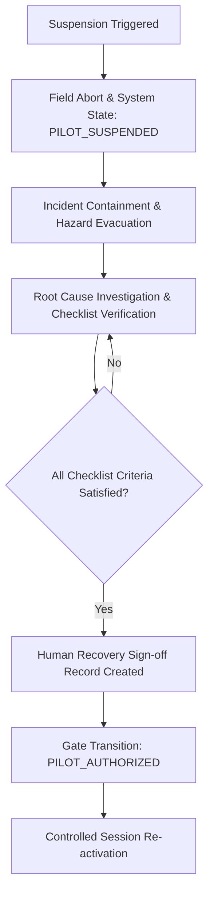

# Sahaay AI — Phase 8: Operational Verification & Suspension Controls

## 1. Executive Summary

This document formalizes the **Operational Stop, Suspension, and Recovery Controls** for Sahaay AI Phase 8.

The primary operating principle of Sahaay AI in field operations is **safety-first and human-supervised fail-closed execution**. Under no circumstances does the system take unilateral autonomous real-world action (such as emergency dispatch, traffic redirection, or physical barrier deployment). Whenever physical safety, legal consent, or data integrity boundaries are breached, operational activities must suspend immediately.

---

## 2. Suspension Triggers & Scope Matrix

Sahaay AI establishes six categorical triggers that mandate immediate suspension of field observation or feed ingestion. Each trigger specifies whether it causes a **Whole-Pilot Suspension** or a **Targeted Capability / Feed Suspension**.

| Trigger ID | Category | Operational Trigger Condition | Scope of Suspension | Immediate System Action | Recovery Authority Required |
| :--- | :--- | :--- | :--- | :--- | :--- |
| **ST-01** | **Authorization Revocation** | Written revocation, expiration, or boundary contraction of institutional agreement (GHMC / HTP / TSDPS). | **Whole-Pilot or Feed-Specific** | Gate transitions to `PILOT_SUSPENDED`. Active collection sessions abort immediately. | `PROJECT_DIRECTOR` or `PRINCIPAL_INVESTIGATOR` post-re-execution. |
| **ST-02** | **Physical Safety Hazard** | Lightning $\le 10\text{ km}$, wind gusts $> 35\text{ km/h}$, flash flood surge approaching walkway elevation, or traffic spillover. | **Whole-Pilot or Corridor-Specific** | `FieldSessionManager.abort_session(reason)` executes. Team evacuates to designated shelter. | `SAFETY_OFFICER` with 30-min hazard-free window. |
| **ST-03** | **Privacy / Consent Violation** | Citizen withdraws consent, bystander facial/license capture cannot be redacted, or unauthorized surveillance detected. | **Session / Record Quarantine** | Tainted record moved to `QUARANTINE_VAULT`. Downstream ingestion blocked. | `DATA_PROTECTION_OFFICER` (DPO). |
| **ST-04** | **Data Integrity / Audit Failure** | Cryptographic hash mismatch in transition chain, missing HMAC on sensor payload, or missing observer pseudonym. | **Whole-Pilot Suspension** | Ingestion pipeline halts. Data writing locked to read-only audit log. | `SYSTEMS_INTEGRATION_LEAD` + `LEAD_DATA_SCIENTIST`. |
| **ST-05** | **Out-of-Scope Source Access** | Attempted ingestion of unapproved feed (e.g. quarantined municipal CCTV or external unverified scraping). | **Feed Quarantine** | Feed disabled, connection severed, alert logged. Other valid feeds continue unaffected. | `LEGAL_AND_COMPLIANCE_LEAD`. |
| **ST-06** | **Measurement Unreliability** | Parallax angle $> 15^\circ$, gauge obstruction, benchmark drift, or sensor calibration failure. | **Corridor / Observation Quarantine** | Measurement flagged `QUALITY_REJECTED`. Not admitted to ground-truth corpus. | `FIELD_LEAD` inspection & calibration check. |

---

## 3. Strict Non-Autonomous Operations Mandate

> [!CAUTION]
> **Strict Operational Prohibition:**
> Sahaay AI is an analytical and decision-support intelligence platform. It **DOES NOT** and **MUST NEVER**:
> 1. Execute autonomous emergency service dispatch (108 / 112 / GHMC Disaster Response Force).
> 2. Initiate autonomous physical road closures, signal manipulation, or barrier deployments.
> 3. Issue public evacuation orders without explicit municipal authority authorization.
>
> All system outputs are advisory recommendations delivered exclusively to authorized municipal and emergency human controllers.

---

## 4. Human-in-the-Loop Recovery Workflow

When a suspension trigger is activated, resumption is never automatic. A rigorous four-phase recovery procedure must be documented and signed off:

### 4.1 Mandatory Recovery Checklist
Before any supervisor or director may authorize transition from `PILOT_SUSPENDED` back to `PILOT_AUTHORIZED`, the following five criteria must be verified in the operational log:

1. **Hazard Duration Clearance:** The environmental hazard (e.g. lightning or wind) has remained below threshold levels for at least 30 consecutive minutes.
2. **Structural / Equipment Re-inspection:** Physical vantage points, railings, and optical calibration markers have been inspected and confirmed undamaged.
3. **Data Quarantine Verification:** Any records captured immediately preceding the abort have been audited, segregated, and quarantined if incomplete.
4. **Independent Role Sign-off:** The recovery request is endorsed by the `SAFETY_OFFICER` and approved by the `PROJECT_DIRECTOR`. Self-approval by the field lead is prohibited.
5. **Prerequisite Validity Check:** `PilotActivationGate.can_pilot_proceed()` confirms that all 4 mandatory blockers remain in `VERIFIED_CLOSED` status without expiration.

---

## 5. Audit Evidence Preservation vs. DPDP Deletion

Sahaay AI maintains strict separation between **immutable audit telemetry** and **personal data subject to erasure**:

- **System Audit Log:** Gate state transitions, abort reasons, observer pseudonyms, session IDs, and environmental telemetry are cryptographically chained and retained in the permanent research log for 36 months.
- **Personal Data Erasure:** If a citizen requests erasure under the Digital Personal Data Protection (DPDP) Act 2023, high-resolution imagery and identifiable metadata are purged from the raw staging tier within 72 hours. An immutable erasure tombstone (recording only timestamp, pseudonym, and redaction hash) is retained in the audit log to document compliance without retaining the underlying personal data.

---

## 6. Simulated Incident & Drill Verification

To test these controls prior to any live deployment, a controlled operational incident was executed and logged in:
`data/phase8/suspension_fixtures/operational_incident_simulation.json`.

### Scenario Summary:
1. **Trigger:** Thunderstorm squall at Rasoolpura Metro Walkway (`CORR-HYD-01`) with wind gusts of 46.5 km/h and lightning at 6.2 km.
2. **Immediate Action:** Field Lead initiated `abort_session`, transitioning field session to `SAFETY_ABORTED`.
3. **Gate Transition:** Safety Officer requested gate transition to `PILOT_SUSPENDED`.
4. **Data Action:** Incomplete observation `SIM-OBS-20261025-9002` was quarantined.
5. **Recovery:** Following a 45-minute weather clearance, Project Director signed reauthorization transition `TRN-RECOVERY-01` returning state to `PILOT_AUTHORIZED`.
