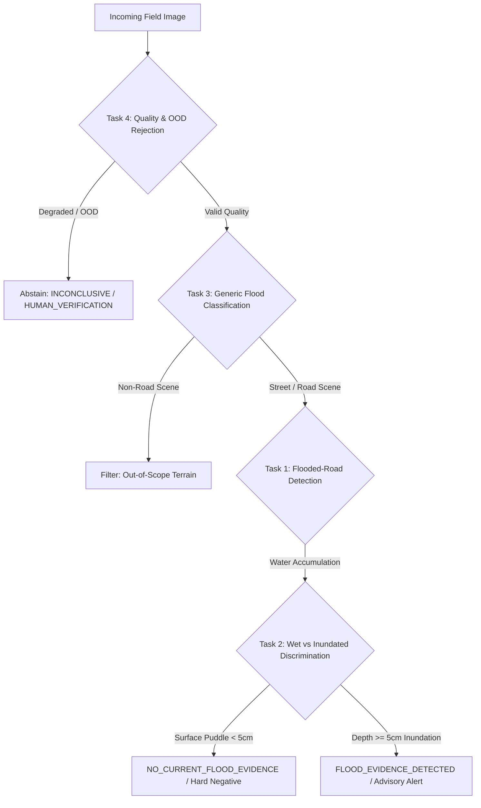

# Sahaay AI — Phase 9: AI/ML Dataset Audit & Source Confounding Forensic

## 1. Executive Summary

This document presents a comprehensive forensic audit of all image datasets available to Sahaay AI for flood vision tasks. It establishes the empirical properties of prospective training, validation, and test data prior to any experimental modeling.

### Core Audit Verdict
- **Total Candidate Road Images (Manifest V4):** 1,478 images (739 flood, 740 non-flood).
- **Multi-Class Road Sources Available:** **`0`** *(Zero)*.
- **Source-Label Contingency:** **Cramér's $V = 1.0000$**, **Mutual Information $= 1.0000\text{ bits}$** *(Complete Collinearity)*.
- **Metadata Shortcut Test Performance:** Non-semantic metadata classifier (width, height, aspect ratio, file size, megapixels, bytes-per-pixel) achieves **85.97% test accuracy** and **0.9145 ROC-AUC** without inspecting pixel semantics.
- **Readiness Gate Conclusion:** Training a production model on this data would yield a system that detects camera profiles rather than floodwater. Vision V4 production training remains strictly **`NO-GO`**.

---

## 2. Inventory of Available Image Datasets

Every prospective dataset on disk or in project registers was inspected:

| Dataset Identifier | Primary Source & Provenance | License & Usage Terms | Total Images Available | Flooded Road Samples | Non-Flood Road Samples | Both Classes in Source? | Road & Water Relevance | Suitability Rating |
| :--- | :--- | :--- | :---: | :---: | :---: | :---: | :---: | :--- |
| **`clemson_floodimg`** | Karanjit et al., *Data in Brief* (2023) / USGS & State DOT cameras | CC-BY 4.0 (Academic Research) | 9,296 (739 in V4) | 739 | 0 | **NO** (100% positive) | Authentic road floods; street-level inundation, submerged curbs. | **DIAGNOSTIC POSITIVE ONLY** (Cannot support standalone training) |
| **`virenbr11_plain`** | Kaggle Open Dataset (Road Pavement Surface) | ODbL / CC0 | 374 in V4 | 0 | 374 | **NO** (100% negative) | Authentic road negatives; dry asphalt, painted lane markings. | **DIAGNOSTIC NEGATIVE ONLY** |
| **`virenbr11_pothole`** | Kaggle Open Dataset (Road Pavement Surface) | ODbL / CC0 | 365 in V4 | 0 | 365 | **NO** (100% negative) | Authentic hard negatives; wet pavement, rain puddles, waterlogged potholes. | **DIAGNOSTIC HARD NEGATIVE ONLY** |
| **`roham1_dataset`** | Kaggle Web Scrape | ODbL / Community | 3,000 | 1,500 (Mixed) | 1,500 (Non-road) | **YES (Severely Confounded)** | Negatives are 100% $224 \times 224$ thumbnails of indoor objects/pets; floods are high-res web scrapes. | **REJECTED AS DEFECTIVE** (Cannot be used for valid evaluation) |
| **`FloodNet-Supervised`** | Code repo in `Downloads/` | Academic Non-Commercial | 0 (Code only) | 0 | 0 | N/A | High-altitude UAV aerial imagery (non-ground level). | **INCOMPLETE / OUT OF DOMAIN** |
| **`eu-flood-dataset`** | Code repo in `Downloads/` | CC-BY-SA | 0 (URLs only) | 0 | 0 | N/A | Scraping returned HTTP 403 Forbidden. | **INCOMPLETE** |
| **`collection_v4`** | Sahaay AI Phase 7/8 Field Pilot Protocol | Sahaay Research Protocol | 0 | 0 | 0 | N/A | Phase 8 activation gate blocked; zero real observations acquired. | **PENDING AUTHORIZATION** |

---

## 3. Four Distinct ML Task Definitions

To prevent conflating distinct computer vision objectives, Sahaay AI establishes four separate task definitions:



### Task 1: Flooded-Road Detection
- **Objective:** Discriminate between dry/normal road pavement and roads experiencing standing water inundation.
- **Current Data Feasibility:** Supported only with source-confounded data (`clemson_floodimg` vs `virenbr11`). Metrics on this task reflect camera sensor shortcuts rather than true generalization.

### Task 2: Wet-Road vs. Inundated-Road Discrimination (Hard Negative Rejection)
- **Objective:** Prevent false alarms on rain-wet asphalt, puddles, specular headlight reflections, and water-filled potholes that do not constitute road inundation (depth $< 5\text{ cm}$).
- **Current Data Feasibility:** `virenbr11_pothole` provides 365 authentic hard negatives. Evaluated models (V3 Monsoon) achieve 100% specificity on these potholes, but positive inundated images originate from a completely separate camera distribution.

### Task 3: Generic Flood-Scene Classification
- **Objective:** Classify whether an arbitrary scene depicts flooding (including aerial river flooding, submerged agricultural fields, indoor basement inundation).
- **Current Data Feasibility:** Categorically disqualified from Sahaay AI urban road intelligence. Datasets like Roham1 include non-road imagery that degrades street-level safety.

### Task 4: Image-Quality and Out-of-Distribution (OOD) Rejection
- **Objective:** Deterministically abstain from classification when optical clarity is insufficient (severe motion blur, lens water droplet distortion, pitch-black night, headlight blinding glare, lens blockage).
- **Current Data Feasibility:** Fully operational via `ImageQualityGate` in `src/sahaay/vision/inference.py`, enforcing 100% abstention on degraded inputs without forcing a binary prediction.

---

## 4. Source-by-Class Contingency & Association Analysis

Cross-tabulation of dataset source versus class label across [`data/processed/manifest_v4/full_manifest_v4.csv`](file:///C:/Users/MahendraReddy/.gemini/antigravity-ide/scratch/sahaay-ai/data/processed/manifest_v4/full_manifest_v4.csv) demonstrates complete collinearity:

### Source $\times$ Class Contingency Matrix ([`reports/phase9/source_class_matrix.csv`](file:///C:/Users/MahendraReddy/.gemini/antigravity-ide/scratch/sahaay-ai/reports/phase9/source_class_matrix.csv))
| Source Dataset Identifier | Class 0 (Non-Flood) | Class 1 (Flood) | Total Samples | Flood Class Ratio |
| :--- | :---: | :---: | :---: | :---: |
| **`clemson_flood`** | 0 | 739 | 739 | **1.0000 (100.0%)** |
| **`virenbr11_plain`** | 374 | 0 | 374 | **0.0000 (0.0%)** |
| **`virenbr11_pothole`** | 365 | 0 | 365 | **0.0000 (0.0%)** |
| **Total V4 Manifest** | **739** | **739** | **1,478** | **0.5000 (50.0%)** |

### Association Statistics:
- **Cramér's $V$:** **`1.0000`** *(Permitted threshold: $\le 0.30$)* $\implies$ **FAILED**.
- **Mutual Information $I(\text{Source}; \text{Label})$:** **`1.0000 bits`** *(Permitted threshold: $\le 0.20\text{ bits}$)* $\implies$ **FAILED**.
- **Source Multi-Class Representation:** **0 / 2 required sources** provide both classes.

---

## 5. Non-Semantic Metadata Diagnostic Baseline

To evaluate whether a machine learning model can classify flood presence without observing visual features, models were trained strictly on non-semantic image metadata:

```
Features: width, height, aspect_ratio, file_size_kb, megapixels, bytes_per_pixel
```

### Empirical Diagnostic Results ([`reports/phase9/metadata_shortcut_results.json`](file:///C:/Users/MahendraReddy/.gemini/antigravity-ide/scratch/sahaay-ai/reports/phase9/metadata_shortcut_results.json)):

| Model Configuration | Input Features | Train Acc | Val Acc | Test Acc | Test Precision | Test Recall | Test Macro-F1 | Test ROC-AUC |
| :--- | :--- | :---: | :---: | :---: | :---: | :---: | :---: | :---: |
| **`file_size_only_stump`** | `file_size_kb` | 85.01% | 87.44% | **80.09%** | 83.67% | 74.55% | 0.7885 | 0.8534 |
| **`dimensions_only_stump`** | `width`, `height` | 75.63% | 70.40% | **67.42%** | 75.00% | 51.82% | 0.6129 | 0.7583 |
| **`logistic_regression_metadata`** | All 6 metadata features | 82.79% | 85.20% | **83.26%** | 87.63% | 77.27% | 0.8213 | 0.8749 |
| **`random_forest_metadata`** | All 6 metadata features | **87.62%** | **87.44%** | **85.97%** | **95.40%** | **75.45%** | **0.8426** | **0.9145** |

### Gini Feature Importances (Random Forest):
- `file_size_kb`: **37.75%**
- `bytes_per_pixel`: **31.20%**
- `width`: **12.05%**
- `megapixels`: **8.01%**
- `height`: **6.98%**
- `aspect_ratio`: **4.01%**

### Scientific Consequence:
A simple pixel-free Random Forest achieves **85.97% test accuracy** and **0.9145 ROC-AUC** by simply checking whether an image file is large or small. Deep neural networks trained on this dataset will converge to features that mirror these file-size and resolution shortcuts.

---

## 6. Readiness Gate Conclusion

The automated pre-flight readiness gate strictly prohibits training:
- **Gate 1 (Multi-Source Class Representation):** FAILED (0 / 2 sources).
- **Gate 2 (Source-Label Contingency):** FAILED ($V = 1.0000 > 0.30$).
- **Gate 3 (Metadata Shortcut Ceiling):** FAILED (85.97% $> 65.0\%$).
- **Gate 4 (Real-World Ground Truth):** FAILED (0 real observations).

> [!CAUTION]
> **Integrity Mandate:**
> Sahaay AI **DOES NOT** bypass or relax these readiness thresholds to permit model training. Production Vision V4 training is formally **NOT_RUN** until paired, multi-class road imagery is legitimately acquired.
