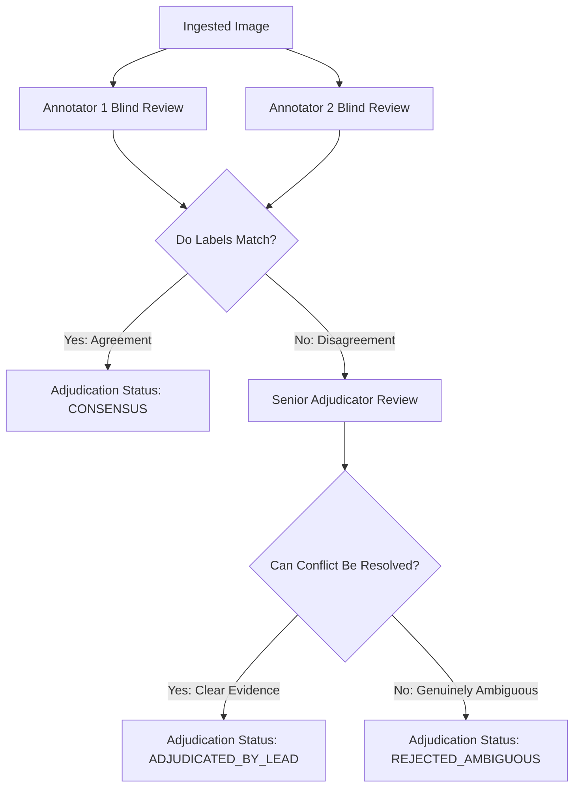

# Sahaay AI — Vision V4 Ground Truth Annotation Guidelines & Review Protocol

## Executive Summary

These guidelines define the annotation taxonomy, evidence requirements, dual-review adjudication workflow, and uncertainty logging for **Sahaay AI Flood Vision V4**. 

To resolve the historical shortcuts documented in [`docs/vision_v3_final_audit.md`](file:///C:/Users/MahendraReddy/.gemini/antigravity-ide/scratch/sahaay-ai/docs/vision_v3_final_audit.md), annotators must differentiate genuine road inundation from non-inundated wet roads, shallow rain puddles, and specular reflections.

> [!CRITICAL]
> **Cardinal Annotation Rule**: **The presence of water alone does NOT automatically mean `flooded_road`.** 
> Rain puddles, water-filled potholes, and wet asphalt sheen are expected surface conditions during a monsoon and constitute critical **hard negatives**. They must NEVER be labeled as `flooded_road` unless there is continuous surface inundation obstructing vehicular passage.

---

## 1. Class Taxonomy & Observable Evidence Criteria

Every image must be classified into exactly one of five primary classes:

```
+--------------------------------------------------------------------------------------------------+
|                                  VISION V4 LABEL TAXONOMY                                        |
+------------------------------------+-------------------------------------------------------------+
| 1. flooded_road                    | Continuous water accumulation covering vehicular lanes;     |
|    (True Positive)                 | submerged curbs, lane dividers, or visible bow waves.       |
+------------------------------------+-------------------------------------------------------------+
| 2. wet_no_visible_inundation       | Wet asphalt, specular reflections, localized shallow       |
|    (Hard Negative Control)         | puddles (< 2 cm), water in potholes WITHOUT continuous road |
|                                    | inundation. Normal traffic maintains speed.                 |
+------------------------------------+-------------------------------------------------------------+
| 3. dry_road                        | Completely dry asphalt or concrete surface; distinct,       |
|    (Baseline Negative)             | unobscured lane markings and dry curbs.                     |
+------------------------------------+-------------------------------------------------------------+
| 4. ambiguous                       | Visual evidence is fundamentally insufficient or obscured   |
|    (Abstention & Gate Cohort)      | (severe rain blur, headlight blinding, distant viewpoint).  |
+------------------------------------+-------------------------------------------------------------+
| 5. out_of_scope                    | Image lacks road infrastructure (indoor photos, pure river  |
|    (Out-of-Distribution Cohort)    | channels without roads, aerial landscapes, portraits).      |
+------------------------------------+-------------------------------------------------------------+
```

### 1.1 Detailed Labeling Criteria

#### Label: `flooded_road`
- **Definition**: Water has inundated the carriageway to an extent that disrupts normal vehicular traffic, submerges road boundaries, or covers full lane widths.
- **Mandatory Observable Evidence (At least ONE required)**:
  - Water sheet extending continuously across at least one full traffic lane.
  - Both road curbs or painted outer lane boundaries are submerged.
  - Vehicles generating visible wake/bow displacement waves while traversing water.
  - Vehicles stalled or diverted due to standing water depth.
  - Water level reaching vehicle tire rims or vehicle undercarriages.

#### Label: `wet_no_visible_inundation`
- **Definition**: Road surface is wet due to recent or active rain, but water depth does not inundate the carriageway or obstruct vehicular passage.
- **Observable Evidence**:
  - Darkened asphalt with reflective specular highlights from streetlights or vehicle headlights.
  - Localized, disconnected rain puddles or water accumulated inside asphalt potholes, where adjacent road asphalt remains exposed.
  - Rain runoff flowing along curb gutters without spilling into active traffic lanes.
  - Vehicles moving at normal cruising speed with tire spray but zero standing water resistance.

#### Label: `dry_road`
- **Definition**: Pavement is dry, devoid of surface water, puddles, or continuous damp patches.
- **Observable Evidence**: Light gray dry asphalt, matte texture, fully visible road markings.

#### Label: `ambiguous`
- **Definition**: The human annotator cannot determine with high confidence whether the road is merely wet or inundated due to environmental or optical degradation.
- **Observable Evidence**:
  - Extreme wiper motion blur or raindrops on the camera lens obstructing the road surface.
  - Direct oncoming high-beam headlights blinding the camera sensor.
  - Very low resolution or distant camera perspective where surface water depth cannot be resolved.
- **Handling**: **Never force into `flooded_road` or `dry_road`.** Preserved for evaluating automated model abstention.

#### Label: `out_of_scope`
- **Definition**: Image does not depict a roadway or street surface suitable for flood navigation assessment.
- **Examples**: Indoor rooms, vehicle dashboards without road view, aerial riverbeds without roadways, generic sky or tree photos.

---

## 2. Policy on Water Depth Estimation

> [!WARNING]
> **Strict Prohibition on Uncalibrated Depth Guessing**:
> Annotators must **NEVER** guess or record precise numerical water depths (e.g., *"depth is 25 cm"*) solely from visual inspection of an uncalibrated 2D photograph. Optical refraction, perspective distortion, and vehicle suspension height variability make uncalibrated visual depth estimation highly unreliable.

### Acceptable Depth Evidence:
Numerical or tiered depth categories may ONLY be recorded if accompanied by:
1. **Calibrated Physical Staff Gauge**: A physical flood measuring ruler visible in the camera frame.
2. **Documented Ground Sensor Telemetry**: Paired ultrasonic or pressure sensor reading from GHMC telemetry at that exact location and timestamp.
3. **Physical Reference Submergence (Qualitative Tiers Only)**:
   - *Tier 1 (Shallow)*: Water level below tire rim / curb top ($< 15\text{ cm}$).
   - *Tier 2 (Moderate)*: Water submerges tire rim and reaches lower bumper ($15\text{--}40\text{ cm}$).
   - *Tier 3 (Severe / Impassable)*: Water reaches vehicle headlights, windshield, or exhausts ($> 40\text{ cm}$).
   - When recorded, the annotator must cite the specific physical reference (e.g., *"submergence of standard sedan tire rim"*).

---

## 3. Dual-Annotation & Adjudication Protocol

To guarantee measurement reliability and eliminate individual annotator bias:



1. **Independent Blind Annotation**: Annotator 1 and Annotator 2 annotate the asset independently without seeing each other's labels or confidence scores.
2. **Consensus**: If both annotators assign identical labels and consistent water extent, the record is marked `consensus` and finalized.
3. **Discrepancy Resolution**: If annotators disagree (e.g., one marks `flooded_road`, the other marks `wet_no_visible_inundation`), the record is routed to the Lead Hydrology/ML Adjudicator.
   - The adjudicator inspects full-resolution uncompressed imagery and writes an explicit justification in `annotation_notes`.
   - If resolved, the record is marked `adjudicated_by_lead`.
   - If genuine uncertainty persists, the record is labeled `ambiguous` with status `rejected_ambiguous`.

### 3.1 Inter-Annotator Agreement Reporting (Cohen's Kappa)
- Inter-annotator agreement must be computed using Cohen's Kappa:
  $$\kappa = \frac{p_o - p_e}{1 - p_e}$$
- **Data Reality Mandate**:
  Cohen's Kappa can **ONLY** be computed and reported when genuine paired human annotations exist in the registry. A target agreement metric (such as $\kappa \ge 0.85$) is a project goal, **NOT** an empirical result until genuine annotations are completed and measured.

---

## 4. Annotation Template Schema

The standardized annotation template is located at:
[`data/collection_v4/annotation_template.csv`](file:///C:/Users/MahendraReddy/.gemini/antigravity-ide/scratch/sahaay-ai/data/collection_v4/annotation_template.csv)

### Field Specifications:
1. `image_id`: Unique image identifier matching `acquisition_id`.
2. `annotator_id_pseudonymous`: Pseudonymous annotator token (e.g., `ANN-01`, `ANN-02`).
3. `label`: `flooded_road`, `wet_no_visible_inundation`, `dry_road`, `ambiguous`, `out_of_scope`.
4. `visible_water_extent`: `none`, `isolated_puddles`, `partial_lane`, `full_carriageway`, `curb_to_curb`.
5. `road_obstruction_evidence`: `none`, `slow_traffic`, `diverted_traffic`, `stalled_submerged_vehicles`.
6. `visibility_quality`: `high_clarity`, `moderate_spray`, `heavy_rain_obscured`, `blinding_glare`.
7. `lighting_condition`: `daylight`, `twilight_dusk`, `twilight_dawn`, `night_streetlights`, `night_unlit`.
8. `occlusion`: `none`, `tree_branch`, `vehicle_spray`, `partial_lens_flare`.
9. `label_confidence`: Float in $[0.0, 1.0]$.
10. `adjudication_status`: `unadjudicated`, `consensus`, `adjudicated_by_lead`, `rejected_ambiguous`.
11. `adjudicated_label`: Final label assigned after adjudication (if required).
12. `annotation_notes`: Free text documenting physical reference points, tire submergence, or justification.
