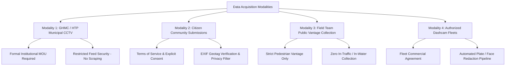

# Sahaay AI — Vision V4 Hyderabad Field Data Acquisition, Consent, and Provenance Plan

## Executive Summary

This document establishes the operational data acquisition framework for **Sahaay AI Flood Vision V4**. Following the forensic findings in [`docs/vision_v3_final_audit.md`](file:///C:/Users/MahendraReddy/.gemini/antigravity-ide/scratch/sahaay-ai/docs/vision_v3_final_audit.md) and [`docs/vision_v4_experiment_plan.md`](file:///C:/Users/MahendraReddy/.gemini/antigravity-ide/scratch/sahaay-ai/docs/vision_v4_experiment_plan.md), production training of Vision V4 is currently **NO-GO** due to 100% source-label confounding across historical datasets (Clemson flood images vs Virenbr11 road pavement images).

To build a scientifically defensible model, Sahaay AI must collect authentic, matched-condition ground imagery from Hyderabad road corridors across multiple independent sources. This plan outlines candidate locations, acquisition modalities, legal authorization, privacy protocols, field safety mandates, annotation standards, and integration into the source-independent evaluation protocol.

> [!IMPORTANT]
> **Candidate Locations Notice**: Corridors and locations specified in this document are *candidate locations* undergoing feasibility and safety audits. They must NOT be treated as pre-approved, safe, or legally authorized collection sites until formal written authorizations and field safety clearances are signed.

---

## 1. Candidate Hyderabad Road Corridors and Location Selection

### 1.1 Candidate Corridors Profile
Twenty critical road corridors across the Greater Hyderabad Municipal Corporation (GHMC) jurisdiction have been designated as candidates based on historical waterlogging frequency, urban catchment topology, and municipal flood risk records:

| Location ID | Corridor Name | GHMC Zone | Catchment / Vulnerability Rationale | Vantage / Infrastructure Type | Authorization Status |
| :--- | :--- | :--- | :--- | :--- | :---: |
| **`HYD-LOC-001`** | Tolichowki Flyover Underpass | West Zone (Khairatabad/Serilingampally) | Natural basin depression; severe monsoon backflow from Shah Hatim lake. | Elevated pedestrian walkway / CCTV pole | `pending` |
| **`HYD-LOC-002`** | Shaikpet Nala Road | West Zone (Khairatabad) | Open storm-drain overflow during torrential rain; chronic flash inundation. | Curb-side sidewalk / Traffic gantry | `pending` |
| **`HYD-LOC-003`** | Begumpet Rasoolpura Underpass | North Zone (Secunderabad) | Low railway underpass; rapid inundation trap; chronic traffic stalling. | Flyover pillar / Overhead CCTV mount | `pending` |
| **`HYD-LOC-004`** | Khairatabad Flyover Junction | Central Zone (Khairatabad) | High-volume arterial intersection; surface runoff from Banjara Hills slopes. | Pedestrian foot overbridge (FOB) | `pending` |
| **`HYD-LOC-005`** | Malakpet Railway Underbridge (RUB) | South Zone (Charminar) | Severe railway depression; historical 1m+ inundation events. | Station approach sidewalk | `pending` |
| **`HYD-LOC-006`** | Panjagutta Underpass & Nagarjuna Circle | Central Zone (Khairatabad) | Major business district corridor; heavy asphalt runoff. | Commercial building vantage / FOB | `pending` |
| **`HYD-LOC-007`** | Gachibowli Bio-Diversity Junction | West Zone (Serilingampally) | IT corridor arterial; significant storm surge across multi-lane junction. | Skywalk / Signal gantry | `pending` |
| **`HYD-LOC-008`** | Lakdikapul Junction & Railway Bridge | Central Zone (Khairatabad) | Low elevation corridor near state assembly; chronic curb submergence. | Railway approach sidewalk | `pending` |
| **`HYD-LOC-009`** | Secunderabad Clock Tower Subway | North Zone (Secunderabad) | Enclosed pedestrian/vehicular subway subject to pump failures. | Subway portal parapet | `pending` |
| **`HYD-LOC-010`** | Musarambagh Bridge Causeway | East Zone (LB Nagar) | Low-level bridge across Musi River; rapid river swelling submergence. | Embankment approach (Safe distance) | `pending` |
| **`HYD-LOC-011`** | Madhapur Cyber Towers Corridor | West Zone (Serilingampally) | High impervious surface ratio; localized water logging at junctions. | Metro pillar sidewalk | `pending` |
| **`HYD-LOC-012`** | Dilsukhnagar Bus Depot Main Road | East Zone (LB Nagar) | High-density transit corridor; roadside storm drain choking. | Bus terminal perimeter curb | `pending` |
| **`HYD-LOC-013`** | Ameerpet Metro Junction | Central Zone (Khairatabad) | Commercial hub; heavy pedestrian traffic and drain clogging. | Metro concourse stairs vantage | `pending` |
| **`HYD-LOC-014`** | Moosarambagh to Amberpet Nala Link | Central Zone (Amberpet) | Nala overflow corridor during peak monsoon discharge. | Nala embankment parapet | `pending` |
| **`HYD-LOC-015`** | Miyapur Allwyn Junction | West Zone (Serilingampally) | NH-65 intersection; runoff accumulation from surrounding hills. | Traffic island curb | `pending` |
| **`HYD-LOC-016`** | Uppal Ring Road Junction | East Zone (Uppal) | Low-lying eastern arterial; heavy commercial vehicle spray. | Overhead skywalk | `pending` |
| **`HYD-LOC-017`** | Bowenpally Check Post | North Zone (Kukatpally) | Northern entry corridor; cross-drainage overflow. | Sidewalk vantage | `pending` |
| **`HYD-LOC-018`** | Mehdipatnam Rythu Bazaar Road | Central Zone (Khairatabad) | High pedestrian density; market runoff and curb-level pooling. | Footpath perimeter | `pending` |
| **`HYD-LOC-019`** | Balanagar Narasapur Cross Road | North Zone (Kukatpally) | Industrial corridor with poor drainage grading. | Pedestrian walkway | `pending` |
| **`HYD-LOC-020`** | Alwal Rythu Bazaar Low-Lying Area | North Zone (Alwal) | Low basin prone to inundation from Hasmathpet lake overflows. | Roadside high ground | `pending` |

### 1.2 Location Candidate Verification Protocol
Before any collection activity is initiated at a candidate location, the field operations lead must complete the **Pre-Collection Site Verification Checklist**:
1. **Safety Audit**: Confirms safe pedestrian access points elevated at least 1.5 meters above maximum anticipated flood crest. Zero requirement to step into traffic lanes or water.
2. **Legal & Jurisdiction Audit**: Establishes whether the location is under GHMC, Hyderabad Traffic Police, Hyderabad Metro Rail (HMR), or National Highways Authority of India (NHAI) jurisdiction.
3. **Optics & Vantage Verification**: Confirms stable, unobstructed sightlines covering the road surface, curbs, and lane markings.
4. **Connectivity & Lighting**: Audits nighttime street lighting (high-pressure sodium, LED, or dark stretch) and 4G/5G cellular coverage for field upload integrity.

---

## 2. Permitted Acquisition Modalities & Authorization Protocols

To ensure data diversity without compromising ethics, legality, or public safety, four modalities are supported:



### 2.1 Modality 1: Authorized GHMC / Hyderabad Traffic Police (HTP) CCTV
- **Scope**: Fixed cameras operated by the Integrated Command and Control Centre (ICCC) or Traffic Police.
- **Prerequisite**: Formal, signed Memorandum of Understanding (MOU) specifying research and early-warning model training rights.
- **Strict Prohibition**: **Never attempt to scrape, intercept, or bypass access controls on municipal CCTV feeds.** Public visibility of a stream does NOT imply machine learning training rights.
- **Handling**: High-resolution snapshots extracted at scheduled intervals (e.g., 5–15 minutes) during rainfall events.

### 2.2 Modality 2: Citizen Community Photo Submissions
- **Scope**: Mobile uploads submitted by Hyderabad residents via the Sahaay AI public portal.
- **Consent Architecture**:
  - Mandatory checkbox affirming: *"I took this photo from a safe location, I grant Sahaay AI a non-exclusive license to use this image for flood modeling and public safety, and I understand faces and vehicle plates will be blurred."*
  - Dedicated privacy policy detailing data retention, license terms (CC-BY-NC-SA 4.0 or platform research license), and deletion request options.
- **Quality & Spoilage Gate**: Automated server-side validation rejecting non-road imagery, screenshots, indoor scenes, or duplicate uploads.

### 2.3 Modality 3: Field-Team Lawful Vantage Photography
- **Scope**: Targeted surveys conducted by trained Sahaay field engineers.
- **Operational Rules**:
  - Conducted strictly from lawful, publicly accessible spaces (pedestrian sidewalks, public foot overbridges, commercial concourses with permission).
  - High-visibility safety vests, official Sahaay AI researcher credentials, and waterproof equipment bags.
  - Paired multi-spectral captures: capture matching angles under clear daylight, twilight, overcast rain, and post-rain puddling.

### 2.4 Modality 4: Authorized Dashcam Fleets
- **Scope**: Commercial transit, delivery, or volunteer fleet dashcam clips across arterial corridors.
- **Prerequisite**: Data-sharing agreement with fleet operators.
- **Temporal Grouping**: Dashcam sequences produce highly correlated video frames. Continuous video must be sub-sampled (maximum 1 frame every 5–10 seconds) and grouped into a single atomic sequence/event ID to prevent pseudo-replication in splits.

---

## 3. Matched Road Condition Protocol

To permanently eliminate source-label confounding, the acquisition pipeline strictly targets **four naturally occurring conditions** across identical viewpoints:

```
+--------------------------------------------------------------------------------------------------+
|                                MATCHED CONDITION FRAMEWORK                                       |
+------------------------------------+-------------------------------------------------------------+
| Condition A: Dry Road Baseline     | Clean asphalt, clear lane markings, dry curbs, baseline      |
|                                    | traffic flow under varied lighting (day, dusk, night).      |
+------------------------------------+-------------------------------------------------------------+
| Condition B: Rain-Wet / Reflections| Wet asphalt, specular headlight glare, surface sheen,       |
|              (Hard Negatives)      | shallow puddles (< 2 cm), water-filled potholes WITHOUT     |
|                                    | vehicular disruption or continuous road inundation.         |
+------------------------------------+-------------------------------------------------------------+
| Condition C: Observable Inundation | Water accumulation covering the asphalt from curb to curb,   |
|              (True Positives)      | submerged lane dividers, vehicular bow waves, or stalled     |
|                                    | traffic due to water depth.                                 |
+------------------------------------+-------------------------------------------------------------+
| Condition D: Ambiguous / Degraded  | Heavy downpour obscuring lens, headlight blinding, severe    |
|              (Safety Gate Cohort)  | motion blur, or partial occlusion. Retained for testing      |
|                                    | automated abstention and quality gate rejection.            |
+------------------------------------+-------------------------------------------------------------+
```

### 3.1 Non-Fabrication Rule
- **Zero Simulation**: Collectors and annotators are strictly forbidden from manufacturing artificial flood samples (e.g., throwing buckets of water, digitally compositing water into dry scenes) and labeling them as real inundation.
- **Authentic Scarcity**: If a candidate corridor remains dry throughout the entire monsoon season, this absence of positive samples must be truthfully recorded in the register. Synthetic balancing by importing un-matched foreign datasets is prohibited.

---

## 4. Privacy, Legal Compliance, and Retention Procedures

### 4.1 Privacy-Preserving De-Identification
> [!WARNING]
> **Privacy Reality**: Machine-learning de-identification tools (such as bounding-box blurring) significantly reduce privacy risk, but **blurring alone does not automatically guarantee complete legal compliance or eliminate all re-identification risks**. Environmental context, vehicle make/model, and unique storefronts can still reveal identity.

1. **Automated Redaction Pipeline**:
   - Every ingested image passes through an automated redaction module prior to eligibility for annotation.
   - Detects and applies heavy Gaussian blurring to:
     - Human faces ($\ge 16 \times 16$ pixels).
     - Vehicle registration plates (motorcycles, cars, commercial autorickshaws, buses).
     - Identifiable corporate uniform badges or name tags.
2. **Access Control & Vaulting**:
   - Original unredacted raw imagery is encrypted (AES-256) and restricted to designated compliance leads.
   - General project team members, annotators, and model pipelines access *only* privacy-processed derivatives.
3. **Geolocation Coarsening in Public Releases**:
   - For public reports or shared manifests, precise GPS coordinates are coarsened to neighborhood or corridor ID level (precision $\approx 250\text{--}500\text{ m}$) to prevent tracking residential properties.

### 4.2 Retention and Right-to-Erasure
- **Retention Period**: Acquired imagery is retained for a maximum of 36 months from capture date for ongoing model benchmarking.
- **Right to Erasure**: Citizens who upload photos retain the right to request deletion by providing their `acquisition_id` or timestamp/location details. The pipeline must purge both raw and processed artifacts within 14 calendar days of a validated request.

---

## 5. Field Safety Mandates

Public safety is the core ethos of Sahaay AI. No data point is worth human injury or distress:

1. **Prohibition of In-Water Entry**: Under no circumstances may field collectors step into flowing water, standing water of unknown depth, or submerged depressions.
2. **Traffic Lane Clearance**: Field collection must take place from designated pedestrian walkways, elevated flyover footpaths, or curb verges. Entering active vehicular carriageways is grounds for immediate project dismissal.
3. **Severe Weather Protocol**: If the India Meteorological Department (IMD) issues a Red Alert (extremely heavy rainfall with squally winds) or if active cloud-to-ground lightning is observed within 3 kilometers, all outdoor field collection must be suspended immediately. Remote CCTV monitoring or post-storm safe inspection must be used instead.
4. **Disaster Zone Courtesy**: Collectors must never impede, obstruct, or distract emergency rescue services, GHMC disaster response teams, or traffic police personnel during active rescue operations.

---

## 6. Acquisition Register Schema & Data Tracking

The machine-readable acquisition register is maintained at:
[`data/collection_v4/acquisition_register.csv`](file:///C:/Users/MahendraReddy/.gemini/antigravity-ide/scratch/sahaay-ai/data/collection_v4/acquisition_register.csv)

### Field Definitions:
1. `acquisition_id`: Unique identifier (e.g., `ACQ-HYD-2026-00001`).
2. `location_id`: Foreign key to verified candidate location (`HYD-LOC-001` through `HYD-LOC-020`).
3. `capture_timestamp`: ISO 8601 UTC timestamp (`YYYY-MM-DDTHH:MM:SSZ`).
4. `source_type`: `municipal_cctv`, `citizen_upload`, `field_team_vantage`, `commercial_dashcam`.
5. `source_owner`: Legal entity or pseudonymous contributor ID (e.g., `GHMC_ICCC`, `citizen_pseudo_7721`).
6. `permission_status`: `pending`, `approved`, `rejected`, `unknown`.
7. `consent_or_authorization_reference`: Document reference or terms acceptance hash.
8. `capture_method`: `fixed_cctv`, `smartphone_rear`, `dslr_tripod`, `dashcam_forward`.
9. `camera_or_device_id_pseudonymous`: Pseudonymous hardware identifier to track sensor bias.
10. `latitude`: WGS84 decimal latitude (access-controlled).
11. `longitude`: WGS84 decimal longitude (access-controlled).
12. `location_precision_m`: Estimated GPS or geocoding accuracy radius in meters.
13. `weather_condition`: `clear`, `overcast`, `light_rain`, `heavy_rain`, `torrential_downpour`.
14. `lighting_condition`: `daylight`, `twilight_dusk`, `twilight_dawn`, `night_streetlights`, `night_unlit`.
15. `road_surface_condition`: `dry`, `wet_sheen`, `wet_puddles_potholes`, `inundated_shallow`, `inundated_deep`.
16. `image_or_clip_reference`: Relative storage path to preserved raw asset.
17. `annotation_status`: `unassigned`, `in_progress`, `dual_annotated`, `adjudicated`.
18. `review_status`: `pending`, `approved`, `rejected_quality`, `rejected_safety`.
19. `privacy_processing_status`: `unprocessed`, `blurred_verified`, `quarantined_pii`.
20. `retention_expiry`: ISO 8601 date when asset must be reviewed or purged.
21. `exclusion_reason`: Reason code if excluded from training/evaluation eligibility (`none`, `unauthorized_source`, `privacy_failure`, `corrupt_bytes`, `low_quality`).
