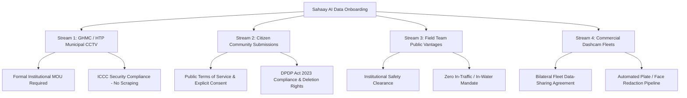

# Sahaay AI — Vision V4 Permission Onboarding & Stakeholder Engagement Plan

## Executive Summary

This document defines the formal legal, ethical, and stakeholder onboarding protocol for **Sahaay AI Flood Vision V4**.

Following the completion of the Phase 2 acquisition infrastructure, Phase 3 establishes the legal authorizations, institutional partnerships, and public consent mechanisms required before real-world imagery can be legally ingested, privacy-processed, and utilized for machine-learning early warning research.

> [!CRITICAL]
> **Cardinal Compliance Rule**:
> **No legal agreement or data authorization is assumed or claimed without documented, verifiable evidence.**
> As an automated software agent, this system does NOT possess legal agency, cannot sign contracts, and cannot submit external regulatory forms. All draft onboarding packets prepared herein are **draft administrative materials** requiring review and formal submission by the human project owner and legal counsel.

---

## 1. Stakeholder Architecture Across Four Acquisition Streams

To build a diverse, shortcut-free dataset that avoids the source confounding of historical datasets, four distinct streams are engaged:

### 1.1 Stream 1: GHMC & Hyderabad Traffic Police (Municipal CCTV)
- **Stakeholder**: Greater Hyderabad Municipal Corporation (GHMC) Command & Control Centre (ICCC) and Hyderabad Traffic Police (HTP).
- **Legal Instrument**: Formal Institutional Memorandum of Understanding (MOU) and Non-Disclosure Data-Access Agreement.
- **Scope & Purpose**: Research access to fixed-camera feeds covering verified flood-vulnerable underpasses and low-lying intersections.
- **Permitted Use**: Machine learning research, model benchmarking, and training of advisory-only flood severity vision models.
- **Security & Restriction**:
  - Raw video streams must NEVER be scraped, publicly broadcast, or shared with third parties.
  - Encryption at rest (AES-256) inside access-controlled compliance vaults.
  - Automated facial and vehicle license plate blurring before images are passed to general annotation pipelines.
- **Current Status**: `pending` formal submission of the onboarding packet by the Project Principal Investigator.

### 1.2 Stream 2: Citizen Community Photo Submissions
- **Stakeholder**: Hyderabad residents, commuter volunteers, and civil defense wardens.
- **Legal Instrument**: Public Terms of Service (ToS) and an Explicit Data-Sharing Consent Notice.
- **Regulatory Framework**: Compliance with India's *Digital Personal Data Protection (DPDP) Act, 2023*.
- **Consent Mechanism**:
  - Mandatory opt-in checkbox before upload: *"I took this photo safely from a public vantage point. I grant Sahaay AI a non-exclusive license to use this image for flood intelligence research and AI model training. I understand personal identifiers (faces, license plates) will be blurred."*
- **Right to Erasure**: Citizens retain the right to request deletion of their submitted images by providing the `acquisition_id` or timestamp/location details. Deletion from all active and archive stores must be executed within 14 calendar days.
- **Current Status**: `not_started` (front-end portal undergoing legal and privacy review prior to deployment).

### 1.3 Stream 3: Field-Team Public Vantage Photography
- **Stakeholder**: Sahaay AI Research & Field Engineering Team.
- **Legal Instrument**: Institutional Field Work Safety Protocol and Research Work Authorization.
- **Permitted Modality**: Photography captured strictly from lawful, publicly accessible pedestrian spaces (elevated sidewalks, foot overbridges, commercial concourses with permission).
- **Safety Mandates**:
  - Absolute prohibition on entering active vehicular carriageways, flowing water, or standing floodwater.
  - Compulsory high-visibility PPE, project identification badges, and waterproof equipment bags.
  - Immediate cessation of collection upon IMD Red Alert warnings or lightning detection within 3 km.
- **Current Status**: `pending` physical site inspection at 4 pilot locations and PPE gear procurement.

### 1.4 Stream 4: Commercial Logistics & Transit Dashcam Partners
- **Stakeholder**: Private logistics, ride-hailing, or municipal bus transit fleet operators.
- **Legal Instrument**: Bilateral Fleet Data-Sharing Agreement and Commercial API License.
- **Data Safeguards**:
  - Continuous video is sub-sampled (maximum 1 frame every 5–10 seconds) to prevent redundant correlation.
  - Video clips are de-identified immediately upon ingestion.
  - GPS coordinates coarsened to arterial road corridor segments.
- **Current Status**: `not_started` (preliminary partner identification and legal framework review).

---

## 2. Permission Register and Tracking System

All stakeholder outreach, legal agreement references, and request statuses are centrally tracked in:
[`data/collection_v4/permission_register.csv`](file:///C:/Users/MahendraReddy/.gemini/antigravity-ide/scratch/sahaay-ai/data/collection_v4/permission_register.csv)

### Permitted Request Status Enums:
- `not_started`: Draft onboarding packet prepared; outreach not yet initiated.
- `pending`: Formal request packet submitted to stakeholder; awaiting institutional response or countersignature.
- `approved`: Written, countersigned agreement or formal terms acceptance registered in repository evidence records.
- `rejected`: Request formally declined or abandoned due to institutional refusal or prohibitive restrictions.

> [!NOTE]
> Every transition to `approved` status requires a valid `evidence_reference` pointing to a verifiable, countersigned document in the project compliance vault. Unevidenced claims of approval are automatically flagged and rejected by the automated test suite.

---

## 3. Human Action Required for Onboarding

Because software agents cannot execute legal contracts, the project workflow defines explicit responsibilities for the project owner:

1. **Review Draft Packets**: Review the 6 formal draft documents in `docs/phase3_onboarding/` with qualified institutional legal and privacy advisors.
2. **Execute Municipal Outreach**: Print or digitally sign the Municipal Data-Access Request and deliver it to the GHMC ICCC Commissioner and Traffic Police DCP.
3. **Deploy Web Consent Notice**: Integrate the Citizen Consent Notice and Privacy Policy into the Sahaay public web upload form.
4. **Approve Field Safety Checklists**: Verify that field researchers are equipped with certified PPE and clear safety SOPs before pilot field surveys commence.
5. **Update Register**: Once countersigned documents are received, update `permission_register.csv` with the executed document reference and transition status to `approved`.
