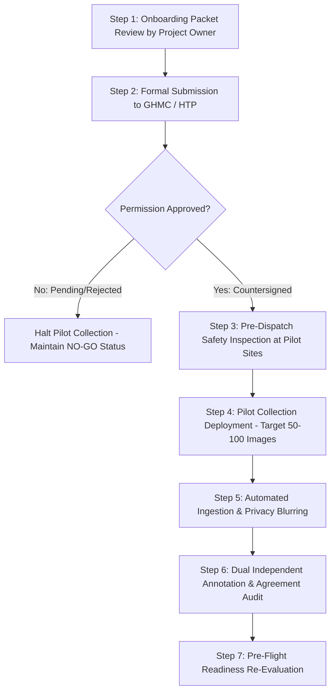

# Sahaay AI — Vision V4 Phase 3 Pilot Field Collection Plan

## Executive Summary

Before attempting to acquire the full 2,000-image multi-source dataset for Vision V4, Sahaay AI must execute a controlled **Phase 3 Pilot Collection** targeting 50 to 100 images across four prioritized candidate road segments in Hyderabad.

The primary objective of this pilot is to validate the legal, safety, technical ingestion, de-identification, and dual-annotation pipelines under authentic operational conditions without incurring unmanageable risk or resource expenditure.

> [!CRITICAL]
> **Candidate Pilot Status**:
> Sites designated in this plan are **provisional pilot candidates** undergoing feasibility and safety audits. 
> No physical field team may be dispatched, and no CCTV stream may be recorded, until the formal municipal MOU is executed and pre-dispatch safety clearances are signed.

---

## 1. Prioritized Candidate Pilot Sites

Four diverse sites representing distinct Hyderabad urban topologies, flood hydraulics, and optical environments have been selected from the 20 candidate corridors:

```
+--------------------------------------------------------------------------------------------------+
|                               PHASE 3 PILOT CANDIDATE SITES                                      |
+--------------------+----------------------------+-----------------------+------------------------+
| Pilot ID / Code    | Corridor Name & Topology   | Vantage Infrastructure| Primary Hydraulic Risk |
+--------------------+----------------------------+-----------------------+------------------------+
| PILOT-LOC-01       | Tolichowki Flyover         | Elevated pedestrian   | Basin depression; lake |
| (HYD-LOC-001)      | Underpass (West Zone)      | walkway (approach)    | backflow inundation    |
+--------------------+----------------------------+-----------------------+------------------------+
| PILOT-LOC-02       | Panjagutta Underpass       | Nagarjuna Circle      | Rapid asphalt runoff;  |
| (HYD-LOC-006)      | (Central Zone)             | Foot Overbridge (FOB) | heavy arterial traffic |
+--------------------+----------------------------+-----------------------+------------------------+
| PILOT-LOC-03       | Begumpet Rasoolpura        | Railway approach      | Low railway clearance; |
| (HYD-LOC-003)      | Underpass (North Zone)     | elevated sidewalk     | flash water trap       |
+--------------------+----------------------------+-----------------------+------------------------+
| PILOT-LOC-04       | Shaikpet Nala Road         | Paved sidewalk set    | Open nala bank overflow|
| (HYD-LOC-002)      | (West Zone)                | back 4m from canal    | during peak discharge  |
+--------------------+----------------------------+-----------------------+------------------------+
```

---

## 2. Comprehensive Site Profiles & Constraints

### 2.1 Site 1: Tolichowki Flyover Underpass (`PILOT-LOC-01`)
- **Location Foreign Key**: `HYD-LOC-001` (Khairatabad/Serilingampally Zone, $17.3984^\circ\text{N}, 78.4145^\circ\text{E}$).
- **Lawful Observation Vantage**: Elevated pedestrian walkway along the flyover approach ramp, elevated approximately 2.5 meters above the underpass carriageway grade.
- **Safety Constraints**:
  - Heavy commercial vehicular traffic (buses, trucks) generating intense water displacement spray.
  - Researchers must remain behind crash barriers on the elevated footway. **Zero stepping onto vehicular lanes.**
- **Permission Requirements**:
  - Municipal CCTV: GHMC ICCC Data-Access MOU (`pending`).
  - Field Team: Sahaay Institutional Research Safety Clearance (`pending`).
- **Available Acquisition Modalities**: Municipal CCTV (Traffic Pole 3 & 4), Field Team safe pedestrian survey, Citizen mobile uploads.
- **Revisit Protocol**:
  - Revisit A: Clear daylight dry road baseline.
  - Revisit B: Overcast active rainfall with wet asphalt and shallow puddles (hard negatives).
  - Revisit C: Continuous surface inundation during storm surge.
  - Revisit D: Post-storm recession (puddling and sediment control).
- **Representativeness & Limitations**: High representation of arterial flyover depressions; optical limitation is deep shadow cast by the flyover deck during sunny intervals.

### 2.2 Site 2: Panjagutta Underpass (`PILOT-LOC-02`)
- **Location Foreign Key**: `HYD-LOC-006` (Khairatabad Zone, $17.4262^\circ\text{N}, 78.4514^\circ\text{E}$).
- **Lawful Observation Vantage**: Nagarjuna Circle pedestrian foot overbridge (FOB) offering an unobstructed 180-degree view of both underpass portals.
- **Safety Constraints**: High pedestrian transit density on FOB during morning and evening rush hours; tripods must not obstruct pedestrian flow or emergency exits.
- **Permission Requirements**: Formal Traffic Police clearance for static equipment on FOB; CCTV MOU (`pending`).
- **Available Modalities**: Fixed Traffic Police CCTV, Field Team hand-held photography from FOB, Commercial transit dashcams.
- **Revisit Protocol**: Tri-daily monitoring (Morning peak dry, Afternoon monsoon shower, Night streetlight reflections).
- **Representativeness & Limitations**: High representation of dense commercial business corridors; limitation is extensive neon and billboard reflections that challenge optical exposure.

### 2.3 Site 3: Begumpet Rasoolpura Underpass (`PILOT-LOC-03`)
- **Location Foreign Key**: `HYD-LOC-003` (Secunderabad Zone, $17.4441^\circ\text{N}, 78.4735^\circ\text{E}$).
- **Lawful Observation Vantage**: Elevated pedestrian sidewalk adjacent to Begumpet railway station approach, positioned 1.8 meters above road carriageway.
- **Safety Constraints**:
  - Flash flooding occurs rapidly in this subway due to pumped drainage limitations.
  - Strict prohibition against descending into the underpass subway bowl during active rain.
  - Absolute prohibition against walking on or near railway tracks.
- **Permission Requirements**: GHMC / South Central Railway (SCR) joint corridor clearance (`pending`).
- **Available Modalities**: Municipal CCTV, Field Team elevated sidewalk vantage.
- **Representativeness & Limitations**: Quintessential railway underbridge (RUB) flood vulnerability; limitation is low-light conditions under bridge girders requiring high-ISO sensor sensitivity.

### 2.4 Site 4: Shaikpet Nala Road (`PILOT-LOC-04`)
- **Location Foreign Key**: `HYD-LOC-002` (Khairatabad Zone, $17.3951^\circ\text{N}, 78.4022^\circ\text{E}$).
- **Lawful Observation Vantage**: Northern paved commercial sidewalk set back a minimum of 4.0 meters from the masonry nala retaining wall.
- **Safety Constraints**:
  - **Severe Hazard**: Open storm drain (nala) prone to sudden hydraulic surges and unpaved embankment erosion.
  - Mandatory 4-meter buffer distance from the nala edge.
  - Immediate evacuation order if nala water level approaches within 1.0 meter of the retaining wall top.
- **Permission Requirements**: Field Research Protocol Clearance (`pending`).
- **Available Modalities**: Field Team elevated sidewalk survey, Citizen uploads.
- **Representativeness & Limitations**: Critical urban nala overflow scenario; limitation is absence of municipal CCTV on certain road segments, requiring primary reliance on safe field surveys.

---

## 3. Pilot Execution Workflow & Stop-Work Authority

The pilot must progress through sequential validation gates:



### Stop-Work Authority:
Every field team member, compliance officer, and software engineer has the absolute authority and obligation to issue an immediate **Stop-Work Order** if:
1. Field physical conditions become unsafe (lightning, surging floodwater, aggressive traffic).
2. Institutional authorization status is questioned by municipal or law enforcement officers.
3. Unredacted privacy-sensitive imagery is detected in general working repositories.
4. Any synthetic fixture is inadvertently commingled with real-world registry records.
