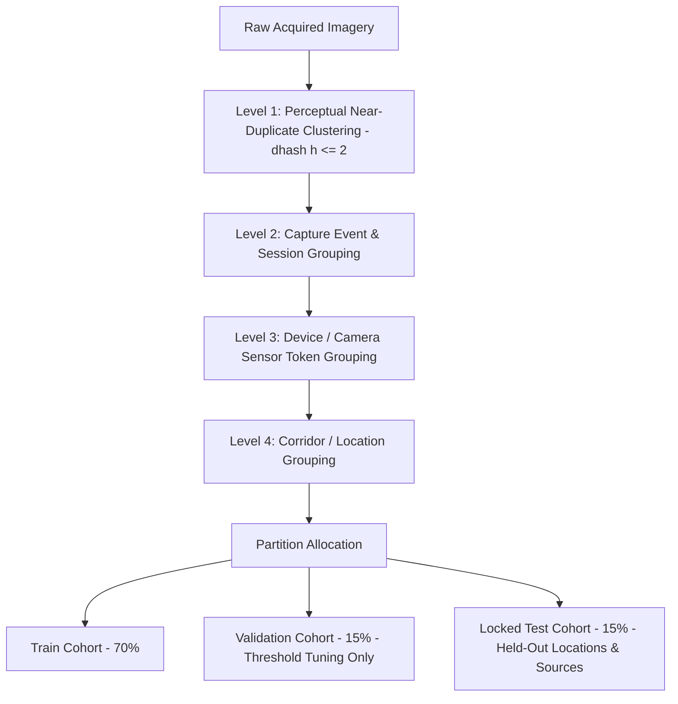

# Sahaay AI — Vision V4 Source-Independent Evaluation Protocol

## Executive Summary

This document establishes the experimental evaluation protocol for **Sahaay AI Flood Vision V4**. Its purpose is to guarantee that future model performance reflects true visual inundation semantics rather than dataset acquisition shortcuts, camera-sensor signatures, or source-label confounding.

Historical evaluations in V1 and V2 demonstrated 100% test scores that collapsed when exposed to real roads, while V3 and initial V4 audits revealed that a decision tree trained on non-semantic metadata alone (`width`, `height`, `file_size_kb`) achieved **85.97% test accuracy** due to complete source-label entanglement.

> [!CRITICAL]
> **Core Methodological Mandate**:
> **A random image-level split is NOT valid evidence of model generalization.** 
> Future Vision V4 evaluation requires source-independent, location-held-out, and event-grouped partitions with mandatory pre-flight contingency audits.

---

## 1. Mandatory Pre-Flight Criteria Before Future Model Training

Before any model training run may be authorized, the candidate dataset must pass three mathematical gates:

### Gate 1: Multi-Source Class Cross-Representation
- **Requirement**: At least two independent acquisition sources must each contribute substantial samples of BOTH classes:
  - $\text{Source}_1$: Positive (`flooded_road`) $\ge 200$ AND Negative (`dry_road` + `wet_no_visible_inundation`) $\ge 200$.
  - $\text{Source}_2$: Positive (`flooded_road`) $\ge 200$ AND Negative (`dry_road` + `wet_no_visible_inundation`) $\ge 200$.
- **Prohibition**: Single-source positive datasets (e.g., Clemson-only) paired with single-source negative datasets (e.g., Virenbr11-only) are categorically disqualified from production training.

### Gate 2: Pre-Training Source $\times$ Label Contingency Table
Prior to partitioning, a cross-tabulation of dataset source versus class label must be generated:

$$\text{Cramér's } V = \sqrt{\frac{\chi^2}{N \cdot (\min(r, c) - 1)}} \le 0.30$$

$$\text{Mutual Information } I(\text{Source};\ \text{Label}) \le 0.20 \text{ bits}$$

If Cramér's $V > 0.30$ or $I(\text{Source}; \text{Label}) > 0.20\text{ bits}$, training is blocked.

### Gate 3: Non-Semantic Metadata Diagnostic Baseline
A baseline classifier (Logistic Regression or shallow Random Forest) trained strictly on non-semantic features (`width`, `height`, `aspect_ratio`, `file_size_kb`) must be evaluated:
- **Pass Criterion**: Metadata-only test accuracy must NOT exceed $\max(\text{majority\_class\_ratio} + 0.05, 0.55)$ and metadata ROC-AUC must be $\le 0.60$.
- If metadata alone predicts the label (as occurred in V3/V4 at 85.97%), the dataset remains confounded and vision training cannot proceed.

---

## 2. Grouped Partitioning Architecture

To prevent pseudo-replication, split partitioning must enforce atomic grouping at four hierarchical levels:

1. **Perceptual Clusters**: Every cluster identified by exhaustive pairwise Hamming distance ($h \le 2$) must be placed entirely within a single split.
2. **Temporal Event Sequences**: Continuous video clips or burst photos from the same rainfall storm event (within a 3-hour window at the same camera) must remain grouped.
3. **Hardware Sensor Token**: Frames from the same pseudonymous camera ID must not span train and held-out test splits.
4. **Location / Corridor Isolation**: Entire road corridors (e.g., `HYD-LOC-001` Tolichowki) must be withheld from training to evaluate spatial transferability.

---

## 3. Tri-Level Evaluation Hierarchy

Future evaluation must report performance across three distinct generalization tiers:

| Evaluation Tier | Scope & Partition | Purpose | Optimization Role |
| :--- | :--- | :--- | :--- |
| **Tier 1: Internal Grouped Validation** | In-distribution locations, disjoint event groups (`val_v4`) | Tuning hyperparameters, learning rate schedules, and decision thresholds ($\tau^*$). | Accessible during model development. |
| **Tier 2: Held-Out Spatial Generalization** | Reserved Hyderabad corridors (`HYD-LOC-heldout`) | Evaluating spatial generalization to unseen road geometry, asphalt aging, and urban topography. | Inaccessible during training; evaluated post-freeze. |
| **Tier 3: Independent External Evaluation** | Distinct external agency / municipal feed (e.g., Cyberabad Police or HMR) | True zero-shot external domain transfer without shared institutional bias. | Locked; evaluated strictly once. |

---

## 4. Frozen Test Set Governance

The final test set (`test_v4.csv`) must remain locked:
- **Access Control**: Stored in a cryptographically sealed manifest with SHA-256 integrity verification.
- **Single Evaluation Policy**: The locked test set is evaluated strictly ONCE after model weights, preprocessing code, and decision thresholds are finalized and frozen.
- **Repeated Tuning Prohibition**: Test set metrics must NEVER be used to select checkpoints, tune thresholds, or guide prompt/hyperparameter engineering.

---

## 5. Disaggregated Metric Reporting Standards

To ensure complete transparency, evaluation reports must satisfy strict reporting standards:

### 5.1 Hard-Negative False Positive Evaluation
- Specific reporting of False Positive Rate ($\text{FPR}$) on non-inundated wet road conditions:
  $$\text{FPR}_{\text{hard\_negatives}} = \frac{\text{FP}_{\text{potholes, wet\_asphalt, reflections}}}{\text{FP}_{\text{potholes, wet\_asphalt, reflections}} + \text{TN}_{\text{potholes, wet\_asphalt, reflections}}}$$
- **Target**: $\text{FPR}_{\text{hard\_negatives}} \le 0.05$ (Less than 5% false alarms on puddles and wet roads).

### 5.2 Environmental & Subgroup Stratification
Performance must be disaggregated across environmental cohorts wherever sample counts $N \ge 30$:
1. **Lighting Cohort**: Daylight vs Dusk/Dawn vs Night with Streetlights vs Night Unlit.
2. **Atmospheric Cohort**: Clear vs Overcast vs Active Rainfall vs Heavy Spray.
3. **Optical Degradation Cohort**: High clarity vs Specular Glare vs Partial Wiper Blur.

### 5.3 Explicit Denominators and Confidence Intervals
- **Rule**: Every percentage or rate MUST report the exact numerator and denominator:
  $$\text{Accuracy} = 94.2\% \quad (N = 195 / 207)$$
- **Confidence Intervals**: All primary metrics (Precision, Recall, F1, FPR, FNR) must report 95% Wilson score confidence intervals:
  $$\text{Recall} = 96.0\% \quad [95\%\text{ CI: } 91.5\% - 98.2\%] \quad (N = 96 / 100)$$

### 5.4 Calibration & Selective Classification
- **Expected Calibration Error (ECE)**: Evaluated across 10 reliability bins. Target: $\text{ECE} \le 0.08$.
- **Risk-Coverage Abstention Curve**: Evaluates error rate as a function of coverage when routing ambiguous predictions ($\tau_1 < P(\text{flood}) < \tau_2$) to human review.
