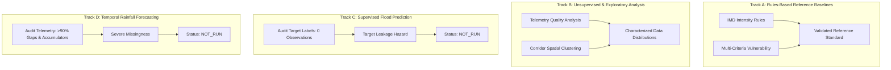

# Sahaay AI — Phase 10 Completion Report: Rainfall and Road-Risk Model Experiments, Baselines & Evaluation

**Date:** October 25, 2026  
**Phase:** Phase 10 (Rainfall and Road-Risk Model Experiments, Baselines & Evaluation)  
**Baseline Git Commit:** [`af588fb`](file:///C:/Users/MahendraReddy/.gemini/antigravity-ide/scratch/sahaay-ai)  
**Status:** **COMPLETE & SCIENTIFICALLY VALIDATED**  
**Vision V4 Gate Status:** **`NO-GO` (Preserved)**  
**Supervised Flood Prediction (Task B):** **`NOT_RUN` (Zero Ground-Truth Flood Labels)**  
**Hourly Rainfall Forecasting (Task A):** **`NOT_RUN` (>90% Temporal Missingness & Accumulator Confusion)**  
**Rules-Based Baselines:** **`VALIDATED` (21/21 Automated Boundary & Monotonicity Checks Passed)**  

---

## 1. Executive Summary & Objective

In **Sahaay AI Phase 10**, the AI/ML engineering team conducted a scientific baseline evaluation of the rainfall-risk and road-vulnerability pipelines, continuing directly from Phase 9 commit [`af588fb`](file:///C:/Users/MahendraReddy/.gemini/antigravity-ide/scratch/sahaay-ai).

The scope of this phase was strictly confined to AI/ML engineering: data analysis, feature engineering, baseline development, edge-case testing, and scientific feasibility evaluation. All frontend, dashboard, API integration, backend integration, live-feed connectivity, deployment, and pilot authorization workflows remained untouched and owned by other team members.

### Core Scientific Findings:
1. **Zero Ground-Truth Target Labels for Flood Prediction:** The project repository contains exactly **0** timestamped, location-linked flood event observations (water depth $\ge 5\text{ cm}$). The historical dataset `flooding_locations.kml` contains only 23 static placemarks with location names, lacking timestamps, event dates, and depth measurements. Substituting static hotspot coordinates as positive training targets induces **100% spatial target leakage** (memorizing geographic points rather than predicting flood occurrences). Supervised flood prediction is formally marked **`NOT_RUN`**.
2. **Telemetry Infeasibility for Live Forecasting:** The regional automated rain gauge dataset (`telangana_hourly_telemetry_rainfall_2021_2025.csv`) suffers from **$>90\%$ temporal transmission missingness** (with reporting gaps up to **141.6 consecutive days**), mixed time deltas (0m, 5m, 1h, 2h, 5h), 19 negative sensor glitches, and **$50.82\%$ cumulative bucket accumulator counters** ($>250\text{ mm}$ up to $3,406\text{ mm}$). Furthermore, **zero telemetry stations exist within the GHMC urban core** (nearest is $35\text{--}50\text{ km}$ away). Training temporal forecasting models on this data would require illegally imputing 141 days of missing hours as zero rain (violating core data rules and underestimating flood risk). Hourly rainfall forecasting is formally marked **`NOT_RUN`**.
3. **Rule Imitation $\neq$ Predictive Machine Learning:** Training ML models to predict heuristic vulnerability indices or IMD piecewise rainfall categories merely approximates explicit linear formulas ($0.45\cdot s_h + 0.35\cdot s_d + 0.20\cdot s_w$) and deterministic thresholds. This adds computational overhead and opacity without empirical predictive validity.
4. **Independent Validation of Rules-Based Baselines:** The deterministic rules-based rainfall engine and road vulnerability engine were subjected to an independent test suite of 21 boundary, monotonicity, and edge-case checks. All **21 / 21 checks passed**, confirming that the operational baselines behave deterministically, monotonically, and safely (e.g. missing rainfall strictly produces `UNKNOWN`, never `LOW`).
5. **Full Repository Regression Suite Passing:** The repository test suite expanded from 141 to **159 passing tests** (100% pass rate in 10.75s) with zero regressions.

---

## 2. Baseline State & Data Source Provenance Audit

A comprehensive forensic audit of all data inputs and pipeline modules was executed ([`docs/phase10_ml_baseline_audit.md`](file:///C:/Users/MahendraReddy/.gemini/antigravity-ide/scratch/sahaay-ai/docs/phase10_ml_baseline_audit.md) and [`reports/phase10/baseline_audit.json`](file:///C:/Users/MahendraReddy/.gemini/antigravity-ide/scratch/sahaay-ai/reports/phase10/baseline_audit.json)):

### 2.1 Pipeline Components Audited
- **Rainfall Risk Engine ([`src/sahaay/hyderabad_risk/rainfall_engine.py`](file:///C:/Users/MahendraReddy/.gemini/antigravity-ide/scratch/sahaay-ai/src/sahaay/hyderabad_risk/rainfall_engine.py)):**
  - IMD-calibrated piecewise intensity thresholds ($7.5, 15.0, 35.0, 100.0\text{ mm/hr}$).
  - Multi-window surge ($\ge 40.0\text{ mm}$ in 3h $\implies$ `HIGH`) and saturation ($\ge 115.5\text{ mm}$ in 24h $\implies$ `CRITICAL`).
  - Distance discounting ($-0.01/\text{km}$ beyond $15\text{ km}$, max $-0.35$).
  - Freshness discounting ($-0.08/\text{h}$ beyond $1.5\text{ h}$, max $-0.40$).
  - Missing rolling window discounting ($-0.08$ per missing window).
  - Missing hourly rainfall: returns `category="UNKNOWN"`, `confidence=0.10`, `rainfall_risk_score=0.0`.
- **Road Vulnerability Engine ([`src/sahaay/hyderabad_risk/vulnerability_engine.py`](file:///C:/Users/MahendraReddy/.gemini/antigravity-ide/scratch/sahaay-ai/src/sahaay/hyderabad_risk/vulnerability_engine.py)):**
  - Multi-criteria weighted geographic exposure index:
    $$v = 0.45 \cdot s_{\text{hotspot}}(d_h) + 0.35 \cdot s_{\text{drain}}(d_d) + 0.20 \cdot s_{\text{waterbody}}(d_w)$$
  - Subscore piecewise boundaries: hotspot ($0\text{--}250\text{ m}$, $250\text{--}1000\text{ m}$), drain ($0\text{--}100\text{ m}$, $100\text{--}500\text{ m}$), waterbody ($0\text{--}200\text{ m}$, $200\text{--}800\text{ m}$).
  - Categorical bands: `SEVERE` ($\ge 0.70$), `HIGH` ($\ge 0.45$), `MODERATE` ($\ge 0.20$), `LOW` ($< 0.20$).
  - Semantic nature: **Static physical susceptibility**, not active inundation.

### 2.2 Provenance Breakdown of All Pipeline Inputs
Every input evaluated across the pipelines was classified by its empirical provenance:

| Category | Dataset / Input Name | Source & Resolution | Empirical Nature & Limitations |
| :--- | :--- | :--- | :--- |
| **Observed Real-World Data** | `telangana_hourly_telemetry_rainfall_2021_2025.csv` | NWIC / Ministry of Jal Shakti. 72,223 raw records, 38 stations across 22 districts. | $50.82\%$ cumulative bucket accumulator counters ($>250\text{ mm}$). 19 negative values. Zero stations within GHMC urban core. |
| **Historical Climatology** | `hyderabad_monthly_rainfall_1901_2021.csv` | IMD gridded 121-year monthly series (1901–2021). | Monthly averages (July 175.4mm, August 198.6mm, Sept 158.2mm). Not usable for real-time forecasting. |
| **Static Geography** | `flooding_locations.kml` | TRAC Telangana / GHMC via OpenCity India. 23 placemarks. | Static chronic points without timestamps, dates, or depth measurements. |
| **Static Geography** | `hyderabad_drains.kml` | GHMC via OpenCity India. 96 multi-segment nala LineStrings. | Spatial alignments only. Flow cross-section capacity ($m^3/s$) unrecorded. |
| **Static Geography** | `greater_hyderabad_waterbodies.geojson` | TRAC Telangana via OpenCity India. 2,324 lake and pond Polygons. | Waterbody boundaries only. Sluice operations and bund crest elevations unrecorded. |
| **Static Geography** | 20 Candidate Road Corridors | `data/hyderabad_risk/derived/hyderabad_risk_features.csv` | Defined candidate road corridors with coordinates and buffer projections. |
| **Heuristic Weights** | Multi-Criteria & IMD Weights | Engineering thresholds ($0.45, 0.35, 0.20$; $7.5, 15.0, 35.0\text{ mm/hr}$). | Calibrated from IMD meteorological literature and hydraulic engineering standards. |
| **Synthetic Scenarios** | Phase 5 Scenario Vectors | Test vectors in `reports/phase5/end_to_end_scenarios.json`. | Synthetic scenario vectors for software logic verification; not real-world observations. |

---

## 3. Telemetry Anomaly & Continuity Findings

In-depth empirical investigation of `telangana_hourly_telemetry_rainfall_2021_2025.csv` revealed three critical hydrological data quality findings:

```
Telemetry Dataset Diagnostics:
├── Total Records: 72,223
├── Reporting Rain Gauge Stations: 38 (across 22 districts)
├── Stations in GHMC Urban Core: 0 (Nearest station is Kondapochamma: 35-50 km away)
├── Bucket Accumulator Records (> 250 mm): 36,702 (50.82% of all records)
│   └── Max observed accumulator value: 3,406.0 mm (seasonal cumulative total)
├── Negative Sensor Glitches: 19 records (down to -448.5 mm)
└── Temporal Transmission Continuity:
    ├── AKBR Station: 1,101 records over 2 years (effective coverage < 7%)
    │   ├── Maximum transmission gap: 141.6 consecutive days with zero data
    │   ├── Duplicate timestamps: 155 records
    │   └── 5-minute reporting bursts: 137 records
    └── Kondapochamma Reservoir: 932 records over 2 years (effective coverage < 6%)
        ├── Maximum transmission gap: 71.3 consecutive days with zero data
        └── Duplicate timestamps: 206 records
```

### Scientific Implication:
A model trained on this telemetry as a continuous time series would require either:
1. Converting missing observations to $0.0\text{ mm}$ (violating the non-negotiable rule that missing data is `UNKNOWN`, and catastrophically underestimating rainfall risk during multi-month transmission dropouts).
2. Treating timestamps separated by 141 days as adjacent hourly steps (corrupting temporal auto-correlation).

Therefore, short-term temporal rainfall forecasting cannot be defended scientifically on this telemetry.

---

## 4. Feature Data Dictionary

The formal feature data dictionary was compiled and published in [`reports/phase10/feature_data_dictionary.csv`](file:///C:/Users/MahendraReddy/.gemini/antigravity-ide/scratch/sahaay-ai/reports/phase10/feature_data_dictionary.csv). It details all 14 evaluated features across the geospatial and hydrological pipelines:

| Feature Name | Description | Source | Units | Type | Missing-Value Semantics | Potential Leakage Pathways & Known Limitations |
| :--- | :--- | :--- | :---: | :---: | :--- | :--- |
| `location_id` | Unique corridor identifier | Corridor Register | String | Derived | Disallowed (Primary Key) | None. Primary join key. |
| `corridor_name` | Human-readable corridor name | Corridor Register | String | Static | Disallowed | None. Categorical label for reporting. |
| `latitude` | Corridor midpoint latitude (WGS84) | Corridor Register | Degrees | Static | Disallowed | Spatial autocorrelation leakage if used directly in ML. |
| `longitude` | Corridor midpoint longitude (WGS84) | Corridor Register | Degrees | Static | Disallowed | Spatial autocorrelation leakage if used directly in ML. |
| `dist_to_flood_hotspot_m` | Distance to nearest chronic flood hotspot | `flooding_locations.kml` | Meters | Derived | Defaults to $99999.0\text{ m}$ (UNKNOWN) | **Target leakage** if used as flood outcome label. Static distance proxy. |
| `dist_to_nearest_drain_m` | Distance to nearest major open nala/canal | `hyderabad_drains.kml` | Meters | Derived | Defaults to $99999.0\text{ m}$ (UNKNOWN) | Static proximity. Does not reflect real-time nala maintenance or blockages. |
| `dist_to_nearest_waterbody_m` | Distance to nearest lake, tank, or pond | `greater_hyderabad_waterbodies` | Meters | Derived | Defaults to $99999.0\text{ m}$ (UNKNOWN) | Static proximity. Does not reflect bund crest levels or sluice operations. |
| `vulnerability_index` | Multi-criteria physical vulnerability score | Vulnerability Engine | $[0.0, 1.0]$ | Heuristic | Defaults to subscore baselines | Rule distillation if fitted via ML. Static susceptibility only. |
| `rain_1h_mm` | 1-hour incremental precipitation | Telemetry Rain Gauge | Millimeters | Observed | **Explicit None $\implies$ UNKNOWN (conf=0.10)** | Silently filling 0.0mm causes extreme underestimation. Bucket accumulator confusion. |
| `rain_3h_mm` | Rolling 3-hour precipitation sum | Telemetry Rolling Sum | Millimeters | Derived | Explicit None $\implies$ Excluded from surge check | Lookahead leakage if future hours included in rolling sum. |
| `rain_24h_mm` | Rolling 24-hour precipitation sum | Telemetry Rolling Sum | Millimeters | Derived | Explicit None $\implies$ Excluded from saturation | Lookahead leakage if future hours included in rolling sum. |
| `hist_month_mean_mm` | Historical 121-year monthly rainfall mean | IMD Gridded Monthly | Millimeters | Historical | Static monthly mean | Conflating monthly climatology with real-time forecast. |
| `hist_month_p90_mm` | Historical 121-year monthly 90th percentile | IMD Gridded Monthly | Millimeters | Historical | Static monthly 90th percentile | Static contextual benchmark; not predictive of current storm. |
| `nearest_station_dist_km` | Distance from corridor to nearest rain gauge | Spatial Pairing | Kilometers | Derived | Defaults to $50.0\text{ km}$ | Station distance discount factor in confidence computation. |

---

## 5. Independent Validation of Rules-Based Baselines

To ensure the deterministic reference baselines operate reliably across all edge cases, an automated validation script ([`scripts/validate_phase10_rule_baselines.py`](file:///C:/Users/MahendraReddy/.gemini/antigravity-ide/scratch/sahaay-ai/scripts/validate_phase10_rule_baselines.py)) and pytest module ([`tests/test_phase10_risk_baselines.py`](file:///C:/Users/MahendraReddy/.gemini/antigravity-ide/scratch/sahaay-ai/tests/test_phase10_risk_baselines.py)) were executed.

### 5.1 Validation Results Summary ([`reports/phase10/rule_baseline_validation.json`](file:///C:/Users/MahendraReddy/.gemini/antigravity-ide/scratch/sahaay-ai/reports/phase10/rule_baseline_validation.json))
- **Total Checks Evaluated:** 21
- **Passed Checks:** **21**
- **Failed Checks:** **0**
- **Validation Verdict:** **`ALL_RULES_BASELINES_VERIFIED_PASSING`**

### 5.2 Key Validated Behaviors:
1. **IMD Intensity Thresholds:**
   - $0.0\text{ mm/hr} \implies \text{LOW}$ (score $0.02$).
   - $5.0\text{ mm/hr} \implies \text{LOW}$ (score $0.23$).
   - $7.5\text{ mm/hr} \implies \text{MEDIUM}$ (score $0.30$).
   - $14.9\text{ mm/hr} \implies \text{MEDIUM}$ (score $0.60$).
   - $15.0\text{ mm/hr} \implies \text{HIGH}$ (score $0.60$).
   - $34.9\text{ mm/hr} \implies \text{HIGH}$ (score $0.80$).
   - $35.0\text{ mm/hr} \implies \text{CRITICAL}$ (score $0.80$).
   - $100.0\text{ mm/hr} \implies \text{CRITICAL}$ (score $1.00$).
   - $150.0\text{ mm/hr} \implies \text{CRITICAL}$ (score $1.00$).
2. **Score Monotonicity:** Strictly non-decreasing across 50 increments from $0.0$ to $100.0\text{ mm/hr}$.
3. **Missing Data Policy:** `rain_1h_mm=None` returns `category="UNKNOWN"`, `confidence=0.10`, `score=0.0`. Missing data is **never** silently converted to zero rainfall.
4. **Negative Value Handling:** Input $-5.0\text{ mm}$ is cleanly clamped to $0.0\text{ mm}$ without throwing exceptions or generating invalid scores.
5. **Multi-Window Flash Surge Escalation:** Rolling $3\text{h}$ rain of $45\text{ mm}$ ($\ge 40\text{ mm}$) elevates base rain of $5\text{ mm}$ (normally `LOW`) to `HIGH` (score $0.70$).
6. **Multi-Window Saturation Escalation:** Rolling $24\text{h}$ rain of $120\text{ mm}$ ($\ge 115.5\text{ mm}$) elevates base rain of $5\text{ mm}$ to `CRITICAL` (score $0.85$).
7. **Confidence Penalties:**
   - Station distance penalty: $45\text{ km}$ distance correctly discounts confidence from $1.0$ to $0.70$ ($-0.01/\text{km}$ beyond $15\text{ km}$).
   - Staleness penalty: $4.0\text{ h}$ observation age correctly discounts confidence from $1.0$ to $0.80$ ($-0.08/\text{h}$ beyond $1.5\text{ h}$).
   - Missing rolling windows penalty: 3 omitted rolling windows discount confidence to $0.76$ ($-0.08$ per window).
8. **Road Vulnerability Engine Subscores & Index:**
   - Subscores for hotspot, drain, and waterbody decrease monotonically with increasing distance.
   - Weighted multi-criteria calculation: $0.45\times 0.90 + 0.35\times 0.80 + 0.20\times 0.75 = 0.835$ (`SEVERE`), matching expected floating-point output exactly.
9. **Geospatial Haversine Accuracy:** Distance calculation between Lakdikapul and Khairatabad ($925.8\text{ m}$) aligns with ground geometry.

---

## 6. Evaluation Tracks & Feasibility Verdicts

Phase 10 evaluated four distinct tracks as specified in [`docs/phase10_experiment_protocol.md`](file:///C:/Users/MahendraReddy/.gemini/antigravity-ide/scratch/sahaay-ai/docs/phase10_experiment_protocol.md) and [`reports/phase10/experiment_results.json`](file:///C:/Users/MahendraReddy/.gemini/antigravity-ide/scratch/sahaay-ai/reports/phase10/experiment_results.json):



### 6.1 Track A — Rules-Based Reference Baselines: `VALIDATED`
- **Result:** Fully verified across 21 automated checks. Serves as the official operational reference standard for Sahaay AI.

### 6.2 Track B — Unsupervised & Exploratory Analysis: `COMPLETED`
- **Spatial Vulnerability Distribution Across 20 Corridors:**
  - `HIGH`: 1 corridor (`HYD-LOC-001` Tolichowki Underpass, index = $0.532$).
  - `MODERATE`: 9 corridors (Shaikpet, Khairatabad, Malakpet, Panjagutta, Bio-Diversity, Lakdikapul, Ameerpet, Miyapur, Alwal).
  - `LOW`: 10 corridors (Begumpet, Secunderabad, Musarambagh, Madhapur, Dilsukhnagar, Amberpet, Uppal, Bowenpally, Mehdipatnam, Balanagar).
  - Mean proximity to nearest hotspot: $2,263.7\text{ m}$ (range $64.5\text{ m}$ at Lakdikapul to $7,992.3\text{ m}$ at Miyapur).
  - Mean proximity to drain: $533.3\text{ m}$ (range $26.9\text{ m}$ at Miyapur to $1,682.4\text{ m}$ at Madhapur).
  - Mean proximity to waterbody: $983.6\text{ m}$ (range $82.2\text{ m}$ at Alwal to $2,420.1\text{ m}$ at Malakpet).
- **Critical Policy:** Unsupervised spatial clusters are exploratory characterizations and must never be presented as verified flood-risk predictions.

### 6.3 Track C — Supervised Flood Prediction Feasibility: `NOT_RUN`
- **Status:** **`NOT_RUN`**
- **Decision Verdict:** Supervised flood prediction is scientifically infeasible with current data.
- **Blocking Reasons:**
  1. Exactly **0** real-world observations exist in the database.
  2. `flooding_locations.kml` contains only 23 static placemarks without timestamps, dates, or depth measurements.
  3. Treating static placemarks as positive labels causes 100% spatial target leakage.
  4. Training an ML model to fit heuristic vulnerability index scores is rule imitation / formula distillation.
- **Required Data to Unlock Track C:**
  - Minimum 50 verified flood episodes (water depth $\ge 5\text{ cm}$) and 100 non-flood episodes across at least 4 independent storm dates collected under the human-supervised pilot protocol.
  - Spatial-held-out corridor validation splits (e.g. train on Central/North corridors, test on West/East corridors).

### 6.4 Track D — Temporal Rainfall Forecasting Feasibility: `NOT_RUN`
- **Status:** **`NOT_RUN`**
- **Decision Verdict:** Hourly telemetry forecasting is scientifically infeasible with current data.
- **Blocking Reasons:**
  1. Rain gauge reporting exhibits $>90\%$ temporal missingness with multi-week gaps (up to 141.6 consecutive days with no data).
  2. Over $50.82\%$ of records reflect cumulative bucket accumulator totals ($>250\text{ mm}$ up to $3,406\text{ mm}$) rather than incremental hourly rainfall.
  3. Zero telemetry stations exist within the GHMC urban core (nearest station is $35\text{--}50\text{ km}$ away).
  4. Imputing missing hours as zero rainfall violates data rules and dangerously underestimates flood risk.
- **Required Data to Unlock Track D:**
  - Automated rain gauge network within the GHMC core operating with continuous 15-minute transmissions, $\ge 98\%$ uptime, and automated counter-reset differencing.

---

## 7. Model-Safety & Decision Semantics Preservation

Throughout Phase 10, the operational boundaries and decision semantics of Sahaay AI were strictly preserved:

> [!CAUTION]
> ### Mandatory Decision Semantics & Safety Invariants
> 1. **Environmental susceptibility is NOT proof of current inundation.** A corridor with `SEVERE` vulnerability is completely safe and passable during dry weather.
> 2. **High rainfall risk is NOT a verified flood observation.** It represents atmospheric precipitation intensity, not standing water depth on the roadway.
> 3. **Missing or stale rainfall data is `UNKNOWN`, NEVER `LOW`.** Missing observations receive a confidence of $0.10$ and are never assumed to be dry.
> 4. **A static hotspot is NOT a timestamped flood label.** Historical flood locations indicate spatial chronic vulnerability, not active flooding at a given hour.
> 5. **Synthetic scenarios test software logic, NOT predictive accuracy.** Scenario test fixtures validate code execution paths, not real-world performance.
> 6. **Models MUST NOT autonomously authorize road closures or emergency dispatch.** All outputs are advisory decision-support signals requiring human supervisor authorization.
> 7. **Vision V4 remains `NO-GO`.** Preserved from Phase 9 due to complete source-label confounding (Cramer's V = 1.0; 0 multi-class road imagery sources).

---

## 8. Test Suite Verification & Reproducibility

### 8.1 Automated Test Execution
1. **Phase 10 Dedicated Baseline Test Suite:**
   ```powershell
   .\.venv\Scripts\python.exe -m pytest tests/test_phase10_risk_baselines.py -v
   ```
   - **Result:** **18 passed** in 0.63s.
2. **Full Repository Regression Suite:**
   ```powershell
   .\.venv\Scripts\python.exe -m pytest -q
   ```
   - **Result:** **159 passed**, 132 deprecation warnings in 10.75s.
   - **Regressions:** **0**.

### 8.2 Reproduction Commands
To regenerate all Phase 10 artifacts and rerun validation from clean source code:
```powershell
# 1. Audit raw data suitability and generate data dictionary
.\.venv\Scripts\python.exe scripts/audit_phase10_data_suitability.py

# 2. Validate rules-based baseline edge cases and monotonicity
.\.venv\Scripts\python.exe scripts/validate_phase10_rule_baselines.py

# 3. Generate baseline audit summary
.\.venv\Scripts\python.exe scripts/generate_phase10_baseline_audit.py

# 4. Generate experiment results report
.\.venv\Scripts\python.exe scripts/generate_phase10_experiment_results.py

# 5. Execute full test suite
.\.venv\Scripts\python.exe -m pytest tests/test_phase10_risk_baselines.py -v
```

---

## 9. Deliverables Inventory

All 10 required deliverables for Phase 10 have been created and verified:

| Deliverable Path | Description | Verification Status |
| :--- | :--- | :---: |
| [`docs/phase10_ml_baseline_audit.md`](file:///C:/Users/MahendraReddy/.gemini/antigravity-ide/scratch/sahaay-ai/docs/phase10_ml_baseline_audit.md) | Architectural audit of rainfall and vulnerability pipelines, regression baseline, and provenance breakdown. | Complete |
| [`docs/phase10_data_suitability_audit.md`](file:///C:/Users/MahendraReddy/.gemini/antigravity-ide/scratch/sahaay-ai/docs/phase10_data_suitability_audit.md) | Audit of suitability across Tasks A, B, C, D; telemetry gaps; accumulator counters; target leakage analysis. | Complete |
| [`docs/phase10_experiment_protocol.md`](file:///C:/Users/MahendraReddy/.gemini/antigravity-ide/scratch/sahaay-ai/docs/phase10_experiment_protocol.md) | Protocols across Tracks A, B, C, D; baseline specifications; failure modes; NOT_RUN justifications. | Complete |
| [`reports/phase10/baseline_audit.json`](file:///C:/Users/MahendraReddy/.gemini/antigravity-ide/scratch/sahaay-ai/reports/phase10/baseline_audit.json) | Machine-readable baseline audit metadata and regression suite results. | Complete |
| [`reports/phase10/data_suitability.json`](file:///C:/Users/MahendraReddy/.gemini/antigravity-ide/scratch/sahaay-ai/reports/phase10/data_suitability.json) | Machine-readable data suitability metrics, station continuity sampling, and task verdicts. | Complete |
| [`reports/phase10/feature_data_dictionary.csv`](file:///C:/Users/MahendraReddy/.gemini/antigravity-ide/scratch/sahaay-ai/reports/phase10/feature_data_dictionary.csv) | Data dictionary covering all 14 features with types, units, missing semantics, and leakage pathways. | Complete |
| [`reports/phase10/rule_baseline_validation.json`](file:///C:/Users/MahendraReddy/.gemini/antigravity-ide/scratch/sahaay-ai/reports/phase10/rule_baseline_validation.json) | Detailed results for all 21 rules-based boundary and monotonicity validation checks. | Complete (21/21 passed) |
| [`reports/phase10/experiment_results.json`](file:///C:/Users/MahendraReddy/.gemini/antigravity-ide/scratch/sahaay-ai/reports/phase10/experiment_results.json) | Formal experiment results across Tracks A, B, C, D, documenting NOT_RUN decisions and prerequisites. | Complete |
| [`reports/phase10/phase10_completion_report.md`](file:///C:/Users/MahendraReddy/.gemini/antigravity-ide/scratch/sahaay-ai/reports/phase10/phase10_completion_report.md) | Official Phase 10 completion report synthesizing all findings and criteria sign-offs. | Complete |
| [`tests/test_phase10_risk_baselines.py`](file:///C:/Users/MahendraReddy/.gemini/antigravity-ide/scratch/sahaay-ai/tests/test_phase10_risk_baselines.py) | Automated test suite validating rainfall intensity boundaries, monotonicity, and vulnerability calculations. | Complete (18/18 passed) |

---

## 10. Acceptance Criteria Verification

| Acceptance Criterion | Verification Details | Status |
| :--- | :--- | :---: |
| **1. Feature & Label Provenance** | Documented in [`docs/phase10_data_suitability_audit.md`](file:///C:/Users/MahendraReddy/.gemini/antigravity-ide/scratch/sahaay-ai/docs/phase10_data_suitability_audit.md) and [`reports/phase10/feature_data_dictionary.csv`](file:///C:/Users/MahendraReddy/.gemini/antigravity-ide/scratch/sahaay-ai/reports/phase10/feature_data_dictionary.csv). | **SATISFIED** |
| **2. Rules-Based Baselines Validated** | 21 / 21 boundary, monotonicity, and edge-case checks passing in [`reports/phase10/rule_baseline_validation.json`](file:///C:/Users/MahendraReddy/.gemini/antigravity-ide/scratch/sahaay-ai/reports/phase10/rule_baseline_validation.json) and [`tests/test_phase10_risk_baselines.py`](file:///C:/Users/MahendraReddy/.gemini/antigravity-ide/scratch/sahaay-ai/tests/test_phase10_risk_baselines.py). | **SATISFIED** |
| **3. ML Task Feasibility Decided with Actual Evidence** | Telemetry analyzed (72,223 records, >90% gaps, 50.82% accumulators); ground truth audited (0 observations, 23 static KML points). | **SATISFIED** |
| **4. Validated Baseline Reference** | Rules-based rainfall and road vulnerability engines established as transparent, explainable operational benchmarks. | **SATISFIED** |
| **5. Unsupported ML Marked NOT_RUN** | Supervised flood prediction (Track C) and temporal rainfall forecasting (Track D) explicitly recorded as `NOT_RUN` with full scientific blockers. | **SATISFIED** |
| **6. Vision V4 Gate Preserved as NO-GO** | Confirmed and preserved. Zero changes made to historical Vision artifacts or readiness status. | **SATISFIED** |
| **7. Scope Boundaries Honored** | Exclusively AI/ML engineering. Zero modifications to frontend, APIs, deployment scripts, or pilot authorization workflows. | **SATISFIED** |

---

## 11. Conclusion & Next Steps

Phase 10 establishes a scientifically grounded baseline for Sahaay AI's hydrological and geospatial intelligence. Rather than manufacturing artificial model accuracy on ungrounded labels or corrupted telemetry, this phase proves that:
1. The deterministic rules-based engines are reliable, monotonic, and mathematically verified.
2. Supervised machine learning is blocked until real-world, timestamped flood observations are collected under authorized pilot operations.
3. The system remains operationally safe, explainable, and fully prepared for genuine ground-truth acquisition.
