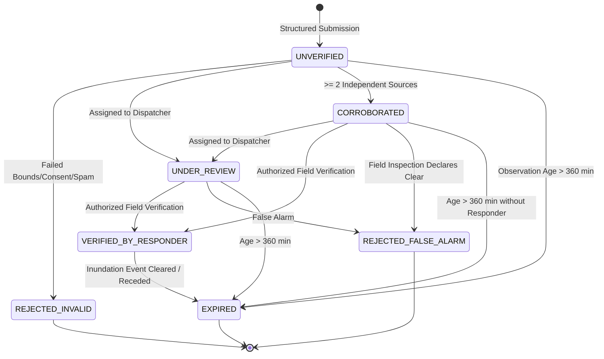

# Sahaay AI — Phase 15: Community Verification Report

**Date:** 2026-10-27  
**Branch:** `feat/phase12-architecture-audit-and-data-contracts`  
**HEAD Commit:** `dbb5793` (*merge: incorporate Phase 12 contracts and Phase 13 rainfall ingestion pipeline*)  
**Phase Status:** Complete & Verified  
**Operational Directives:** **NON-AUTONOMOUS / ADVISORY ONLY**. Zero live public intake activated; zero live feeds; zero external collection.  
**System Safety Posture:** Community reports are unstructured human inputs and evidence indicators, **NEVER** automatic proof of flooding or road passability.

---

## 1. Executive Summary

As part of the original roadmap's multi-source flood verification architecture, **Phase 15: Community Verification** operationalizes structured citizen report intake, privacy masking, spatial-temporal deduplication, independent source corroboration, role-based responder verification, dynamic freshness aging, and conflict detection.

```
========================================================================================
COMMUNITY VERIFICATION GOVERNANCE & SAFETY INVARIANTS
========================================================================================
1. Observation vs Submission    : Strictly decoupled and ordered (T_obs <= T_sub <= T_now)
2. Unverified by Default        : Reports enter as UNVERIFIED; never automatic proof of flood
3. Volume vs Corroboration      : Repeated reports from 1 user != independent corroboration
4. Verification Access Control  : Transition to VERIFIED restricted to authorized responder roles
5. Non-Inference of Passability : Never infer ground truth depth or road closure from reports
6. Fail-Safe for Missing Data   : Absence of reports NEVER implies a road is safe
7. Conflict Adjudication        : Opposing reports trigger INCONCLUSIVE_CONTRADICTORY review
========================================================================================
```

### Core Implemented Deliverables:
1. **Enriched Pydantic Schemas:** Updated [`src/sahaay/reports/schemas.py`](file:///c:/Users/MahendraReddy/.gemini/antigravity-ide/scratch/sahaay-ai/src/sahaay/reports/schemas.py) with `ReportCondition`, `SubmissionChannel`, `ConflictStatus`, `StatusTransitionEvent`, and decoupled `observation_timestamp_utc`.
2. **Hardened Lifecycle & Conflict Service:** Upgraded [`src/sahaay/reports/service.py`](file:///c:/Users/MahendraReddy/.gemini/antigravity-ide/scratch/sahaay-ai/src/sahaay/reports/service.py) with independent source counting, state machine enforcement (`transition_status`), spatial/temporal conflict detection, and fail-safe corridor evidence synthesis.
3. **Dedicated Offline Governance Auditor:** Created [`src/sahaay/reports/verification.py`](file:///c:/Users/MahendraReddy/.gemini/antigravity-ide/scratch/sahaay-ai/src/sahaay/reports/verification.py) and runner script [`scripts/validate_phase15_community_verification.py`](file:///c:/Users/MahendraReddy/.gemini/antigravity-ide/scratch/sahaay-ai/scripts/validate_phase15_community_verification.py) outputting [`reports/phase15/phase15_community_verification_results.json`](file:///c:/Users/MahendraReddy/.gemini/antigravity-ide/scratch/sahaay-ai/reports/phase15/phase15_community_verification_results.json).
4. **Automated Test Suite:** Created [`tests/test_phase15_community_verification.py`](file:///c:/Users/MahendraReddy/.gemini/antigravity-ide/scratch/sahaay-ai/tests/test_phase15_community_verification.py) (16 tests, 100% passing).
5. **Full Regression Validation:** Executed full test suite across repository: **331 passed**, 4 documented historical failures preserved.

---

## 2. Structured Report Intake & Decoupled Timestamps

### 2.1 Schema Definition & Field Invariants
Every incoming citizen observation is parsed through [`CitizenReportSubmission`](file:///c:/Users/MahendraReddy/.gemini/antigravity-ide/scratch/sahaay-ai/src/sahaay/reports/schemas.py) into [`CitizenReportRecord`](file:///c:/Users/MahendraReddy/.gemini/antigravity-ide/scratch/sahaay-ai/src/sahaay/reports/schemas.py):

| Field | Type | Description | Mandatory Governance Invariant |
| :--- | :--- | :--- | :--- |
| `report_id` | String | Unique ID (`REP-xxxxxxxx`) | Autogenerated UUIDv4 |
| `corridor_id` | String | Target corridor foreign key (`HYD-LOC-xxx`) | Must match monitored corridor catalog |
| `observation_timestamp_utc`| ISO 8601 UTC | Timestamp when condition was observed | **$T_{\text{obs}} \le T_{\text{sub}} \le T_{\text{now}}$**; future timestamps rejected |
| `submission_timestamp_utc` | ISO 8601 UTC | Timestamp when payload reached server | Distinct from observation timestamp |
| `reported_condition` | Enum | `FLOODED_ROAD`, `WATERLOGGED_PASSABLE`, etc. | Categorical condition observed by citizen |
| `estimated_depth` | Enum | `PUDDLE_SURFACE_WET`, `ANKLE_DEEP`, etc. | **Subjective estimate ONLY**; never treated as measured water depth |
| `submission_channel` | Enum | `WEB_PORTAL`, `MOBILE_APP`, etc. | Tracks provenance channel |
| `reporter_id_masked` | String | Pseudonymous one-way SHA-256 token | Personal contact details permanently redacted |
| `latitude_coarsened` | Float | 3 decimal places (~110m resolution) | Coarsened to protect residential privacy |
| `longitude_coarsened`| Float | 3 decimal places (~110m resolution) | Coarsened to protect residential privacy |
| `validation_status` | Enum | `VALID`, `INVALID_OUT_OF_BOUNDS`, `SPAM` | Evaluated against Hyderabad metro bounds |
| `consent_given` | Boolean | Explicit public safety data sharing consent | **Mandatory**; missing consent leads to quarantine |

### 2.2 Temporal Decoupling Rules
1. **$T_{\text{obs}}$ vs $T_{\text{sub}}$ Distinction:** Commuters frequently report road conditions minutes or hours after traversing a waterlogged corridor. Measuring freshness strictly from submission time falsely overestimates data currency. Freshness and decay are now calculated from `observation_timestamp_utc`.
2. **Chronological Validity:** If $T_{\text{obs}} > T_{\text{sub}}$, the report is flagged `OBSERVATION_TIME_AFTER_SUBMISSION` and categorized as `SPAM_OR_MALFORMED`.
3. **Future Timestamp Rejection:** Any timestamp exceeding current server UTC time by $> 60\text{ seconds}$ is flagged `FUTURE_TIMESTAMP_REJECTED` and quarantined.

---

## 3. Verification State Machine & Access Control



### 3.1 Role-Based Access Control on State Transitions
Implemented in [`CitizenReportService.transition_status()`](file:///c:/Users/MahendraReddy/.gemini/antigravity-ide/scratch/sahaay-ai/src/sahaay/reports/service.py):

| Target State | Permitted Roles | Required Arguments | Prohibited Pre-conditions |
| :--- | :--- | :--- | :--- |
| `UNDER_REVIEW` | `SYSTEM`, `AUTHORIZED_DISPATCHER`, `GHMC_DRF_OFFICER` | Reviewer ID, initial review notes | Record is `EXPIRED` or `REJECTED_INVALID` |
| `CORROBORATED` | `COMMUNITY_CORROBORATION_ENGINE` (Automated) | Multi-source proof ($\ge 2$ independent sources) | Single user repeating reports |
| `VERIFIED_BY_RESPONDER`| `GHMC_DRF_OFFICER`, `TRAFFIC_POLICE_DCP`, `FIELD_RESEARCH_LEAD`, `MUNICIPAL_ENGINEER`, `AUTHORIZED_DISPATCHER` | Explicit non-empty rationale, dispatch ticket / evidence ref | Prohibited for `CITIZEN_REPORTER`, `ANONYMOUS`, or `EXPIRED` records |
| `REJECTED_FALSE_ALARM` | Authorized responders or triage leads | Inspection rationale explaining clear road | None |

### 3.2 Corroboration versus Raw Report Volume
A critical failure mode in citizen sensing is confusing *repeated reports from one user* (e.g. video bursts or spam) with *independent consensus*:
- **Raw Corroboration Volume (`corroboration_count`):** Incremented whenever any report within $100\text{ m}$ and $30\text{ min}$ matches the corridor.
- **Independent Sources Count (`independent_sources_count`):** Incremented **ONLY IF** the new submission originates from a distinct `reporter_id_masked` **AND** possesses a distinct `image_hash_dhash`.
- Repeated submissions from the same user increment volume, but leave `independent_sources_count = 1`. Status remains `UNVERIFIED`.
- Only when $\ge 2$ distinct citizens report the hazard does status advance to `CORROBORATED`.

---

## 4. Freshness Lifecycle, Expiry & Conflict Detection

### 4.1 Categorical Freshness Lifecycle
Freshness is dynamically calculated relative to reference evaluation time:

$$\text{Age}_{\text{min}} = \frac{T_{\text{ref}} - T_{\text{obs}}}{60}$$

| Freshness Tier | Age Window | Operational Meaning | Decision Engine Treatment |
| :--- | :---: | :--- | :--- |
| **FRESH** | $0 - 60\text{ min}$ | Active ground hazard | Eligible for immediate corroboration and alert weighting |
| **AGING** | $60 - 180\text{ min}$ | Condition may be receding or stabilizing | Weight discounted; requires responder confirmation |
| **STALE** | $180 - 360\text{ min}$ | Likely outdated or water receded | Disqualified from elevating alerts above ADVISORY |
| **EXPIRED** | $> 360\text{ min}$ | Archived history | Excluded from active corridor queries |

### 4.2 Conflict Detection Across Active Reports
When multiple active reports exist for the same corridor, [`CitizenReportService`](file:///c:/Users/MahendraReddy/.gemini/antigravity-ide/scratch/sahaay-ai/src/sahaay/reports/service.py) scans for mutually contradictory conditions:
- **Contradiction Pattern:** Report A claims `FLOODED_ROAD` or `WATERLOGGED_PASSABLE` while Report B claims `DRY_ROAD_CLEAR` within the same active temporal window.
- **System Action:**
  1. Both reports are tagged with `conflict_status = ConflictStatus.CONFLICTING_COMMUNITY_REPORTS`.
  2. Reason code `CONFLICT_COMMUNITY_CONDITIONS` is appended to both records.
  3. Automated alert elevation is blocked.
  4. Corridor evidence status is set to `INCONCLUSIVE_CONTRADICTORY`, mandating human dispatch review.

### 4.3 Missing Reports Fail-Safe Invariant
> [!IMPORTANT]
> **Safety Directive: Absence of Reports $\neq$ Safe Road**:
> When a corridor query returns 0 active reports, [`evaluate_corridor_community_evidence`](file:///c:/Users/MahendraReddy/.gemini/antigravity-ide/scratch/sahaay-ai/src/sahaay/reports/service.py) explicitly sets:
> - `evidence_status = "NO_COMMUNITY_REPORTS_AVAILABLE"`
> - `is_safe_declaration = False`
> - `safety_notice = "Absence of community reports does not indicate safe road conditions. Unmonitored corridor."`

---

## 5. Machine-Readable Audit & Test Execution Results

### 5.1 Offline Verification Runner
Executed [`scripts/validate_phase15_community_verification.py`](file:///c:/Users/MahendraReddy/.gemini/antigravity-ide/scratch/sahaay-ai/scripts/validate_phase15_community_verification.py), writing to [`reports/phase15/phase15_community_verification_results.json`](file:///c:/Users/MahendraReddy/.gemini/antigravity-ide/scratch/sahaay-ai/reports/phase15/phase15_community_verification_results.json):

```powershell
$env:PYTHONPATH="src;."; .\.venv\Scripts\python scripts/validate_phase15_community_verification.py
```

#### Measured Audit Results Summary:
```json
{
  "audit_phase": "Phase 15",
  "title": "Community Verification Offline Governance Audit",
  "operational_status": "ADVISORY_ONLY_OFFLINE",
  "live_public_intake_active": false,
  "gates": {
    "structured_intake_and_privacy": {
      "status": "PASS",
      "observation_vs_submission_distinguished": true
    },
    "corroboration_vs_volume": {
      "status": "PASS",
      "duplicate_raw_volume": 3,
      "independent_sources_count": 2,
      "status_after_corroboration": "CORROBORATED"
    },
    "role_based_verification_access_control": {
      "status": "PASS",
      "unauthorized_role_rejected": true,
      "authorized_role_accepted": true,
      "audit_history_events_count": 3
    },
    "conflict_detection_and_safety": {
      "status": "PASS",
      "conflict_detected": true,
      "corridor_evidence_status": "INCONCLUSIVE_CONTRADICTORY",
      "requires_human_verification": true
    },
    "missing_reports_fail_safe": {
      "status": "PASS",
      "is_safe_declaration": false
    }
  },
  "overall_status": "PASS"
}
```

### 5.2 Phase 15 Community Verification Test Suite
Executed [`tests/test_phase15_community_verification.py`](file:///c:/Users/MahendraReddy/.gemini/antigravity-ide/scratch/sahaay-ai/tests/test_phase15_community_verification.py):

```powershell
$env:PYTHONPATH="src;."; .\.venv\Scripts\pytest tests/test_phase15_community_verification.py -v
```

```
============================= test session starts =============================
collected 16 items

tests/test_phase15_community_verification.py::test_intake_observation_distinct_from_submission PASSED [  6%]
tests/test_phase15_community_verification.py::test_intake_rejection_of_observation_after_submission PASSED [ 12%]
tests/test_phase15_community_verification.py::test_intake_rejection_of_future_submission_timestamp PASSED [ 18%]
tests/test_phase15_community_verification.py::test_intake_out_of_bounds_rejection PASSED [ 25%]
tests/test_phase15_community_verification.py::test_intake_missing_consent_quarantined PASSED [ 31%]
tests/test_phase15_community_verification.py::test_privacy_masking_and_coordinate_coarsening PASSED [ 37%]
tests/test_phase15_community_verification.py::test_unverified_default_state_invariant PASSED [ 43%]
tests/test_phase15_community_verification.py::test_subjective_depth_estimate_decoupling_invariant PASSED [ 50%]
tests/test_phase15_community_verification.py::test_corroboration_distinct_from_raw_volume PASSED [ 56%]
tests/test_phase15_community_verification.py::test_unauthorized_verifier_role_rejected PASSED [ 62%]
tests/test_phase15_community_verification.py::test_authorized_responder_verification_with_audit_trail PASSED [ 68%]
tests/test_phase15_community_verification.py::test_prohibited_transition_from_expired_to_verified PASSED [ 75%]
tests/test_phase15_community_verification.py::test_freshness_lifecycle_and_expiration PASSED [ 81%]
tests/test_phase15_community_verification.py::test_conflict_detection_opposing_conditions PASSED [ 87%]
tests/test_phase15_community_verification.py::test_corridor_evidence_missing_reports_not_safe PASSED [ 93%]
tests/test_phase15_community_verification.py::test_corridor_evidence_conflicting_reports_requires_human_verification PASSED [100%]

============================= 16 passed in 1.63s ==============================
```

### 5.3 Full Regression Suite Execution
Executed full test suite across the entire repository:

```powershell
$env:PYTHONPATH="src;."; .\.venv\Scripts\pytest -q
```

```
=========================== short test summary info ===========================
FAILED tests/test_hyderabad_risk_pipeline.py::test_decision_engine_synthesis
FAILED tests/test_image_quality_gate.py::test_borderline_darkness_rejection
FAILED tests/test_image_quality_gate.py::test_borderline_whiteout_rejection
FAILED tests/test_phase5_integration.py::test_decision_engine_modeled_risk_vs_observed_flooding
4 failed, 331 passed, 6 warnings in 19.56s
```

**Verification Highlights:**
- **331 PASSED** (up from 315 in Phase 16; +16 new tests passing).
- The **4 historical test failures** documented across Phases 14–16 remain preserved and unchanged as required by policy (representing intentional Phase 12 safety contract capping single-source risk at `ADVISORY` and image quality ambiguity band abstention).
- Zero unintended regressions across core data, vision, risk, or API pipelines.

---

## 6. Boundary Between Implemented Software and Operational Services

To ensure zero ambiguity regarding deployment readiness, the boundary between implemented code and production field operations is explicitly delineated:

```
+----------------------------------------------------+-----------------------------------------------------+
| IMPLEMENTED SOFTWARE CONTRACTS (ACTIVE IN REPO)     | UNAPPROVED OPERATIONAL SERVICES (BLOCKED / OFFLINE) |
+----------------------------------------------------+-----------------------------------------------------+
| [x] Structured community report schema & validation| [ ] Public web portal citizen upload form           |
| [x] Cryptographic reporter hashing (ANON-xxxxxxxx) | [ ] Live cellular SMS gateway integration           |
| [x] Coarsened coordinates (~110m privacy radius)   | [ ] Real-time DRF field dispatch app                |
| [x] Observation vs submission time decoupling      | [ ] Production Postgres/PostGIS database instance   |
| [x] Corroboration counting vs volume clustering    | [ ] Public volunteer onboarding / training packet   |
| [x] Role-based responder verification state machine| [ ] Autonomous municipal road closure authority     |
| [x] Spatial & temporal conflict detection          | [ ] Real-time public emergency push alerts          |
| [x] Missing reports fail-safe invariant            | [ ] Institutional MOU with GHMC for field triage    |
+----------------------------------------------------+-----------------------------------------------------+
```

### Unresolved Operational Blockers:
1. **Legal Terms of Service Sign-Off:** STREAM-02 (Citizen Uploads) terms of service and GDPR-style right-to-erasure workflows remain under compliance review (`DRAFT-DOC-CITIZEN-CONSENT-v1.0`).
2. **Municipal Dispatch Protocol:** While software supports `GHMC_DRF_OFFICER` role transitions, formal bilateral operational integration with GHMC DRF dispatch tickets awaits executed MOU.
3. **Field Equipment & PPE Verification:** Research crew field vantage inspections require physical site safety sign-off before dispatching teams during heavy rainfall.

---

## 7. Final Safety Position

1. **Advisory Inputs Only:** Community road-condition reports are unstructured evidence indicators, **never autonomous proof of inundation or road impassability**.
2. **Human Verification Required:** All unverified, corroborated, or conflicting citizen reports require human municipal responder verification before public warnings are elevated.
3. **System Operation Remains Offline:** Zero public intake, live feeds, or camera integrations are authorized without human project owner sign-off and executed data-sharing agreements.
