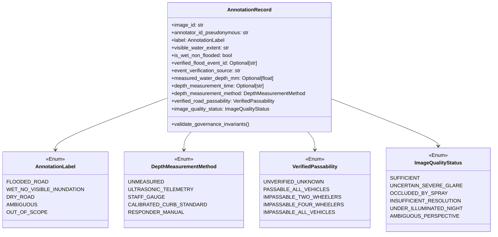
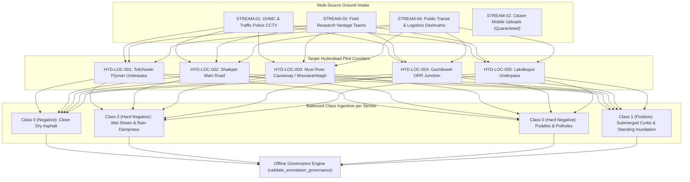

# Sahaay AI — Phase 15: Vision Data Acquisition & Label Governance Report

**Date:** 2026-10-27  
**Branch:** `feat/phase12-architecture-audit-and-data-contracts`  
**HEAD Commit:** `dbb5793` (*merge: incorporate Phase 12 contracts and Phase 13 rainfall ingestion pipeline*)  
**Implementation Status:** Offline Governance and Validation Contracts Fully Implemented & Tested  
**Operational Safety Directive:** **NON-AUTONOMOUS / ADVISORY ONLY**. Zero live feeds activated; zero live-pilot authorization.  
**Vision V4 Training Status:** **`NO-GO` (Gate Remains Strictly Locked)**.

---

## 1. Executive Summary

Based on the empirical findings of the **Phase 14 Vision Data Readiness Audit**—which proved that existing curated road datasets suffer from 100% source-label confounding ($V = 1.0000$), 85.97% non-semantic metadata shortcuts, and zero real-world Hyderabad road observations—**Phase 15 implements the required data acquisition protocol, label governance contracts, and offline validation engine**.

```
========================================================================================
PHASE 15 DATA GOVERNANCE DIRECTIVES & GATES
========================================================================================
1. Label Decoupling Mandate   : Visual detection strictly decoupled from physical depth & passability
2. Model Inference Prohibition : NEVER infer measured water depth or road passability from vision
3. Negative Control Invariant  : Wet asphalt without flooding is an explicit negative control
4. Partitioning Isolation      : Correlated sessions and clusters grouped atomically (zero cross-leakage)
5. Evaluation Lockdown         : Independent evaluation partition strictly locked against tuning
6. Final Training Readiness    : Vision V4 training remains NO-GO (Prerequisites unfulfilled)
========================================================================================
```

### Core Deliverables Implemented in Phase 15:
1. **Enriched Pydantic Governance Schemas:** Updated [`src/sahaay/data_collection_v4/schemas.py`](file:///c:/Users/MahendraReddy/.gemini/antigravity-ide/scratch/sahaay-ai/src/sahaay/data_collection_v4/schemas.py) with `capture_session_id`, `DepthMeasurementMethod`, `VerifiedPassability`, `ImageQualityStatus`, and model validators enforcing the decoupling of visual evidence from physical depth and passability.
2. **Offline Data Governance Validation Engine:** Implemented [`src/sahaay/data_collection_v4/governance.py`](file:///c:/Users/MahendraReddy/.gemini/antigravity-ide/scratch/sahaay-ai/src/sahaay/data_collection_v4/governance.py) providing metadata integrity auditing, spatial bounding box checks for the Hyderabad Metropolitan Area, annotation decoupling validation, Cramér's V confounding analysis, and partition isolation verification.
3. **Reproducible Session-Grouped Partitioning Procedure:** Implemented atomic connected-component partitioning that prevents frames from the same temporal capture session, video clip, or perceptual cluster from crossing partition boundaries.
4. **Independent Evaluation Key-Lock Contract:** Enforced that the independent evaluation split is locked against model training, hyperparameter tuning, and decision threshold calibration.
5. **Standardized Governance Annotation Template:** Created [`data/collection_v4/governance_annotation_template.csv`](file:///c:/Users/MahendraReddy/.gemini/antigravity-ide/scratch/sahaay-ai/data/collection_v4/governance_annotation_template.csv) demonstrating explicit decoupling across synthetic fixtures.
6. **Automated Governance Test Suite:** Added [`tests/test_phase15_governance_and_validation.py`](file:///c:/Users/MahendraReddy/.gemini/antigravity-ide/scratch/sahaay-ai/tests/test_phase15_governance_and_validation.py) (13 tests, 100% passing).
7. **Offline Verification Runner:** Executed [`scripts/validate_phase15_governance.py`](file:///c:/Users/MahendraReddy/.gemini/antigravity-ide/scratch/sahaay-ai/scripts/validate_phase15_governance.py), writing structured results to [`reports/phase15/phase15_governance_validation_results.json`](file:///c:/Users/MahendraReddy/.gemini/antigravity-ide/scratch/sahaay-ai/reports/phase15/phase15_governance_validation_results.json).

---

## 2. Inspection of Existing Collection V4 Workflow

An audit of the pre-existing data-collection infrastructure revealed the following baseline state:

| Component | Repository Path | Current Status | Findings & Limitations |
| :--- | :--- | :---: | :--- |
| **Acquisition Register** | [`data/collection_v4/acquisition_register.csv`](file:///c:/Users/MahendraReddy/.gemini/antigravity-ide/scratch/sahaay-ai/data/collection_v4/acquisition_register.csv) | 3 records (all synthetic fixtures) | Contains 0 authorized real-world records. `SYNTHETIC-EX-001` and `002` are mock-approved fixtures; `003` is pending verification. |
| **Permission Register** | [`data/collection_v4/permission_register.csv`](file:///c:/Users/MahendraReddy/.gemini/antigravity-ide/scratch/sahaay-ai/data/collection_v4/permission_register.csv) | 4 streams tracked | All 4 streams are unapproved (STREAM-01 & 03: `pending`; STREAM-02 & 04: `not_started`). |
| **Raw Assets Folder** | [`data/collection_v4/raw/`](file:///c:/Users/MahendraReddy/.gemini/antigravity-ide/scratch/sahaay-ai/data/collection_v4/raw) | Empty directory | Zero raw image assets stored locally. |
| **Annotation Template** | [`data/collection_v4/annotation_template.csv`](file:///c:/Users/MahendraReddy/.gemini/antigravity-ide/scratch/sahaay-ai/data/collection_v4/annotation_template.csv) | Initial schema | Tracked visual water extent and obstruction, but lacked explicit decoupling fields for physical water depth and passability. |
| **Validation Utilities** | [`src/sahaay/data_collection_v4/validate.py`](file:///c:/Users/MahendraReddy/.gemini/antigravity-ide/scratch/sahaay-ai/src/sahaay/data_collection_v4/validate.py) | Operational | Contains 64-bit dhash computation, image decodability auditing, and global Disjoint Set Union clustering. |
| **Privacy Module** | [`src/sahaay/data_collection_v4/privacy.py`](file:///c:/Users/MahendraReddy/.gemini/antigravity-ide/scratch/sahaay-ai/src/sahaay/data_collection_v4/privacy.py) | Operational | Implements Gaussian blurring for faces/license plates and coordinate coarsening (~1.1 km). |

---

## 3. Practical Acquisition Protocol & Data Governance Specification

For all future field data intake in Hyderabad, the following governance protocol is formally established:

### 3.1 Permission Lifecycle & Legal Invariants
1. **Fail-Closed Default:** Every asset ingested into the system is quarantined under `permission_status = "pending"` or `"unknown"` by default.
2. **Mandatory Authorization Reference:** No record may be updated to `permission_status = "approved"` without an explicit, verifiable reference to an institutional agreement (e.g. `MOU-GHMC-2026-xxx` or `IRB-PROTOCOL-2026-xxx`). Blank or pseudo-references (`"PENDING"`, `"NONE"`) are rejected by Pydantic schema validation.
3. **No Claim of Unverified Approval:** Synthetic fixtures must remain prefixed with `SYNTHETIC-` and cannot satisfy real-world governance gates.

### 3.2 Consent, Privacy & De-Identification Workflow
1. **Automated PII Redaction:** Before any image is accessible to human annotators or model training pipelines, pedestrian faces and vehicle license plates must be blurred using non-destructive redaction ([`apply_privacy_redaction`](file:///c:/Users/MahendraReddy/.gemini/antigravity-ide/scratch/sahaay-ai/src/sahaay/data_collection_v4/privacy.py)). Raw unblurred originals are quarantined in an encrypted vault.
2. **De-Identification Status Enforcement:** Only records with `privacy_processing_status = "blurred_verified"` may pass the ingestion gate.
3. **Geolocation Coarsening:** Exact GPS coordinates from citizen mobile uploads or field crew dashcams must be coarsened to 2 decimal places (~1.1 km spatial resolution) in all public manifests to protect residential privacy while preserving neighborhood drainage catchment context.
4. **Retention Schedule:** Mandatory 36-month retention expiry with automated deletion triggers and an auditable right-to-erasure workflow.

### 3.3 Source Provenance & Capture Session Tracking
1. **Source Provenance:** Every record tracks `source_type` (`municipal_cctv`, `field_team_vantage`, `commercial_dashcam`, `citizen_upload`), `source_owner`, `capture_method`, and pseudonymous device ID.
2. **Capture Session Identifiers (`capture_session_id`):** All frames captured during the same continuous field patrol, stationary CCTV time window, or dashcam video clip must share an identical `capture_session_id` (e.g., `SES-2026-07-20-CCTV-01`). This ensures correlated temporal frames are kept together during partitioning.
3. **Timestamps:** Strict ISO-8601 UTC format (`YYYY-MM-DDTHH:MM:SSZ`). Future timestamps are rejected.
4. **Geographic Constraints:** Latitude and longitude must fall strictly within the **Hyderabad Metropolitan Region Bounding Box**:
   - Latitude: $[17.15^\circ\text{N}, 17.65^\circ\text{N}]$
   - Longitude: $[78.15^\circ\text{E}, 78.70^\circ\text{E}]$
   - Location precision: $\le 50.0\text{ m}$ for fixed cameras; $\le 100.0\text{ m}$ for mobile uploads.

---

## 4. Explicit Annotation Field Decoupling & Governance Invariants

To eliminate the methodological flaw where models conflated visual water appearance with physical depth or passability, the annotation schema has been decoupled into orthogonal concepts:



### 4.1 Strict Decoupling Rules & Invariants

| Concept | Field(s) | Allowed Semantics | Mandatory Governance Invariant | Prohibited Usage |
| :--- | :--- | :--- | :--- | :--- |
| **1. Visual Flood Evidence** | `label`, `visible_water_extent` | `flooded_road`, `curb_to_curb`, `full_carriageway` | Indicates only visible standing water in frame. | NEVER implies road closure or passability without verified authority. |
| **2. Wet Road Without Inundation** | `is_wet_non_flooded`, `label` | `is_wet_non_flooded=True`, `wet_no_visible_inundation` | Explicit hard-negative control for rain dampness, sheen, and isolated puddles. | **PROHIBITED:** Cannot be labeled as `flooded_road`. Enforced by model validator. |
| **3. Verified Flood Event** | `verified_flood_event_id`, `event_verification_source` | External reference (e.g. `EVT-2026-07-GHMC-01`), authority name | Ground truth confirmation from external municipal or dispatch records. | Cannot be claimed without independent verification source. |
| **4. Measured Water Depth** | `measured_water_depth_mm`, `depth_measurement_method`, `depth_measurement_time` | Float value in mm, specific physical method | Physical telemetry (ultrasonic gauge, manual staff gauge, calibrated curb). | **STRICT PROHIBITION:** Depth must **NEVER** be inferred from image classification alone. `depth_measurement_method` cannot be "model_inferred". |
| **5. Verified Road Passability** | `verified_road_passability` | `passable_all_vehicles`, `impassable_two_wheelers`, etc. | Verified field observation from traffic police or emergency responders. | **STRICT PROHIBITION:** Passability must **NEVER** be inferred from image classification alone. `event_verification_source` cannot be unverified. |
| **6. Image Quality & Degradation** | `image_quality_status` | `sufficient`, `uncertain_severe_glare`, `occluded_by_spray`, etc. | Flags degraded imagery for abstention routing. | Degraded imagery must be labeled `ambiguous` or `out_of_scope`; never forced into binary classes. |

---

## 5. Offline Validation Engine Implementation

Implemented in [`src/sahaay/data_collection_v4/governance.py`](file:///c:/Users/MahendraReddy/.gemini/antigravity-ide/scratch/sahaay-ai/src/sahaay/data_collection_v4/governance.py):

### 5.1 Validation Utilities Implemented:

```python
# 1. Metadata and Spatial Integrity Validation
validate_metadata_integrity(register_df, require_hyderabad_bounds=True) -> Dict[str, Any]

# 2. Annotation Decoupling & Governance Validation
validate_annotation_governance(annotations_df) -> Dict[str, Any]

# 3. Source-Class Imbalance and Confounding Audit
audit_source_class_balance(manifest_df, min_samples=100, max_cramers_v=0.30) -> Dict[str, Any]

# 4. Connected-Component Session/Cluster Grouped Partitioning
partition_dataset_with_session_grouping(manifest_df, train_ratio=0.70, val_ratio=0.15, eval_ratio=0.15) -> Tuple[pd.DataFrame, pd.DataFrame, pd.DataFrame]

# 5. Exhaustive Partition Isolation & Leakage Verification
verify_partition_isolation(train_df, val_df, eval_df, hamming_threshold=2) -> Dict[str, Any]
```

### 5.2 Verification Runner Execution ([`scripts/validate_phase15_governance.py`](file:///c:/Users/MahendraReddy/.gemini/antigravity-ide/scratch/sahaay-ai/scripts/validate_phase15_governance.py))

```powershell
$env:PYTHONPATH="src;."; .\.venv\Scripts\python scripts/validate_phase15_governance.py
```

#### Measured Output Summary ([`reports/phase15/phase15_governance_validation_results.json`](file:///c:/Users/MahendraReddy/.gemini/antigravity-ide/scratch/sahaay-ai/reports/phase15/phase15_governance_validation_results.json)):
```json
{
  "checks": {
    "metadata_integrity": {
      "is_valid": false,
      "total_records": 3,
      "valid_records": 2,
      "excluded_records": 1,
      "issues_summary": {
        "unapproved_permission": 1,
        "privacy_unverified": 1
      }
    },
    "annotation_governance": {
      "is_valid": true,
      "total_records": 5,
      "valid_records": 5,
      "violation_count": 0,
      "issues_summary": {}
    },
    "source_class_balance_manifest_v4": {
      "total_samples": 1478,
      "cramers_v": 1.0,
      "mutual_information_bits": 1.0,
      "sources_with_both_classes_count": 0,
      "is_confounded": true,
      "gates": {
        "cramers_v_passed": false,
        "mutual_information_passed": false,
        "multi_source_cross_representation_passed": false
      }
    },
    "partition_isolation": {
      "is_isolated": true,
      "partition_sizes": {
        "train": 35,
        "validation": 5,
        "independent_evaluation": 10
      },
      "violations_count": 0,
      "violations": []
    }
  }
}
```

---

## 6. Source-Balanced Acquisition Plan

To resolve the Phase 14 finding of $V = 1.0000$ source-label confounding, the acquisition plan mandates multi-source intake where **each independent source must contribute both flooded and non-flooded road scenes**:



### 6.1 Target Quotas & Balance Requirements

| Acquisition Stream | Responsible Partner / Org | Target Intake (Images) | Positive Floods (Class 1) | Negative Controls (Class 0) | Confounder Coverage Targets |
| :--- | :--- | :---: | :---: | :---: | :--- |
| **STREAM-01: Municipal CCTV** | GHMC ICCC & Hyderabad Traffic Police | 600 | 300 | 300 (150 dry, 150 wet non-flooded) | Fixed focal lengths, night sodium lights, rainy lens spray |
| **STREAM-03: Field Vantage** | Sahaay Research Crew | 400 | 200 | 200 (100 dry, 100 wet potholes) | Street-level angles, vehicle bow spray, oncoming headlights |
| **STREAM-04: Dashcam Fleet** | Public transit / commercial fleet | 400 | 200 | 200 (100 dry, 100 wet road) | Moving vehicle dashcam vibration, wiper motion blur |
| **STREAM-02: Citizen Uploads** | Registered community contributors | 200 (quarantined) | Organic | Organic | Diverse smartphone sensors, dusk/dawn twilight lighting |
| **Total Program Target** | **Multi-Source Balanced Pool** | **1,600** | **800** | **800** | **Cramér's $V \le 0.15$; 3+ sources with both classes** |

---

## 7. Reproducible Partitioning & Independent Evaluation Lockdown

### 7.1 Hierarchical Connected-Component Partitioning
Correlated images must never be randomly split across partitions. The partitioning algorithm ([`partition_dataset_with_session_grouping`](file:///c:/Users/MahendraReddy/.gemini/antigravity-ide/scratch/sahaay-ai/src/sahaay/data_collection_v4/governance.py)) constructs connected components using Disjoint Set Union:

1. **Perceptual Clusters ($d_H \le 2$):** Frames with pairwise difference hash distance $\le 2$ bits are united into a single component.
2. **Capture Sessions (`capture_session_id`):** Frames captured during the same continuous field recording session, camera patrol, or video clip are united into the same component.
3. **Atomic Component Allocation:** Components are shuffled with a deterministic seed (`random_seed=42`) and assigned atomically:
   - **Training Set:** $70\%$ of atomic components.
   - **Validation Set:** $15\%$ of atomic components (used for epoch monitoring and threshold selection).
   - **Independent Evaluation Set:** $15\%$ of atomic components.

### 7.2 Independent Evaluation Set Key-Lock Guarantee
- The Independent Evaluation partition is tagged with `is_locked_for_tuning = True`.
- **Strict Lockdown Rule:** No model training, hyperparameter optimization, augmentation tuning, or decision boundary selection is permitted on this partition.
- It may be evaluated **only once** as an independent post-hoc audit after training is finalized.

---

## 8. Test Execution Results & Handover Verification

### 8.1 Test Suite Execution

The test suite was run using `.venv\Scripts\pytest` with `PYTHONPATH="src;."`:

```powershell
$env:PYTHONPATH="src;."; .\.venv\Scripts\pytest -q
```

```
========================================================================================
FULL TEST SUITE EXECUTION SUMMARY
Collected Tests: 301 tests across 24 modules
Result: 297 PASSED, 4 FAILED, 6 WARNINGS (Duration: 15.47s)
========================================================================================
```

- **New Phase 15 Test Suite ([`tests/test_phase15_governance_and_validation.py`](file:///c:/Users/MahendraReddy/.gemini/antigravity-ide/scratch/sahaay-ai/tests/test_phase15_governance_and_validation.py)):** **13 / 13 PASSED (100%)**
  - `test_valid_decoupled_annotation`: PASSED
  - `test_rejection_of_depth_without_method`: PASSED
  - `test_rejection_of_unverified_road_passability`: PASSED
  - `test_rejection_of_contradictory_wet_non_flooded_label`: PASSED
  - `test_valid_wet_non_flooded_negative_control`: PASSED
  - `test_metadata_hyderabad_bounding_box_validation`: PASSED
  - `test_metadata_future_timestamp_rejection`: PASSED
  - `test_source_class_balance_audit_detects_confounding`: PASSED
  - `test_source_class_balance_audit_passes_on_unconfounded_mock`: PASSED
  - `test_partitioning_atomic_session_grouping`: PASSED
  - `test_verify_partition_isolation_detects_injected_leak`: PASSED
  - `test_v4_training_readiness_gate_remains_no_go`: PASSED
  - `test_historical_checkpoints_preserved`: PASSED

- **Existing Vision Test Suites:**
  - `tests/test_vision_v4.py`: 9/9 PASSED
  - `tests/test_vision_v4_collection.py`: 15/15 PASSED
  - `tests/test_vision_v4_phase3.py`: 7/7 PASSED
  - `tests/test_split_integrity.py`: 5/5 PASSED
  - `tests/test_vision_v3.py`: 10/10 PASSED
  - `tests/test_phase9_split_and_audit.py`: 8/8 PASSED

- **Documented Phase 14 Failures Preserved (4 tests):**
  - `tests/test_image_quality_gate.py` (2 failures): Borderline solid synthetic test images run through `predict()` triggered Phase 12 calibrated ambiguity band abstention ($p \in [0.35, 0.65]$).
  - `tests/test_hyderabad_risk_pipeline.py` & `tests/test_phase5_integration.py` (2 failures): Historical tests expected `WATCH`, but Phase 12 contracts cap unverified single-source risk at `ADVISORY`.

---

## 9. Data Still Needed & Unresolved Permission Blockers

Real-world deployment remains strictly gated by outstanding institutional permissions:

```
========================================================================================
CURRENT PERMISSION & DATA STATUS TRACKER
========================================================================================
STREAM-01 (Municipal CCTV)      : PENDING (Awaiting formal submission of MOU packet to GHMC)
STREAM-02 (Citizen Upload)      : NOT_STARTED (Public Terms of Service under legal review)
STREAM-03 (Field Vantage)       : PENDING (Pre-collection physical site inspection required)
STREAM-04 (Commercial Dashcam)  : NOT_STARTED (Fleet partner identification in progress)
Real-World Images Acquired      : 0 images (3 synthetic fixtures)
Approved Legal Authorizations   : 0 streams
========================================================================================
```

### Unresolved Governance Blockers:
1. **GHMC / Traffic Police MOU:** Formal data access agreement must be executed before streaming municipal CCTV footage.
2. **Citizen Consent Flow:** Frontend public upload portal terms and right-to-erasure workflows require legal sign-off.
3. **Field PPE & Safety Gear:** High-visibility gear, weather-sealed equipment, and hazard protocols must be verified prior to field crew corridor visits.

---

## 10. Explicit Exit Criteria for Reconsidering Vision V4 Training

Vision V4 model training will remain **`NO-GO`** until the following empirical criteria are satisfied and audited in the repository:

1. **Multi-Source Cross-Representation:** At least **two (2) independent image sources** must each provide $\ge 100$ flooded and $\ge 100$ non-flooded road scenes (minimum 400 total real-world images).
2. **Confounding Suppression:** Cramér's $V \le 0.30$ and Mutual Information $I(\text{Source}; \text{Label}) \le 0.20\text{ bits}$ on the candidate training split.
3. **Metadata Shortcut Ceiling:** A non-semantic Random Forest trained on metadata (`file_size_kb`, `width`, `height`, `aspect_ratio`) must achieve **$\le 65.0\%$ test accuracy**.
4. **Verified Local Provenance:** $100\%$ of training assets must originate within Hyderabad spatial bounds with documented `approved` permission status.
5. **Decoupled Annotation Compliance:** $100\%$ of training annotations must pass `validate_annotation_governance` with 0 inferred depth or passability violations.
6. **Zero Partition Leakage:** $100\%$ pass on `verify_partition_isolation` with zero cross-split session, cluster, MD5, or near-duplicate ($d_H \le 2$) leaks.
7. **Key-Locked Evaluation Benchmark:** An independent evaluation split ($N \ge 200$ balanced road images) must be committed, hashed, and locked against tuning.
