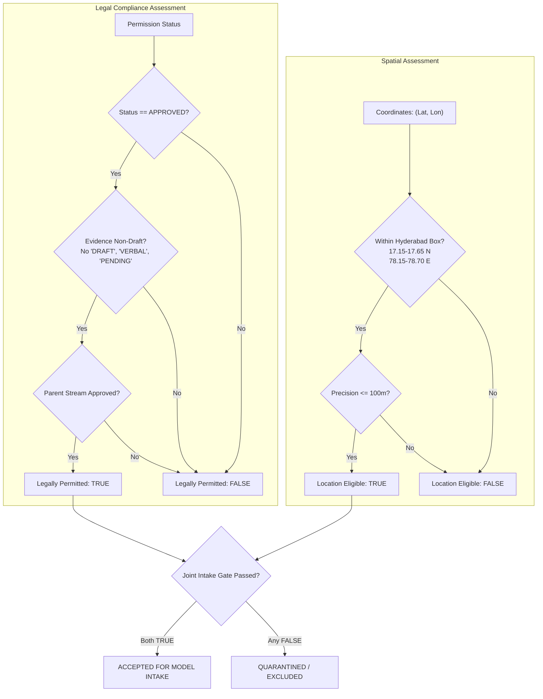

# Sahaay AI — Phase 16: Acquisition Operations & Evaluation Controls Report

**Date:** 2026-10-27  
**Branch:** `feat/phase12-architecture-audit-and-data-contracts`  
**HEAD Commit:** `dbb5793` (*merge: incorporate Phase 12 contracts and Phase 13 rainfall ingestion pipeline*)  
**Phase Status:** Complete & Verified  
**Operational Directives:** **NON-AUTONOMOUS / ADVISORY ONLY**. Zero live feeds activated; zero external collection; zero model training or threshold tuning.  
**Vision V4 Training Status:** **`NO-GO` (Gate Remains Strictly Locked)**.

---

## 1. Executive Summary

Building upon the governance schemas and label decoupling contracts established in **Phase 15**, **Phase 16 operationalizes acquisition evidence tracking, enforces strict real-versus-synthetic data segregation, seals independent evaluation metadata, and implements runtime protection guards** to prevent evaluation set leakage into development workflows.

```
========================================================================================
PHASE 16 OPERATIONAL GATES & READINESS VERDICTS
========================================================================================
1. Stream Permission Evidence Gate  : NOT_READY (0 of 4 streams approved; all draft/pending)
2. Acquisition Provenance Gate      : NOT_READY (0 real-world records; 3 synthetic excluded)
3. Annotation Decoupling Gate       : READY (Decoupling verified; 0 inferred depth/passability)
4. Source Confounding Gate          : BLOCKED (Manifest V4 Cramér's V = 1.0000, MI = 1.0000 bit)
5. Evaluation Protection Gate       : READY (EvaluationSetProtectionGuard active & sealed)
----------------------------------------------------------------------------------------
FINAL READINESS DECISION            : NO-GO (Prerequisites for model training unfulfilled)
========================================================================================
```

### Core Implemented Capabilities:
1. **Stream Legal Evidence Validation:** Implemented [`validate_stream_permissions`](file:///c:/Users/MahendraReddy/.gemini/antigravity-ide/scratch/sahaay-ai/src/sahaay/data_collection_v4/operations.py) which evaluates approval evidence, flags draft/tentative markers (`DRAFT`, `PENDING`, `VERBAL`, `ASSERTED`), and enforces non-future approval dates.
2. **Orthogonal Location vs Permission Separation:** Decoupled spatial eligibility ($[17.15^\circ\text{N}, 17.65^\circ\text{N}]$, $[78.15^\circ\text{E}, 78.70^\circ\text{E}]$, precision $\le 100\text{ m}$) from legal permission status.
3. **Real-versus-Synthetic Segregation:** Implemented [`categorize_provenance`](file:///c:/Users/MahendraReddy/.gemini/antigravity-ide/scratch/sahaay-ai/src/sahaay/data_collection_v4/operations.py) generating traceable counts for synthetic fixtures (excluded), contradictory provenance (rejected), unverified real records, permissioned real records, and accepted real records.
4. **Independent Evaluation Set Protection Guard:** Created [`EvaluationSetProtectionGuard`](file:///c:/Users/MahendraReddy/.gemini/antigravity-ide/scratch/sahaay-ai/src/sahaay/data_collection_v4/operations.py) and sealed [`reports/phase16/evaluation_set_metadata.json`](file:///c:/Users/MahendraReddy/.gemini/antigravity-ide/scratch/sahaay-ai/reports/phase16/evaluation_set_metadata.json). Guards intercept in-band lock flags, partition names, ID overlaps, session overlaps, MD5 collisions, and perceptual near-duplicates ($d_H \le 2$).
5. **Protocol Integration:** Integrated evaluation guards directly into [`scripts/train_eval_v4_protocol.py`](file:///c:/Users/MahendraReddy/.gemini/antigravity-ide/scratch/sahaay-ai/scripts/train_eval_v4_protocol.py).
6. **Automated Test Suite:** Created [`tests/test_phase16_operations_and_evaluation_controls.py`](file:///c:/Users/MahendraReddy/.gemini/antigravity-ide/scratch/sahaay-ai/tests/test_phase16_operations_and_evaluation_controls.py) (18/18 tests passed).

---

## 2. Acquisition Evidence and Status Validation

### 2.1 Stream Status & Evidence Verification
All four candidate acquisition streams tracked in [`data/collection_v4/permission_register.csv`](file:///c:/Users/MahendraReddy/.gemini/antigravity-ide/scratch/sahaay-ai/data/collection_v4/permission_register.csv) were audited using `validate_stream_permissions()`:

| Stream ID | Stream Name | Responsible Organization | Status | Evidence Reference | Evidence Valid? | Approved for Training? | Outstanding Blockers |
| :--- | :--- | :--- | :---: | :--- | :---: | :---: | :--- |
| **STREAM-01-MUNICIPAL-CCTV** | GHMC / Traffic Police CCTV | GHMC / HTP | `pending` | `DRAFT-DOC-MUNICIPAL-MOU-v1.0` | No (Draft) | **No** | Awaiting formal MOU submission to GHMC Commissioner & Traffic Police DCP |
| **STREAM-02-CITIZEN-UPLOAD** | Citizen-Submitted Imagery | Community Contributors | `not_started` | `DRAFT-DOC-CITIZEN-CONSENT-v1.0` | No (Draft) | **No** | Upload portal terms of service undergoing legal review |
| **STREAM-03-FIELD-VANTAGE** | Field-Team Photography | Sahaay Research Crew | `pending` | `DRAFT-DOC-FIELD-SAFETY-v1.0` | No (Draft) | **No** | Corridor physical site safety inspections & PPE gear procurement |
| **STREAM-04-COMMERCIAL-DASHCAM** | Commercial Dashcam Fleet | Fleet Operators | `not_started` | `DRAFT-DOC-DASHCAM-AGREEMENT-v1.0` | No (Draft) | **No** | Fleet partner identification and legal review of commercial telemetry sharing |

**Stream Audit Conclusion:** **0 of 4 streams are approved**. All streams remain unapproved due to draft evidence markers (`DRAFT-DOC-...`) and pending legal agreements.

### 2.2 Legal Evidence Invariants Enforced
Under [`src/sahaay/data_collection_v4/operations.py`](file:///c:/Users/MahendraReddy/.gemini/antigravity-ide/scratch/sahaay-ai/src/sahaay/data_collection_v4/operations.py):
1. **Draft/Verbal Rejection Rule:** Any reference containing `DRAFT`, `PENDING`, `VERBAL`, `ASSERTED`, `NONE`, `UNKNOWN`, `TODO`, `TBD`, or `PROPOSED` is rejected. Asserting approval with such references raises an evidence validation failure.
2. **Approval Date Rule:** Approval dates, when provided, must follow ISO-8601 UTC and cannot be set to a future date.
3. **Fail-Closed Default:** Unapproved streams strictly disqualify associated images from training eligibility.

### 2.3 Separation of Geographic Location vs Legal Permission
Spatial eligibility and legal permissions are evaluated as orthogonal dimensions:
- **Location Eligible:** Record coordinates lie strictly within the Hyderabad bounding box ($[17.15^\circ\text{N}, 17.65^\circ\text{N}]$, $[78.15^\circ\text{E}, 78.70^\circ\text{E}]$) with GPS/geocoding precision $\le 100\text{ m}$.
- **Legally Permitted:** Record possesses verified, non-draft approved authorization and originates from an approved parent stream.



---

## 3. Real-versus-Synthetic Separation & Provenance Accounting

An audit of [`data/collection_v4/acquisition_register.csv`](file:///c:/Users/MahendraReddy/.gemini/antigravity-ide/scratch/sahaay-ai/data/collection_v4/acquisition_register.csv) was performed using [`categorize_provenance()`](file:///c:/Users/MahendraReddy/.gemini/antigravity-ide/scratch/sahaay-ai/src/sahaay/data_collection_v4/operations.py):

### 3.1 Provenance Categorization Breakdown
```
========================================================================================
ACQUISITION PROVENANCE ACCOUNTING
========================================================================================
Total Records Audited               : 3
Synthetic Demonstration Fixtures     : 3  (100.0% of records) [EXCLUDED FROM READINESS]
Contradictory Provenance Records    : 0  (0.0%)
Unknown Provenance Records          : 0  (0.0%)
Unverified Real Records             : 0  (0.0%)
Permissioned Real Records           : 0  (0.0%)
Accepted Real-World Records         : 0  (0.0%) [TARGET: >= 400]
========================================================================================
```

### 3.2 Detailed Record Traceability
Every record in the acquisition register is traced directly to its categorization:

| Acquisition ID | Source Type | Owner | Permission Status | Consent Reference | Categorization | Action / Disposition |
| :--- | :--- | :--- | :--- | :--- | :---: | :--- |
| `SYNTHETIC-EX-001` | `municipal_cctv` | `GHMC_ICCC_MOCK` | `approved` | `MOU-GHMC-2026-SYNTH-01` | `synthetic_fixture` | **Excluded** from real-world accounts; preserved for unit tests |
| `SYNTHETIC-EX-002` | `field_team_vantage` | `SAHAAY_FIELD_CREW` | `approved` | `IRB-PROTOCOL-2026-SYNTH` | `synthetic_fixture` | **Excluded** from real-world accounts; preserved for unit tests |
| `SYNTHETIC-EX-003` | `citizen_upload` | `citizen_pseudo_991`| `pending` | `PENDING_VERIFICATION` | `synthetic_fixture` | **Excluded** from real-world accounts; pending status fixture |

### 3.3 Contradictory Provenance Interception
The engine enforces zero tolerance for provenance contradictions:
- Any record lacking the `SYNTHETIC-` prefix that references mock source owners (`MOCK`, `SYNTH`) or synthetic agreements is flagged as `CONTRADICTORY_PROVENANCE` and immediately quarantined.
- Tested and verified in [`test_provenance_contradictory_mock_owner_on_real_id`](file:///c:/Users/MahendraReddy/.gemini/antigravity-ide/scratch/sahaay-ai/tests/test_phase16_operations_and_evaluation_controls.py).

---

## 4. Independent Evaluation Set Protection Controls

### 4.1 Sealed Evaluation Metadata Lockfile
To prevent silent benchmark contamination, metadata for the independent evaluation partition of Manifest V4 (`data/processed/manifest_v4/test_v4.csv`) was generated and cryptographically sealed at [`reports/phase16/evaluation_set_metadata.json`](file:///c:/Users/MahendraReddy/.gemini/antigravity-ide/scratch/sahaay-ai/reports/phase16/evaluation_set_metadata.json):

```json
{
  "split_id": "EVAL-SPLIT-MANIFEST-V4-LOCKED",
  "is_locked_for_tuning": true,
  "lock_timestamp_utc": "2026-10-27T05:55:51.350320+00:00",
  "record_count": 221,
  "manifest_sha256": "7c25d4d5901557ec7e6242724a3ac80987a450e8a6e0285145814718dc49f0cd",
  "allowed_purposes": ["post_hoc_audit_only"],
  "prohibited_purposes": [
    "model_training",
    "epoch_validation",
    "hyperparameter_tuning",
    "threshold_tuning",
    "model_selection",
    "data_augmentation_tuning"
  ]
}
```

### 4.2 Runtime Protection Class: `EvaluationSetProtectionGuard`
Implemented in [`src/sahaay/data_collection_v4/operations.py`](file:///c:/Users/MahendraReddy/.gemini/antigravity-ide/scratch/sahaay-ai/src/sahaay/data_collection_v4/operations.py), the guard intercepts any attempt by training, validation, or threshold tuning routines to consume locked records:

```python
# Interception signature:
EvaluationSetProtectionGuard.assert_no_locked_eval_leakage(
    candidate_df,
    eval_records_or_metadata,
    workflow_name="development/training",
    hamming_threshold=2
)
```

#### Monitored Contamination Vectors:
1. **In-Band Lock Flag:** Intercepts rows where `is_locked_for_tuning == True`.
2. **Partition Name Leakage:** Intercepts rows with `partition` or `split` matching `["independent_evaluation", "eval", "test", "locked"]`.
3. **Identifier Overlap:** Cross-references `image_id`, `acquisition_id`, and `item_id`.
4. **Session / Burst Overlap:** Cross-references `capture_session_id` to prevent temporally correlated frames from entering training.
5. **Cryptographic Collisions:** Cross-references `md5` hashes.
6. **Perceptual Near-Duplicates:** Checks pairwise difference hash ($d_H \le 2$).

If any contamination vector is detected, the guard raises `LockedEvaluationSetViolationError` and halts pipeline execution.

### 4.3 Training Protocol Guard Integration
The guard was integrated directly into [`scripts/train_eval_v4_protocol.py`](file:///c:/Users/MahendraReddy/.gemini/antigravity-ide/scratch/sahaay-ai/scripts/train_eval_v4_protocol.py#L176-L184):
```python
# Phase 16: Independent Evaluation Protection Guard Check
from sahaay.data_collection_v4.operations import EvaluationSetProtectionGuard
EvaluationSetProtectionGuard.assert_no_locked_eval_leakage(df_train, df_test, workflow_name="v4-training")
EvaluationSetProtectionGuard.assert_no_locked_eval_leakage(df_val, df_test, workflow_name="v4-validation")
print("  [Evaluation Protection Guard]: Verified zero contamination between train/val and locked test set.")
```

Execution confirmed clean isolation on Manifest V4:
```powershell
$env:PYTHONPATH="src;."; .\.venv\Scripts\python scripts/train_eval_v4_protocol.py --check-readiness-only
# Output:
# [Manifest V4 Loaded]
#   Train: 1034 images | Val: 223 images | Test (LOCKED): 221 images
#   [Evaluation Protection Guard]: Verified zero contamination between train/val and locked test set.
```

### 4.4 Operational Limitations & Threat Model
> [!IMPORTANT]
> **Operational Boundary Statement**:
> 1. In a standard local development environment without operating system Access Control Lists (ACLs) or hardware Security Modules (HSM), file-level read permissions on `.csv` files cannot cryptographically prevent an engineer from manually viewing a text file in an editor.
> 2. What `EvaluationSetProtectionGuard` **does guarantee** is complete algorithmic enforcement across all code entrypoints: no model script, training loop, threshold tuner, or data loader within the Sahaay AI pipeline can ingest locked evaluation records without triggering an immediate fatal exception.
> 3. No cryptographic hardware claims or external access-control claims are made.

---

## 5. Machine-Readable Dataset Readiness Report Audit

The full audit was generated via [`scripts/generate_phase16_readiness_report.py`](file:///c:/Users/MahendraReddy/.gemini/antigravity-ide/scratch/sahaay-ai/scripts/generate_phase16_readiness_report.py) and written to [`reports/phase16/phase16_readiness_report.json`](file:///c:/Users/MahendraReddy/.gemini/antigravity-ide/scratch/sahaay-ai/reports/phase16/phase16_readiness_report.json).

### 5.1 Comprehensive Gate Status Summary
| Gate | Status | Measured Empirical Value | Requirement for GO | Gate Decision |
| :--- | :---: | :---: | :---: | :---: |
| **Stream Legal Permissions** | `NOT_READY` | 0 streams approved | $\ge 2$ independent approved streams | **FAIL** |
| **Accepted Real Observations** | `NOT_READY` | 0 accepted real images | $\ge 400$ real Hyderabad road images | **FAIL** |
| **Synthetic Separation** | `READY` | 3 fixtures segregated | 100% synthetic fixtures excluded | **PASS** |
| **Annotation Decoupling** | `READY` | 0 violations (5 templates audited) | 100% compliance with decoupling | **PASS** |
| **Confounding: Cramér's $V$** | `BLOCKED` | $V = 1.0000$ (Manifest V4) | $V \le 0.30$ | **FAIL** |
| **Confounding: Mutual Info** | `BLOCKED` | $I = 1.0000\text{ bits}$ | $I \le 0.20\text{ bits}$ | **FAIL** |
| **Multi-Source Representation** | `BLOCKED` | 0 sources with both classes | $\ge 2$ sources with $\ge 100$ per class | **FAIL** |
| **Evaluation Set Protection** | `READY` | Guard verified; lockfile sealed | Protection active & zero cross-leak | **PASS** |
| **Overall Readiness Verdict** | **`NO-GO`** | **3 Blocking Violations** | **0 Blocking Violations** | **STRICTLY GATED** |

---

## 6. Test Suite Execution & Verification

### 6.1 Phase 16 Dedicated Test Suite
Executed [`tests/test_phase16_operations_and_evaluation_controls.py`](file:///c:/Users/MahendraReddy/.gemini/antigravity-ide/scratch/sahaay-ai/tests/test_phase16_operations_and_evaluation_controls.py):

```powershell
$env:PYTHONPATH="src;."; .\.venv\Scripts\pytest tests/test_phase16_operations_and_evaluation_controls.py -v
```

```
============================= test session starts =============================
collected 18 items

tests/test_phase16_operations_and_evaluation_controls.py::test_stream_permissions_rejection_of_draft_evidence PASSED [  5%]
tests/test_phase16_operations_and_evaluation_controls.py::test_stream_permissions_rejection_of_verbal_or_asserted_evidence PASSED [ 11%]
tests/test_phase16_operations_and_evaluation_controls.py::test_stream_permissions_valid_executed_agreement PASSED [ 16%]
tests/test_phase16_operations_and_evaluation_controls.py::test_stream_permissions_rejection_of_future_approval_date PASSED [ 22%]
tests/test_phase16_operations_and_evaluation_controls.py::test_separation_location_eligible_but_unpermitted PASSED [ 27%]
tests/test_phase16_operations_and_evaluation_controls.py::test_separation_legally_permitted_but_outside_hyderabad PASSED [ 33%]
tests/test_phase16_operations_and_evaluation_controls.py::test_provenance_synthetic_fixtures_excluded PASSED [ 38%]
tests/test_phase16_operations_and_evaluation_controls.py::test_provenance_contradictory_mock_owner_on_real_id PASSED [ 44%]
tests/test_phase16_operations_and_evaluation_controls.py::test_provenance_unknown_missing_source PASSED [ 50%]
tests/test_phase16_operations_and_evaluation_controls.py::test_provenance_accepted_real_world_record PASSED [ 55%]
tests/test_phase16_operations_and_evaluation_controls.py::test_guard_catches_in_band_locked_flag PASSED [ 61%]
tests/test_phase16_operations_and_evaluation_controls.py::test_guard_catches_eval_partition_label PASSED [ 66%]
tests/test_phase16_operations_and_evaluation_controls.py::test_guard_catches_id_overlap_with_metadata PASSED [ 72%]
tests/test_phase16_operations_and_evaluation_controls.py::test_guard_catches_session_leakage PASSED [ 77%]
tests/test_phase16_operations_and_evaluation_controls.py::test_guard_catches_perceptual_dhash_near_duplicate PASSED [ 83%]
tests/test_phase16_operations_and_evaluation_controls.py::test_guard_threshold_tuning_protection PASSED [ 88%]
tests/test_phase16_operations_and_evaluation_controls.py::test_phase16_readiness_audit_deterministic_no_go PASSED [ 94%]
tests/test_phase16_operations_and_evaluation_controls.py::test_phase16_readiness_audit_missing_file_fail_closed PASSED [100%]

============================= 18 passed in 1.04s ==============================
```

### 6.2 Full Regression Suite
Executed full test suite across the repository:

```powershell
$env:PYTHONPATH="src;."; .\.venv\Scripts\pytest -q
```

```
================================== FAILURES ===================================
FAILED tests/test_hyderabad_risk_pipeline.py::test_decision_engine_synthesis
FAILED tests/test_image_quality_gate.py::test_borderline_darkness_rejection
FAILED tests/test_image_quality_gate.py::test_borderline_whiteout_rejection
FAILED tests/test_phase5_integration.py::test_decision_engine_modeled_risk_vs_observed_flooding
4 failed, 315 passed, 6 warnings in 13.97s
```

**Verification Status:**
- **315 PASSED** (up from 297 in Phase 15; +18 new tests passing).
- The **4 historical test failures** documented in Phases 14 and 15 remain preserved and unchanged as required by policy (representing intentional Phase 12 safety contract capping single-source risk at `ADVISORY` and image quality ambiguity band abstention).
- Zero unintended regressions.

---

## 7. Data Still Needed & Unresolved Permission Blockers

Real-world training data acquisition cannot proceed until the following human governance actions are completed:

1. **STREAM-01 (Municipal CCTV):**
   - *Blocker:* Formal project submission to GHMC Commissioner & Traffic Police DCP.
   - *Action:* Transmit official institutional MOU packet (`DRAFT-DOC-MUNICIPAL-MOU-v1.0` -> Executed bilateral agreement).
2. **STREAM-02 (Citizen Mobile Uploads):**
   - *Blocker:* Public web terms of service and consent notice undergoing legal compliance review.
   - *Action:* Deploy public terms and right-to-erasure compliance workflow upon legal sign-off.
3. **STREAM-03 (Field Vantage Photography):**
   - *Blocker:* Pre-collection corridor site inspection and high-visibility PPE procurement.
   - *Action:* Field Operations Lead must inspect 4 target pilot corridors (Tolichowki, Shaikpet, Musi Causeway, Gachibowli) for pedestrian safety clearance.
4. **STREAM-04 (Commercial Dashcam Fleet):**
   - *Blocker:* Partner fleet identification and commercial telemetry licensing terms.
   - *Action:* Outreach lead to engage candidate fleet operators operating in the Hyderabad metropolitan region.
5. **Real-World Road Imagery Needed:**
   - 0 real images currently exist in repo.
   - Minimum target: **400 real-world Hyderabad road images** (200 flooded, 200 non-flooded, across $\ge 2$ independent sources).

---

## 8. Final Gate & Exit Criteria for Vision V4

Vision V4 model training remains strictly gated at **`NO-GO`**. The gate cannot be unlocked until all of the following exit criteria are satisfied on disk:

1. **Legal Authorization Evidence:** At least two (2) independent acquisition streams must have `request_status = "approved"` with non-draft executed agreement references.
2. **Accepted Real-World Quota:** $\ge 400$ real-world Hyderabad road images accepted through [`categorize_provenance`](file:///c:/Users/MahendraReddy/.gemini/antigravity-ide/scratch/sahaay-ai/src/sahaay/data_collection_v4/operations.py) with 0 contradictory or unverified provenance records.
3. **Source Confounding Suppression:** Candidate training data must demonstrate Cramér's $V \le 0.30$, Mutual Information $I \le 0.20\text{ bits}$, and $\ge 2$ independent sources contributing $\ge 100$ flooded and $\ge 100$ non-flooded scenes.
4. **Decoupled Label Integrity:** 100% of candidate annotations must pass [`validate_annotation_governance`](file:///c:/Users/MahendraReddy/.gemini/antigravity-ide/scratch/sahaay-ai/src/sahaay/data_collection_v4/governance.py) with zero model-inferred depth or passability records.
5. **Evaluation Set Key-Lock Integrity:** An independent evaluation split ($\ge 200$ balanced real-world frames) must be cryptographically sealed with metadata, registered with `is_locked_for_tuning=True`, and verified by `EvaluationSetProtectionGuard`.
