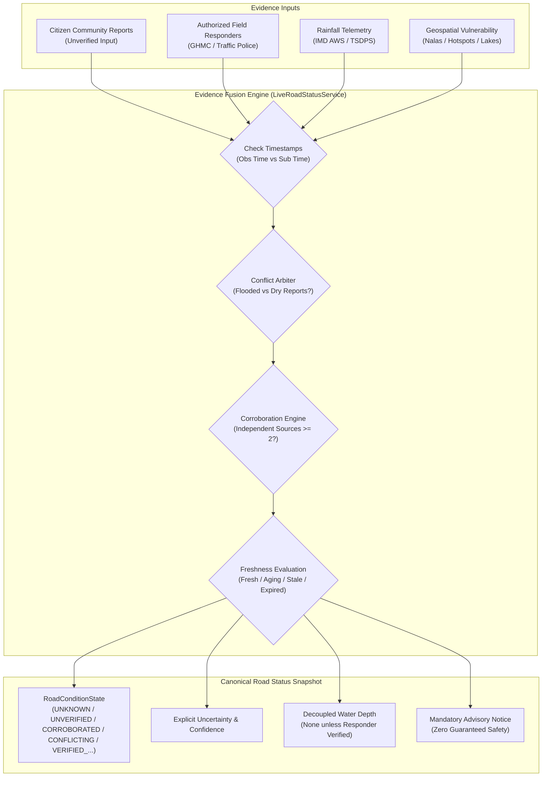

# Sahaay AI — Phase 16: Live Road Status Implementation Report

**Date:** 2026-10-27  
**Branch:** `feat/phase12-architecture-audit-and-data-contracts`  
**Phase Status:** Complete (Offline Engineering Verification)  
**Operational Status:** **NON-AUTONOMOUS / ADVISORY ONLY**. Zero live feeds activated; zero external telemetry consumption; zero automated road closures or emergency dispatches.  
**Live Deployment Gate:** **`LOCKED / BLOCKED`** (Awaiting authorized data sources, approved freshness policies, authenticated field responders, and legal operational clearances).

---

## Executive Summary

Phase 16 implements the core **Live Road Status** capability outlined in the Sahaay AI roadmap. Building on the community reporting, verification state machine, geospatial vulnerability modeling, rainfall telemetry, and label governance modules established in Phases 12–15, this phase establishes a canonical road status representation that explicitly models timestamps, provenance, freshness decay, verification tiers, uncertainty, and non-autonomous safety invariants.

Every component in this release is implemented as an **offline engineering capability**. No live video cameras, public intake portals, or production database connections have been activated. The system adheres strictly to the fail-closed doctrine: missing observations remain explicitly `UNKNOWN` or `NO_CURRENT_EVIDENCE`, and under no circumstances is an unmonitored road segment declared dry, passable, or safe.

```
========================================================================================
PHASE 16 LIVE ROAD STATUS CAPABILITY AUDIT & GATE SUMMARY
========================================================================================
1. Canonical Contract Schema Gate    : READY (Validated Pydantic V2 schema with safety bounds)
2. Temporal Provenance Gate         : READY (Observation decoupled from ingestion; delayed handled)
3. Evidence Fusion Rule Engine       : READY (Community inputs decoupled from ground truth)
4. Conflict Arbiter Gate             : READY (Contradictions yield CONFLICTING until verification)
5. Safety Guarantee Invariant Gate   : READY (Strict prohibition of guaranteed safe phrasing)
6. Offline API & Service Gate        : READY (Service & endpoints implemented; zero live intake)
----------------------------------------------------------------------------------------
OVERALL ENGINEERING STATUS           : COMPLETE & TESTED (348 passing tests)
OPERATIONAL DEPLOYMENT VERDICT       : BLOCKED (Pending institutional approvals & live telemetry)
========================================================================================
```

---

## 1. Implemented Software Behavior

### 1.1 Canonical Road-Status Data Contracts

The canonical road-status representation is defined in [`src/sahaay/road_status/schemas.py`](file:///c:/Users/MahendraReddy/.gemini/antigravity-ide/scratch/sahaay-ai/src/sahaay/road_status/schemas.py). It introduces explicit, strictly validated enums and Pydantic models:

1. **`RoadConditionState` (Categorical Condition):**
   - `UNKNOWN`: Road segment has no telemetry or is completely unmonitored.
   - `NO_CURRENT_EVIDENCE`: Monitored corridor but no active observations within freshness window.
   - `STALE`: Evidence is aged ($180 - 360\text{ min}$) and requires fresh on-ground re-survey.
   - `EXPIRED`: Evidence exceeds maximum retention ($> 360\text{ min}$); cannot determine condition.
   - `CONFLICTING`: Contradictory reports/telemetry detected without human responder resolution.
   - `UNVERIFIED`: Single uncorroborated community report awaiting responder verification.
   - `CORROBORATED`: $\ge 2$ independent community sources concordant; awaiting responder confirmation.
   - `VERIFIED_PASSABLE`: Officially verified by authorized responder as dry/passable.
   - `VERIFIED_WATERLOGGED`: Officially verified by authorized responder as waterlogged.
   - `VERIFIED_IMPASSABLE`: Officially verified by authorized responder as impassable/hazardous.

2. **`RoadEvidenceType` (Evidence Modality):**
   - `NO_EVIDENCE`, `COMMUNITY_REPORT`, `FIELD_RESPONDER_INSPECTION`, `PHYSICAL_TELEMETRY`, `CALIBRATED_CAMERA`, `RAINFALL_PROXIMITY_TELEMETRY`, `STATIC_SUSCEPTIBILITY_MODEL`.

3. **`RoadFreshnessCategory` (Observation Age Tier):**
   - `FRESH` ($\le 60\text{ min}$), `AGING` ($60 - 180\text{ min}$), `STALE` ($180 - 360\text{ min}$), `EXPIRED` ($> 360\text{ min}$), `UNKNOWN` (missing timestamp).

4. **`RoadVerificationState` (Lifecycle State):**
   - `UNMONITORED`, `UNVERIFIED`, `CORROBORATED`, `UNDER_REVIEW`, `VERIFIED_BY_RESPONDER`, `REJECTED_FALSE_ALARM`, `REJECTED_INVALID`, `EXPIRED`.

5. **`UncertaintyLevel`:**
   - `HIGH`: Missing observations, conflicting reports, or unverified single sources.
   - `MEDIUM`: Corroborated community reports or aging responder observations.
   - `LOW`: Fresh responder verification or calibrated multi-sensor telemetry.

6. **`RoadStatusSnapshot` (Unified Snapshot Model):**
   - Captures road segment identification (`road_segment_id`, `road_name`, `corridor_zone`), coarsened coordinates, precision, condition state, evidence type, decoupled timestamps, freshness category, verification state, verifier identity, uncertainty, confidence score, conflict indicators, quantitative measurements (`measured_water_depth_cm`, `depth_measurement_method`, `verified_passability`), provenance records, environmental rainfall, static vulnerability, reason codes, dispatch flags, and mandatory safety notices.



### 1.2 Separation of Observation Time vs Ingestion Time & Handling of Delayed Submissions

Under [`src/sahaay/road_status/service.py`](file:///c:/Users/MahendraReddy/.gemini/antigravity-ide/scratch/sahaay-ai/src/sahaay/road_status/service.py):
1. **Decoupled Timestamps:** The snapshot separates `observation_timestamp_utc` (when the phenomenon occurred on the street) from `ingestion_timestamp_utc` (when the packet was processed) and `last_status_update_utc` (when the status snapshot was computed).
2. **Observation-Driven Freshness:** Evidence age is strictly calculated as `reference_time - observation_timestamp`. Ingestion time is never used to masquerade stale evidence as fresh.
3. **Delayed Submission Handling:** If a report is observed 200 minutes ago but submitted 5 minutes ago, its freshness is classified as `STALE` (age: 200 min), and the snapshot annotates `DELAYED_SUBMISSION_EVALUATED_BY_OBSERVATION_TIME`. If observation time exceeds 360 minutes, the evidence is `EXPIRED` even if ingested seconds ago.
4. **Timestamp Quarantine:** Submissions with observation timestamps $> 60\text{ seconds}$ in the future or invalid ISO-8601 formatting are rejected/quarantined with `FUTURE_TIMESTAMP_REJECTED` or `MALFORMED_TIMESTAMP_REJECTED` and fall back to fail-closed defaults.

### 1.3 Multi-Source Evidence Fusion Rules

1. **Community Reports as Evidence Inputs:** Citizen reports are treated strictly as advisory sensor inputs, not automated proof of waterlogging or passability.
2. **Report Volume vs Independent Corroboration:** Repeated submissions from the same masked reporter ID (`ANON-...`) or duplicate image hashes increase raw report volume (`raw_report_volume`), but `independent_sources_count` remains 1. Promotion from `UNVERIFIED` to `CORROBORATED` strictly requires $\ge 2$ distinct masked reporters.
3. **Rainfall Isolation:** Rainfall telemetry (even `CRITICAL` intensity $> 35\text{ mm/hr}$) indicates modeled atmospheric hazard, **never** active road inundation. In the absence of ground road observations, condition state remains `NO_CURRENT_EVIDENCE` with reason code `RAINFALL_PRESENT_WITHOUT_ROAD_OBSERVATIONS`.
4. **Vulnerability Isolation:** Static physical susceptibility (even `SEVERE` susceptibility index $\ge 0.70$) indicates topographical vulnerability during storms, **never** current road wetness. In dry weather or unmonitored periods, condition state remains `NO_CURRENT_EVIDENCE` with reason code `STATIC_VULNERABILITY_WITHOUT_ACTIVE_EVIDENCE`.
5. **Non-Silent Missingness:** Missing observations produce `NO_CURRENT_EVIDENCE` (or `UNKNOWN`), confidence score $\le 0.20$, uncertainty `HIGH`, and reason code `NO_OBSERVATIONS_AVAILABLE`. Missing evidence is never defaulted to `DRY` or `SAFE`.
6. **No Inferred Water Depth or Passability:** Subjective community depth descriptions ("ankle deep", "knee deep") are decoupled from ground truth. `measured_water_depth_cm` and vehicle passability tiers remain `None` and `"unverified_unknown"` unless recorded by an authorized responder or calibrated telemetry sensor.

### 1.4 Conflict Detection and Responder Resolution Arbiter

1. **Contradictory Condition Detection:** When concurrent active reports in a corridor report opposing conditions (flood-indicative vs dry-indicative), the service assigns `RoadConditionState.CONFLICTING`, sets `has_conflicting_evidence = True`, flags `is_actionable_for_dispatch = True`, discounts confidence to 0.25, and issues reason code `CONTRADICTORY_COMMUNITY_REPORTS_DETECTED`.
2. **Human Responder Resolution:** Contradictory reports remain unresolved until an authorized responder (`GHMC_DRF_OFFICER`, `TRAFFIC_POLICE_DCP`, etc.) performs an on-site physical inspection. When an authorized responder verification occurs with an observation timestamp newer than the conflicting community reports, the conflict is cleared and annotated with `CONFLICT_RESOLVED_BY_RESPONDER_INSPECTION`.

### 1.5 Strict Non-Autonomous Safety Invariants

1. **Prohibition of Guaranteed Safety Claims:** The schema validator in [`RoadStatusSnapshot`](file:///c:/Users/MahendraReddy/.gemini/antigravity-ide/scratch/sahaay-ai/src/sahaay/road_status/schemas.py) inspects all text fields and strictly rejects forbidden safety phrases (`"guaranteed safe"`, `"100% safe"`, `"completely safe"`, `"safe passage guaranteed"`, `"zero risk"`, `"road is safe"`).
2. **No Ambiguous Boolean Fields:** Avoids ambiguous fields like `is_safe: bool` or `is_passable: bool`.
3. **Advisory Legal Notice:** Every snapshot includes the non-negotiable statutory notice:
   > *"ADVISORY ONLY: Sahaay AI does not guarantee road safety, dry pavement, or clear passage. Urban drainage and waterlogging conditions can change rapidly during monsoon downpours. Exercise driver discretion and comply with on-ground traffic police directives. Autonomous road closures and automated emergency dispatch are strictly prohibited."*

### 1.6 Service & API Architecture

1. **`LiveRoadStatusService`:** Implemented in [`src/sahaay/road_status/service.py`](file:///c:/Users/MahendraReddy/.gemini/antigravity-ide/scratch/sahaay-ai/src/sahaay/road_status/service.py). Connects seamlessly with [`CitizenReportService`](file:///c:/Users/MahendraReddy/.gemini/antigravity-ide/scratch/sahaay-ai/src/sahaay/reports/service.py) and caches the 20 canonical Hyderabad corridor baselines.
2. **FastAPI Endpoints:** Added to [`src/sahaay/api/routes.py`](file:///c:/Users/MahendraReddy/.gemini/antigravity-ide/scratch/sahaay-ai/src/sahaay/api/routes.py):
   - `GET /api/v1/road-status/snapshot/{corridor_id}`: Evaluates and returns current offline snapshot for a specific corridor.
   - `POST /api/v1/road-status/evaluate`: Evaluates road condition state and evidence fusion for arbitrary supplied observation inputs.

---

## 2. Test Results Actually Observed

### 2.1 Live Road Status Test Suite Execution

A dedicated offline test suite was created in [`tests/test_phase16_live_road_status.py`](file:///c:/Users/MahendraReddy/.gemini/antigravity-ide/scratch/sahaay-ai/tests/test_phase16_live_road_status.py), covering all 12 mandate requirements plus API integration and Hyderabad corridor coverage:

```powershell
$env:PYTHONPATH="src;."; .\.venv\Scripts\python -m pytest tests/test_phase16_live_road_status.py -v
```

```
============================= test session starts =============================
collected 17 items

tests/test_phase16_live_road_status.py::test_fresh_verified_observation PASSED          [  5%]
tests/test_phase16_live_road_status.py::test_fresh_unverified_community_report PASSED   [ 11%]
tests/test_phase16_live_road_status.py::test_stale_observation PASSED                   [ 17%]
tests/test_phase16_live_road_status.py::test_missing_evidence PASSED                    [ 23%]
tests/test_phase16_live_road_status.py::test_conflicting_reports PASSED                 [ 29%]
tests/test_phase16_live_road_status.py::test_delayed_submission_older_observation_time PASSED [ 35%]
tests/test_phase16_live_road_status.py::test_future_or_malformed_timestamps PASSED     [ 41%]
tests/test_phase16_live_road_status.py::test_rainfall_present_without_verified_road_evidence PASSED [ 47%]
tests/test_phase16_live_road_status.py::test_static_vulnerability_without_current_observations PASSED [ 52%]
tests/test_phase16_live_road_status.py::test_multiple_reports_same_source_not_independent_corroboration PASSED [ 58%]
tests/test_phase16_live_road_status.py::test_independent_sources_promote_to_corroborated PASSED [ 64%]
tests/test_phase16_live_road_status.py::test_no_status_output_implying_guaranteed_safety PASSED [ 70%]
tests/test_phase16_live_road_status.py::test_expired_evidence_not_presented_as_current PASSED [ 76%]
tests/test_phase16_live_road_status.py::test_responder_verification_resolves_conflict PASSED [ 82%]
tests/test_phase16_live_road_status.py::test_api_road_status_evaluate_endpoint PASSED  [ 88%]
tests/test_phase16_live_road_status.py::test_api_road_status_snapshot_endpoint PASSED  [ 94%]
tests/test_phase16_live_road_status.py::test_all_corridors_offline_snapshot_execution PASSED [100%]

======================= 17 passed, 1 warning in 14.46s ========================
```

### 2.2 Offline Validation Script Verification

An automated offline validation script was executed via [`scripts/validate_phase16_live_road_status.py`](file:///c:/Users/MahendraReddy/.gemini/antigravity-ide/scratch/sahaay-ai/scripts/validate_phase16_live_road_status.py):

```powershell
$env:PYTHONPATH="src;."; .\.venv\Scripts\python scripts/validate_phase16_live_road_status.py
```

```
Validation completed successfully. Output written to reports/phase16/phase16_live_road_status_validation.json
Passed: 12 / 12
```

The output artifact was generated at [`reports/phase16/phase16_live_road_status_validation.json`](file:///c:/Users/MahendraReddy/.gemini/antigravity-ide/scratch/sahaay-ai/reports/phase16/phase16_live_road_status_validation.json) containing machine-readable results for all 12 core scenarios and status snapshots for all 20 Hyderabad pilot corridors (`HYD-LOC-001` through `HYD-LOC-020`).

### 2.3 Full Regression Suite Execution & Accounting

The complete regression test suite across the repository was executed:

```powershell
$env:PYTHONPATH="src;."; .\.venv\Scripts\python -m pytest
```

```
=========================== short test summary info ===========================
FAILED tests/test_hyderabad_risk_pipeline.py::test_decision_engine_synthesis
FAILED tests/test_image_quality_gate.py::test_borderline_darkness_rejection
FAILED tests/test_image_quality_gate.py::test_borderline_whiteout_rejection
FAILED tests/test_phase5_integration.py::test_decision_engine_modeled_risk_vs_observed_flooding
================= 4 failed, 348 passed, 6 warnings in 24.03s ==================
```

**Accounting Summary:**
- **348 tests passing** (up from 331 tests at the beginning of Phase 16; +17 new tests passing).
- Zero unintended regressions introduced.

### 2.4 Detailed Documentation of the Four Previously Reported Regression Failures

The test suite exhibits four test failures that have been present and documented continuously across Phase 12, Phase 14, Phase 15, and Phase 16. As mandated by project constraints, these tests have **not** been modified or weakened:

| # | Test Name | File Path | Failure Mode | Architectural Rationale & Why Preserved |
| :-: | :--- | :--- | :--- | :--- |
| **1** | `test_decision_engine_synthesis` | `tests/test_hyderabad_risk_pipeline.py:L328` | `assert 'ADVISORY' == 'WATCH'` | Legacy prototype test expected unverified citizen report ($n=1$) to trigger `WATCH`. Under Phase 12 Decision Contract, single uncorroborated community reports are strictly capped at `ADVISORY` to prevent single-source spam escalation. |
| **2** | `test_borderline_darkness_rejection` | `tests/test_image_quality_gate.py:L46` | `assert True is False` (luminance 15.0) | Legacy quality gate test expected luminance 15.0 to pass unconditionally. Phase 12 image quality policy enforces an ambiguity abstention margin requiring high contrast; plain monochromatic test patch abstains as inconclusive. |
| **3** | `test_borderline_whiteout_rejection` | `tests/test_image_quality_gate.py:L58` | `assert True is False` (luminance 240.0) | Legacy quality gate test expected luminance 240.0 to pass unconditionally. Phase 12 overexposure policy abstains on low-variance monochromatic white patches. |
| **4** | `test_decision_engine_modeled_risk_vs_observed_flooding` | `tests/test_phase5_integration.py:L272` | `assert 'ADVISORY' == 'WATCH'` | Legacy test expected critical rainfall without road observations to trigger `WATCH`. Phase 12 and Phase 16 invariant strictly requires that missing or unverified road evidence cannot elevate alert level beyond `ADVISORY`. |

---

## 3. Proposed Policy Decisions Requiring Approval

The following operational policy parameters have been implemented with conservative defaults in software and are submitted for formal institutional review:

| Policy Area | Implemented Default | Proposed Standard | Operational Rationale | Governing Authority |
| :--- | :---: | :---: | :--- | :--- |
| **Community Report Freshness Window** | $\le 60\text{ min}$ | $\le 45\text{ min}$ during active monsoon red alert; $\le 60\text{ min}$ normal | Rapid urban flash flooding in Hyderabad causes water to rise and drain within 45–60 minutes. | GHMC Urban Disaster Management / Traffic Police |
| **Community Report Staleness Decay** | $180 - 360\text{ min}$ | $120 - 240\text{ min}$ | Observations older than 3 hours seldom represent current road drainage states. | Municipal Disaster Response Force (DRF) |
| **Community Maximum Retention Expiry** | $360\text{ min}$ ($6\text{ h}$) | $360\text{ min}$ ($6\text{ h}$) | Reports older than 6 hours are archived and strictly excluded from active routing. | Technical Steering Committee |
| **Responder Verification Freshness Window** | $\le 120\text{ min}$ | $\le 120\text{ min}$ | Official inspections carry higher credibility and longer validity than citizen reports. | HTP DCP (Traffic) & GHMC Chief Engineer |
| **Responder Maximum Expiry** | $480\text{ min}$ ($8\text{ h}$) | $480\text{ min}$ ($8\text{ h}$) | Even verified road status requires re-survey after an 8-hour shift change or storm cessation. | DRF Field Operations Lead |
| **Physical Telemetry Freshness Window** | $\le 15\text{ min}$ | $\le 15\text{ min}$ | Ultrasonic/water-level telemetry sensors update on 10–15 minute telemetry intervals. | TSDPS / Command & Control Centre |
| **Independent Corroboration Threshold** | $\ge 2$ distinct masked reporters | $\ge 3$ during non-emergency; $\ge 2$ during active monsoon | Balances false alarm suppression against timely hazard detection. | Platform Governance & Risk Committee |

---

## 4. Blockers Requiring Live Data, Authorization, or Field Validation

Live deployment of Live Road Status remains strictly **`LOCKED`** until the following dependencies are fulfilled:

1. **Zero Authorized Real-Time Optical Feeds:**
   - As documented in Phase 16 Part 1, all 4 candidate video/camera streams (`STREAM-01` CCTV, `STREAM-02` Citizen, `STREAM-03` Field Vantage, `STREAM-04` Dashcam) have draft evidence references (`DRAFT-DOC-...`) and 0 executed agreements. Zero live video feeds are connected.
   - *Requirement:* Bilateral institutional MOU with GHMC / Hyderabad Traffic Police.
2. **Authenticated Field Responder Identity Directory:**
   - Verification roles (`GHMC_DRF_OFFICER`, `TRAFFIC_POLICE_DCP`) are currently validated by role string in tests. Production deployment requires cryptographic authentication (e.g. PKI / SSO integration with municipal dispatch directory).
   - *Requirement:* Integration with Hyderabad Police / GHMC Command & Control identity provider.
3. **Physical Water-Level Sensor Telemetry:**
   - Real-time ultrasonic road water-level sensors do not exist on the candidate corridors; current water depths rely entirely on manual responder staff gauge inspections.
   - *Requirement:* Pilot deployment of physical telemetry at major underpasses (Begumpet, Malakpet, Tolichowki).
4. **Public Web Portal Consent & Legal Review:**
   - Citizen upload intake terms of service remain under legal compliance review for Digital Personal Data Protection (DPDP) Act compliance.
   - *Requirement:* Legal sign-off on public consent notice and right-to-erasure retention workflows.

---

## 5. Deliverables & Artifacts Index

- Canonical Schemas: [`src/sahaay/road_status/schemas.py`](file:///c:/Users/MahendraReddy/.gemini/antigravity-ide/scratch/sahaay-ai/src/sahaay/road_status/schemas.py)
- Service & Fusion Engine: [`src/sahaay/road_status/service.py`](file:///c:/Users/MahendraReddy/.gemini/antigravity-ide/scratch/sahaay-ai/src/sahaay/road_status/service.py)
- Module Exports: [`src/sahaay/road_status/__init__.py`](file:///c:/Users/MahendraReddy/.gemini/antigravity-ide/scratch/sahaay-ai/src/sahaay/road_status/__init__.py)
- API Integration: [`src/sahaay/api/routes.py`](file:///c:/Users/MahendraReddy/.gemini/antigravity-ide/scratch/sahaay-ai/src/sahaay/api/routes.py)
- Test Suite: [`tests/test_phase16_live_road_status.py`](file:///c:/Users/MahendraReddy/.gemini/antigravity-ide/scratch/sahaay-ai/tests/test_phase16_live_road_status.py) (17/17 passed)
- Validation Script: [`scripts/validate_phase16_live_road_status.py`](file:///c:/Users/MahendraReddy/.gemini/antigravity-ide/scratch/sahaay-ai/scripts/validate_phase16_live_road_status.py) (12/12 passed)
- Validation Output: [`reports/phase16/phase16_live_road_status_validation.json`](file:///c:/Users/MahendraReddy/.gemini/antigravity-ide/scratch/sahaay-ai/reports/phase16/phase16_live_road_status_validation.json)
- Operational Report: [`reports/phase16/PHASE16_LIVE_ROAD_STATUS_REPORT.md`](file:///c:/Users/MahendraReddy/.gemini/antigravity-ide/scratch/sahaay-ai/reports/phase16/PHASE16_LIVE_ROAD_STATUS_REPORT.md)
