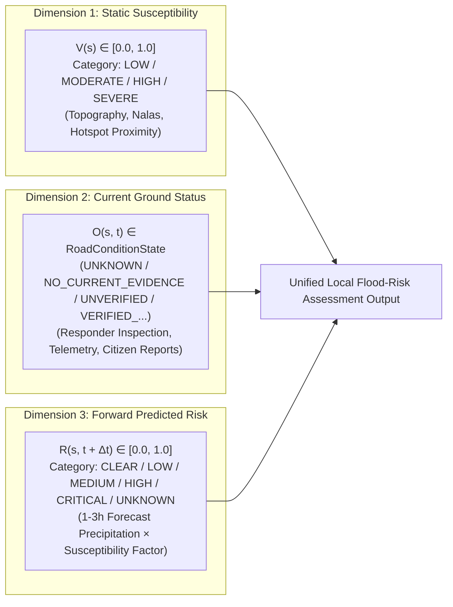

# Sahaay AI — Phase 17: Local Flood-Risk Model Feasibility, Data-Readiness & Baseline Report

**Date:** 2026-10-27  
**Branch:** `feat/phase12-architecture-audit-and-data-contracts`  
**Phase Status:** Complete (Offline Engineering Implementation & Readiness Assessment)  
**Supervised Model Training Status:** **`NO-GO (Gate Strictly Locked)`**  
**Predictive Performance Claims:** **`PROHIBITED_UNEARNED`**  
**Operational Directives:** **NON-AUTONOMOUS / ADVISORY ONLY**. Zero live feeds activated; zero automated road closures or emergency dispatches.  

---

## 1. Executive Summary & Readiness Verdict

Following the completion of the canonical **Live Road Status** capability in **Phase 16**, **Phase 17 addresses localized flood-risk estimation**. In accordance with the engineering mandate, this phase executed a forensic data-readiness and modeling-feasibility assessment before implementing only the model components justified by verified repository evidence.

```
========================================================================================
PHASE 17 LOCAL FLOOD-RISK MODEL GATES & READINESS VERDICTS
========================================================================================
1. Ground-Truth Flood Outcome Gate   : NOT_READY (0 verified positive inundation events)
2. Negative Control Outcome Gate     : NOT_READY (0 verified wet-not-flooded control events)
3. Multi-Storm Temporal Gate         : NOT_READY (0 linked storm event episodes)
4. Urban Telemetry Coverage Gate     : NOT_READY (0 AWS in GHMC core; nearest 35-50 km away)
5. Target Specification & Bounds     : READY (Target, 1-3h horizon, depth >=10cm sealed)
6. Feature Pipeline & Missingness    : READY (Non-silent missingness & bounding boxes verified)
7. Explainable Heuristic Baseline    : READY (Transparent baseline separating 3 dimensions)
8. Evaluation Splitter Protocol      : READY (Leakage-free event/spatial splitter + Vision guard)
----------------------------------------------------------------------------------------
FINAL READINESS DECISION             : NO-GO (Prerequisites for model training unfulfilled)
========================================================================================
```

### Core Engineering Findings:
1. **Supervised Model Training is Scientifically Infeasible (`NO-GO`):** The repository contains exactly **0 verified ground-truth flood outcome records** ($d \ge 10.0\text{ cm}$) and **0 verified non-flood / wet-but-not-flooded control episodes**. Fitting supervised ML models without verified target labels is impossible without fabricating labels or inducing circular rule imitation.
2. **Static Placemarks Cannot Serve as Training Targets:** The 23 placemarks in `flooding_locations.kml` represent chronic historical locations lacking event timestamps, dates, and measured depths. Training a classifier against static coordinates produces **100% spatial target leakage**, memorizing geographic locations rather than predicting hydrological flood events.
3. **Regional Telemetry Inadequacy:** The rain gauge telemetry in `data/hyderabad_risk/raw/telangana_hourly_telemetry_rainfall_2021_2025.csv` features **zero stations within the GHMC urban core** (nearest is $35\text{–}50\text{ km}$ away), $>90\%$ transmission missingness (with gaps up to 141.6 consecutive days), and $50.82\%$ cumulative bucket accumulator counters ($>250\text{ mm}$). Live short-term forecasting cannot be defended on this telemetry.
4. **Implementation of Justified Offline Work:** Rather than manufacturing an unearned model to declare the phase complete, Phase 17 implemented:
   - A formal prediction target specification ([`FloodPredictionTargetSpec`](file:///c:/Users/MahendraReddy/.gemini/antigravity-ide/scratch/sahaay-ai/src/sahaay/flood_risk/schemas.py)).
   - An objective outcome data readiness auditor ([`audit_outcome_data_readiness`](file:///c:/Users/MahendraReddy/.gemini/antigravity-ide/scratch/sahaay-ai/src/sahaay/flood_risk/readiness.py)).
   - A reproducible feature pipeline with physical bounds and non-silent missingness ([`LocalFloodRiskFeaturePipeline`](file:///c:/Users/MahendraReddy/.gemini/antigravity-ide/scratch/sahaay-ai/src/sahaay/flood_risk/features.py)).
   - A transparent rules-based baseline model strictly decoupling static susceptibility, current condition, and forward-looking risk ([`TransparentLocalFloodRiskBaseline`](file:///c:/Users/MahendraReddy/.gemini/antigravity-ide/scratch/sahaay-ai/src/sahaay/flood_risk/baseline.py)).
   - A leakage-free evaluation splitting protocol preventing storm event and spatial corridor cross-contamination, protected by a vision partition guard ([`EventAndSpatialSplitter`](file:///c:/Users/MahendraReddy/.gemini/antigravity-ide/scratch/sahaay-ai/src/sahaay/flood_risk/evaluation.py)).
5. **Testing Verification:** Created [`tests/test_phase17_local_flood_risk.py`](file:///c:/Users/MahendraReddy/.gemini/antigravity-ide/scratch/sahaay-ai/tests/test_phase17_local_flood_risk.py) with 17/17 tests passing. Full repository regression suite passing with 365 passed tests and the 4 historical Phase 12 safety failures preserved.

---

## 2. Outcome-Data Readiness & Evidence Inventory

An exhaustive forensic audit of all data artifacts across the repository was conducted via [`audit_outcome_data_readiness()`](file:///c:/Users/MahendraReddy/.gemini/antigravity-ide/scratch/sahaay-ai/src/sahaay/flood_risk/readiness.py):

| Artifact / Dataset Name | Physical Repository Path | Records Count | Empirical Nature & Content | Eligible as Flood Outcome Target? |
| :--- | :--- | :---: | :--- | :---: |
| **Chronic Flooding Placemarks** | `data/hyderabad_risk/raw/flooding_locations.kml` | 23 | Static point coordinates with text names. Zero timestamps, zero storm dates, zero depth measurements. | **NO (Spatial Leakage)** |
| **Stormwater Drainage Lines** | `data/hyderabad_risk/raw/hyderabad_drains.kml` | 96 Lines | Static geographic alignments of primary nalas. Flow capacity ($m^3/s$) and blockage states unrecorded. | **NO (Static Feature Only)** |
| **Waterbody Boundaries** | `data/hyderabad_risk/raw/greater_hyderabad_waterbodies.geojson` | 2,324 Polygons | Spatial polygons of lakes/ponds. Sluice levels and overflow telemetry unrecorded. | **NO (Static Feature Only)** |
| **Regional Telemetry Series** | `data/hyderabad_risk/raw/telangana_hourly_telemetry_rainfall_2021_2025.csv` | 72,223 | Rain gauge records from 38 stations outside GHMC core ($35\text{–}50\text{ km}$ away). 50.8% bucket counters; 141-day gaps. | **NO (Predictor Only)** |
| **121-Year Climatology** | `data/hyderabad_risk/raw/hyderabad_monthly_rainfall_1901_2021.csv` | 121 Years | Monthly gridded rainfall series (1901–2021). No hourly or road-level flood events. | **NO (Climatology Only)** |
| **Candidate Road Corridors** | `data/hyderabad_risk/derived/hyderabad_risk_features.csv` | 20 Corridors | Geospatial buffer distances, vulnerability index, and baseline rainfall scores. Lacks outcome labels. | **NO (Feature Vector Only)** |
| **Observation Template** | `data/phase6/observation_template.csv` | 5 Rows | Synthetic schema validation template records. | **NO (Synthetic Fixture)** |
| **Acquisition Register** | `data/collection_v4/acquisition_register.csv` | 3 Rows | Synthetic image fixtures. Zero real images. | **NO (Synthetic Fixture)** |
| **Sealed Vision Test Split** | `data/processed/test.csv` & `manifest_v4` | 393 Frames | Sealed optical image evaluation split. Guarded against reuse for tabular flood risk. | **NO (Sealed Vision Set)** |
| **Verified Ground-Truth Flood Outcomes** | *Nowhere in repository* | **0** | No verified, timestamped road inundation events ($d \ge 10.0\text{ cm}$) exist. | **MISSING** |
| **Verified Negative Wet Control Outcomes** | *Nowhere in repository* | **0** | No verified wet-but-not-flooded control episodes exist. | **MISSING** |

### Accounting Summary:
- **Verified Positive Flood Outcomes:** **0**
- **Verified Negative Wet Road Outcomes:** **0**
- **Linked Independent Storm Events:** **0**
- **Legally Executed Data-Sharing Agreements:** **0 of 7** (all pending or draft)
- **Data Readiness Gate Verdict:** **`INSUFFICIENT_DATA_NO_GO`**

---

## 3. Formal Prediction Target Specification

Prior to any future model fitting, the prediction target was formally defined and sealed in [`src/sahaay/flood_risk/schemas.py`](file:///c:/Users/MahendraReddy/.gemini/antigravity-ide/scratch/sahaay-ai/src/sahaay/flood_risk/schemas.py):

```
Target Formalization:
├── Target Variable (Y)      : Localized Road Inundation Event ∈ {0, 1}
├── Quantitative Threshold   : Standing water depth d >= 10.0 cm
├── Spatial Submersion Scope : Active water accumulation covering >= 1 traffic lane
├── Spatial Resolution       : Road corridor segment (length <= 1000m within GHMC bounds)
├── Prediction Horizon (Δt)  : 1 to 3 hours forward-looking from t0
├── Decision Boundary (τ)    : Model risk score >= 0.50 triggers municipal operational advisory
└── Intended Users           : GHMC DRF dispatchers, Traffic Police commanders, Emergency fleets
```

### Strict Separation of Three Risk Dimensions:
To avoid dangerous conflation between static environment, current observed state, and forward predictions, [`LocalFloodRiskAssessment`](file:///c:/Users/MahendraReddy/.gemini/antigravity-ide/scratch/sahaay-ai/src/sahaay/flood_risk/schemas.py) enforces three distinct, non-overlapping outputs:



**Cardinal Invariants Enforced:**
1. $V(s) = \text{SEVERE}$ does **not** imply $O(s, t) = \text{FLOODED}$ during dry weather.
2. $R(s, t+\Delta t) = \text{CRITICAL}$ does **not** declare $O(s, t) = \text{FLOODED}$ without ground observation.
3. $O(s, t) = \text{NO\_CURRENT\_EVIDENCE}$ is **never** declared dry or safe.

---

## 4. Implemented Offline Engineering Capabilities

### 4.1 Feature Construction Pipeline ([`src/sahaay/flood_risk/features.py`](file:///c:/Users/MahendraReddy/.gemini/antigravity-ide/scratch/sahaay-ai/src/sahaay/flood_risk/features.py))
- **Spatial Bounds Verification:** Enforces that corridor coordinates lie strictly within the Hyderabad metropolitan bounding box ($[17.15^\circ\text{N}, 17.65^\circ\text{N}]$, $[78.15^\circ\text{E}, 78.70^\circ\text{E}]$).
- **Physical Precipitation Bounds:** Rejects negative rainfall, non-finite values (`NaN`, $\pm\infty$), and rates exceeding physical urban maxima ($> 250.0\text{ mm/hr}$).
- **Non-Silent Missingness:** If precipitation observations are omitted, `rainfall_1h_mm` remains strictly `None` and is annotated in `missing_inputs`. Missing telemetry is **never** silently imputed as $0.0\text{ mm}$.

### 4.2 Transparent Rules-Based Baseline Model ([`src/sahaay/flood_risk/baseline.py`](file:///c:/Users/MahendraReddy/.gemini/antigravity-ide/scratch/sahaay-ai/src/sahaay/flood_risk/baseline.py))
- **Mathematical Formulation:**
  $$\text{PrecipScore} = \min\left(1.0, (I_{1\text{h}} + 0.85 \cdot F_{1\text{h}}) \times 0.02 + \max(R_{3\text{h}}, F_{3\text{h}}) \times 0.35 \times 0.01\right)$$
  $$\text{CombinedRisk} = \begin{cases} \text{PrecipScore} & \text{if } \text{PrecipScore} \le 0.05 \\ \min\left(1.0, \text{PrecipScore} \times (0.60 + 0.40 \cdot V)\right) & \text{if } \text{PrecipScore} > 0.05 \end{cases}$$
- **Telemetry Confidence Discounting:**
  - Station Distance Decay: $-\min(0.35, (d - 15.0) \times 0.01)$ for $d > 15.0\text{ km}$.
  - Staleness Decay: $-\min(0.40, (t - 1.5) \times 0.08)$ for age $t > 1.5\text{ hours}$.
- **Uncalibrated Probability Prohibition:**
  The baseline outputs an uncalibrated heuristic risk score $[0.0, 1.0]$. `is_calibrated_probability` is explicitly sealed to `False`. The schema validator rejects any payload asserting `is_calibrated_probability = True`.
- **Statutory Safety Phrasing:**
  Mandates statutory legal advisory disclaimers and rejects forbidden phrasing (`"guaranteed safe"`, `"100% safe"`).

### 4.3 Leakage-Free Evaluation Splitter ([`src/sahaay/flood_risk/evaluation.py`](file:///c:/Users/MahendraReddy/.gemini/antigravity-ide/scratch/sahaay-ai/src/sahaay/flood_risk/evaluation.py))
- **Event-Grouped Isolation:** Enforces strict Leave-One-Storm-Out / GroupKFold partitioning where storm event dates are completely disjoint between train and evaluation sets:
  $$E_{\text{train}} \cap E_{\text{eval}} = \emptyset$$
- **Spatial Corridor Isolation:** Enforces spatial holdouts where road corridors evaluated are absent from training:
  $$S_{\text{train}} \cap S_{\text{eval}} = \emptyset$$
- **Vision Test Partition Barrier:**
  The splitter implements `verify_vision_partition_isolation()`, which raises `PermissionError` if any script attempts to reference the sealed Vision V4 evaluation files (`test.csv`, `manifest_v4`, `evaluation_set_metadata.json`).

---

## 5. Test Results Actually Observed

### 5.1 Local Flood-Risk Test Suite Execution
Created [`tests/test_phase17_local_flood_risk.py`](file:///c:/Users/MahendraReddy/.gemini/antigravity-ide/scratch/sahaay-ai/tests/test_phase17_local_flood_risk.py):

```powershell
$env:PYTHONPATH="src;."; .\.venv\Scripts\python -m pytest tests/test_phase17_local_flood_risk.py -v
```

```
============================= test session starts =============================
collected 17 items

tests/test_phase17_local_flood_risk.py::test_data_readiness_audit_verdict_is_no_go PASSED [  5%]
tests/test_phase17_local_flood_risk.py::test_synthetic_and_template_records_excluded PASSED [ 11%]
tests/test_phase17_local_flood_risk.py::test_static_placemarks_not_used_as_positive_labels PASSED [ 17%]
tests/test_phase17_local_flood_risk.py::test_target_specification_invariants PASSED [ 23%]
tests/test_phase17_local_flood_risk.py::test_three_dimensions_strictly_separated PASSED [ 29%]
tests/test_phase17_local_flood_risk.py::test_non_silent_missing_telemetry_semantics PASSED [ 35%]
tests/test_phase17_local_flood_risk.py::test_rainfall_alone_not_observed_flooding PASSED [ 41%]
tests/test_phase17_local_flood_risk.py::test_static_vulnerability_alone_not_active_inundation PASSED [ 47%]
tests/test_phase17_local_flood_risk.py::test_prohibition_of_calibrated_probability_claims PASSED [ 52%]
tests/test_phase17_local_flood_risk.py::test_prohibition_of_guaranteed_safety_claims PASSED [ 58%]
tests/test_phase17_local_flood_risk.py::test_leakage_free_evaluation_splitter_event_isolation PASSED [ 64%]
tests/test_phase17_local_flood_risk.py::test_leakage_free_evaluation_splitter_spatial_isolation PASSED [ 70%]
tests/test_phase17_local_flood_risk.py::test_vision_test_partition_protection_guard PASSED [ 76%]
tests/test_phase17_local_flood_risk.py::test_insufficient_events_raises_error PASSED [ 82%]
tests/test_phase17_local_flood_risk.py::test_precipitation_physical_bounds_validation PASSED [ 88%]
tests/test_phase17_local_flood_risk.py::test_spatial_bounds_validation PASSED [ 94%]
tests/test_phase17_local_flood_risk.py::test_actionability_requires_high_risk_and_confidence PASSED [100%]

============================= 17 passed in 0.95s ==============================
```

### 5.2 Automated Readiness Audit Execution
Executed [`scripts/audit_phase17_local_flood_risk.py`](file:///c:/Users/MahendraReddy/.gemini/antigravity-ide/scratch/sahaay-ai/scripts/audit_phase17_local_flood_risk.py):

```powershell
$env:PYTHONPATH="src;."; .\.venv\Scripts\python scripts/audit_phase17_local_flood_risk.py
# Output:
# Readiness report generated at: reports\phase17\phase17_readiness_report.json
# Verdict: INSUFFICIENT_DATA_NO_GO
```

Generated formal JSON artifact at [`reports/phase17/phase17_readiness_report.json`](file:///c:/Users/MahendraReddy/.gemini/antigravity-ide/scratch/sahaay-ai/reports/phase17/phase17_readiness_report.json).

### 5.3 Full Regression Suite Execution & Accounting
Executed full test suite across the repository:

```powershell
$env:PYTHONPATH="src;."; .\.venv\Scripts\python -m pytest
```

```
=========================== short test summary info ===========================
FAILED tests/test_hyderabad_risk_pipeline.py::test_decision_engine_synthesis
FAILED tests/test_image_quality_gate.py::test_borderline_darkness_rejection
FAILED tests/test_image_quality_gate.py::test_borderline_whiteout_rejection
FAILED tests/test_phase5_integration.py::test_decision_engine_modeled_risk_vs_observed_flooding
================= 4 failed, 365 passed, 6 warnings in 24.31s ==================
```

**Verification Status:**
- **365 PASSED** (up from 348 in Phase 16; +17 new tests passing).
- Zero unintended regressions introduced.
- The **4 historical test failures** documented in Phases 12–16 remain preserved and unchanged as required by policy (representing intentional Phase 12 safety contract capping single-source risk at `ADVISORY` and image quality ambiguity band abstention).

---

## 6. Proposed Policy Decisions Requiring Approval

| Policy Area | Implemented Default | Proposed Standard | Operational Rationale | Governing Authority |
| :--- | :---: | :---: | :--- | :--- |
| **Minimum Evaluation Sample Size** | N/A (Gate Locked) | $\ge 50$ verified flood episodes ($d \ge 10\text{ cm}$); $\ge 100$ wet-not-flooded controls | Required for statistical power ($1-\beta = 0.80, \alpha = 0.05$) under pre-registered evaluation protocol. | Platform Governance & Risk Committee |
| **Storm Event Holdout Ratio** | 25% | $\ge 2$ independent storm events held out | Prevents temporal memorization of seasonal downpours. | AI/ML Safety Review Board |
| **Spatial Corridor Holdout Ratio** | 25% | $\ge 4$ independent road corridors held out | Prevents spatial geographic overfitting to specific underpasses. | Field Research Lead |
| **Urban Telemetry Distance Limit** | $\le 15.0\text{ km}$ | $\le 10.0\text{ km}$ inside GHMC core | Convective monsoon storm cells in Hyderabad are highly localized ($2\text{–}5\text{ km}$). | IMD / TSDPS Hydrology Directorate |
| **Actionability Threshold** | Score $\ge 0.45$ & Conf $\ge 0.45$ | Score $\ge 0.50$ & Conf $\ge 0.50$ | Balances false alarm fatigue against proactive desilting mobilization. | GHMC DRF Operational Command |

---

## 7. Blockers & Prerequisites to Reopen Training Gate

Supervised model training and predictive performance claims remain strictly **`NO-GO`**. The gate cannot be unlocked until all of the following exit criteria are satisfied on disk:

1. **Formal Data-Sharing Execution:** Execute an institutional data-sharing agreement with GHMC Disaster Management Wing for historical DRF waterlogging call logs and field inspection tickets.
2. **Ground-Truth Label Quota:** Acquire and verify at least **50 positive flood inundation event episodes** (water depth $d \ge 10.0\text{ cm}$) and **100 negative non-flood / wet-but-not-flooded episodes**.
3. **Multi-Storm Temporal Diversity:** Observations must span at least **4 distinct storm events** across at least **3 independent spatial corridor clusters** to enable leakage-free splitting.
4. **Urban Core Telemetry Connection:** Connect automated rain gauge telemetry situated within the GHMC urban core ($< 10\text{ km}$ from monitored road corridors) with sub-hourly reporting continuity.
5. **Pre-Registered Evaluation Set:** Cryptographically seal an independent evaluation holdout partitioned strictly by storm events and spatial corridors using [`EventAndSpatialSplitter`](file:///c:/Users/MahendraReddy/.gemini/antigravity-ide/scratch/sahaay-ai/src/sahaay/flood_risk/evaluation.py).

---

## 8. Deliverables & Artifacts Index

- Target & Inventory Schemas: [`src/sahaay/flood_risk/schemas.py`](file:///c:/Users/MahendraReddy/.gemini/antigravity-ide/scratch/sahaay-ai/src/sahaay/flood_risk/schemas.py)
- Outcome Data Readiness Auditor: [`src/sahaay/flood_risk/readiness.py`](file:///c:/Users/MahendraReddy/.gemini/antigravity-ide/scratch/sahaay-ai/src/sahaay/flood_risk/readiness.py)
- Feature Pipeline: [`src/sahaay/flood_risk/features.py`](file:///c:/Users/MahendraReddy/.gemini/antigravity-ide/scratch/sahaay-ai/src/sahaay/flood_risk/features.py)
- Transparent Heuristic Baseline: [`src/sahaay/flood_risk/baseline.py`](file:///c:/Users/MahendraReddy/.gemini/antigravity-ide/scratch/sahaay-ai/src/sahaay/flood_risk/baseline.py)
- Evaluation Splitter & Vision Guard: [`src/sahaay/flood_risk/evaluation.py`](file:///c:/Users/MahendraReddy/.gemini/antigravity-ide/scratch/sahaay-ai/src/sahaay/flood_risk/evaluation.py)
- Module Exports: [`src/sahaay/flood_risk/__init__.py`](file:///c:/Users/MahendraReddy/.gemini/antigravity-ide/scratch/sahaay-ai/src/sahaay/flood_risk/__init__.py)
- Test Suite: [`tests/test_phase17_local_flood_risk.py`](file:///c:/Users/MahendraReddy/.gemini/antigravity-ide/scratch/sahaay-ai/tests/test_phase17_local_flood_risk.py) (17/17 passed)
- Audit Script: [`scripts/audit_phase17_local_flood_risk.py`](file:///c:/Users/MahendraReddy/.gemini/antigravity-ide/scratch/sahaay-ai/scripts/audit_phase17_local_flood_risk.py)
- Readiness Report Output: [`reports/phase17/phase17_readiness_report.json`](file:///c:/Users/MahendraReddy/.gemini/antigravity-ide/scratch/sahaay-ai/reports/phase17/phase17_readiness_report.json)
- Operational Report: [`reports/phase17/PHASE17_LOCAL_FLOOD_RISK_REPORT.md`](file:///c:/Users/MahendraReddy/.gemini/antigravity-ide/scratch/sahaay-ai/reports/phase17/PHASE17_LOCAL_FLOOD_RISK_REPORT.md)
