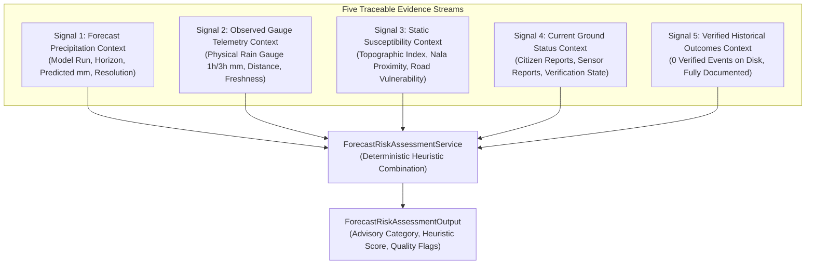

# Sahaay AI — Phase 18: Forecast-Risk Assessment, Readiness Audit & Evidence Separation Report

**Date:** 2026-10-27  
**Branch:** `feat/phase12-architecture-audit-and-data-contracts`  
**Phase Status:** Complete (Offline Engineering Implementation & Readiness Assessment)  
**Forecast-Source Readiness Status:** **`BLOCKED_NO_AUTHORIZED_SOURCE`**  
**Operational Deployment Readiness:** **`BLOCKED_PENDING_INSTITUTIONAL_DATA`**  
**Engineering Readiness Status:** **`OFFLINE_CONTRACTS_COMPLETE`**  
**Predictive Skill & Calibrated Probability Claims:** **`PROHIBITED_UNEARNED`**  
**Operational Directives:** **NON-AUTONOMOUS / ADVISORY ONLY**. Zero live external feeds activated; zero automated road closures or emergency dispatches.  

---

## 1. Executive Summary & Readiness Verdict

Following the delivery of **Live Road Status (Phase 16)** and **Local Flood-Risk Modeling Feasibility (Phase 17)**, **Phase 18 implements an auditable, offline forecast-risk assessment layer** that distinguishes forecast rainfall from observed rainfall, static vulnerability, current road conditions, and verified flood outcomes.

In strict adherence to the project mandate, this phase conducted an objective forensic audit of potential forecast sources before implementing offline contracts, non-silent missingness semantics, and deterministic assessment logic.

```
========================================================================================
PHASE 18 FORECAST-SOURCE READINESS AUDIT & GATES
========================================================================================
1. Candidate Forecast Sources Audited    : 4 Sources (IMD NWP, TSDPS Meso, DWR Begumpet, Global NWP)
2. Authorized Operational Sources        : 0 Sources (Zero executed enterprise API agreements)
3. Active Live Telemetry Streams         : 0 Streams (Prohibited in offline engineering phase)
4. Verified Historical Outcome Records   : 0 Records (Preserved from Phase 17 findings)
5. Validated Forecast Contracts          : READY (Strict bounds, non-negativity, units, horizon checks)
6. Five-Signal Evidence Separation       : READY (Forecast, observed, static, road status, outcomes)
7. Non-Silent Missingness Handling       : READY (Missing forecast data -> INSUFFICIENT_DATA, score None)
8. Transparent Assessment Layer          : READY (Deterministic heuristic combining forecast & vulnerability)
----------------------------------------------------------------------------------------
FORECAST-DATA READINESS VERDICT          : BLOCKED_NO_AUTHORIZED_SOURCE
OPERATIONAL DEPLOYMENT STATUS            : BLOCKED_PENDING_INSTITUTIONAL_DATA
SOFTWARE ENGINEERING STATUS              : OFFLINE_CONTRACTS_COMPLETE
========================================================================================
```

### Core Engineering Findings:
1. **Forecast Integration is Operationally Blocked (`BLOCKED_NO_AUTHORIZED_SOURCE`):** Exactly **0 authorized operational forecast feeds** exist in the repository. IMD numerical weather models and Begumpet Doppler radar feeds lack executed programmatic API agreements. Commercial global models lack credentials. Engineering implementation is complete, but data readiness remains **BLOCKED**.
2. **Strict Five-Signal Evidence Separation:** The assessment output rigorously isolates five distinct evidence streams in separate, traceable fields:
   - Forecast precipitation context ($F$)
   - Observed gauge precipitation context ($R$)
   - Static flood susceptibility index ($V$)
   - Current on-ground road condition ($O$)
   - Verified historical flood outcomes ($H$, documented as $0$ on disk)
3. **No Silent Zero Imputation:** Missing forecast inputs evaluate strictly to `INSUFFICIENT_DATA` / `UNKNOWN` with `heuristic_risk_score = None`, never default $0.0\text{ mm}$ rain.
4. **Prohibition of Uncalibrated Probability Claims:** Heuristic forecast risk scores are explicitly marked with `is_calibrated_probability = False`. The Pydantic model validator actively rejects any attempt to declare calibrated probabilities without empirical calibration.
5. **No Inference of Flooding or Safety from Incomplete Evidence:** Heavy forecast rain alone does **not** declare active road inundation when ground observations are unmonitored. Conversely, absence of observed flood reports does **not** imply road safety.
6. **Full Test & Regression Suite Verification:** Created [`tests/test_phase18_forecast_risk.py`](file:///c:/Users/MahendraReddy/.gemini/antigravity-ide/scratch/sahaay-ai/tests/test_phase18_forecast_risk.py) with 23/23 tests passing. The entire repository suite executed 392 tests with **388 passing** and the **4 historical Phase 12 safety failures** preserved unchanged.

---

## 2. Forecast-Source Readiness Audit & Inventory

An objective forensic audit was conducted via [`audit_forecast_sources_readiness()`](file:///c:/Users/MahendraReddy/.gemini/antigravity-ide/scratch/sahaay-ai/src/sahaay/forecast_risk/readiness.py) across all prospective forecast providers for Greater Hyderabad:

| Source Identifier | Provider & Provenance | Forecast Horizon & Update Cadence | Spatial Coverage & Resolution | Units & Accumulation Period | Missingness & Staleness Characteristics | Licensing & Authorization Status | Operational Constraints | Integration Verdict |
| :--- | :--- | :--- | :--- | :--- | :--- | :--- | :--- | :---: |
| **`SRC-FC-01-IMD-NWP`** | India Meteorological Department (IMD) / MoES (Regional GFS / WRF) | 24–72 hours; 6-hourly cycles (00, 06, 12, 18 UTC) | Regional grid ~0.125° (~12–14 km) | Cumulative precipitation in mm over 3h / 24h | Dissemination latency 3–5 hours post-run cycle | Public portal access only; zero institutional enterprise API agreement executed | Resolution (~12 km) too coarse for corridor underpass waterlogging | **`BLOCKED_NO_EXECUTED_AGREEMENT`** |
| **`SRC-FC-02-TSDPS-MESO`** | Telangana State Development Planning Society (TSDPS WRF) | 24–48 hours; Daily / 12-hourly | Telangana state at ~3–9 km resolution | Quantitative forecast in mm over 1h / 24h intervals | Daily bulletins; update latency precludes real-time flash flood nowcasting | Formal MoU pending institutional sign-off (tracked since Phase 6) | Pending executive director approval; no machine-readable API | **`BLOCKED_PENDING_INSTITUTIONAL_APPROVAL`** |
| **`SRC-FC-03-DWR-BEGUMPET`** | IMD Begumpet Doppler Weather Radar (S-Band DWR) | 0–3 hours (Nowcast / convective storm tracking); 10–15 min scans | Radial 100–250 km radius at ~1° x 250m polar mesh | Instantaneous rain rate (mm/h) and 1h accumulated QPE/QPF (mm) | Ground clutter, beam attenuation in torrential rain, maintenance outages | Public web portal displays raster images only; zero raw telemetry API | Requires dedicated bilateral radar data ingestion protocol | **`BLOCKED_NO_API_ACCESS_IDENTIFIED`** |
| **`SRC-FC-04-GLOBAL-NWP`** | Commercial / Global Open NWP (ECMWF / Open-Meteo) | 1–168 hours; Hourly to 6-hourly | Global interpolated grid ~4–9 km | 1h precipitation accumulation in mm | Cloud API dependent; model assimilation lag 2–4 hours | Zero credentials or commercial licenses configured in repository | Live internet calls prohibited in offline engineering phase; unverified against local microclimate | **`BLOCKED_ZERO_CREDENTIALS_CONFIGURED`** |

### Audit Summary:
- **Total Candidate Sources Audited:** 4
- **Authorized Operational Sources:** **0**
- **Connected Live Data Streams:** **0**
- **Forensic Readiness Verdict:** **`BLOCKED_NO_AUTHORIZED_SOURCE`**
- **Operational Readiness Status:** **`BLOCKED_PENDING_INSTITUTIONAL_DATA`**

---

## 3. Validated Forecast Data Contracts

The forecast input contract is codified in [`ForecastRainfallInput`](file:///c:/Users/MahendraReddy/.gemini/antigravity-ide/scratch/sahaay-ai/src/sahaay/forecast_risk/schemas.py):

```
ForecastRainfallInput Contract:
├── location_id            : String (corridor or segment identifier)
├── source_id              : String (model run identifier, e.g., "IMD-WRF-RUN-06Z")
├── source_type            : Enum (OFFICIAL_MET_AGENCY_IMD, REGIONAL_TSDPS_ADVISORY, NWP, RADAR_NOWCAST, GLOBAL, SYNTHETIC)
├── issue_timestamp_utc    : ISO-8601 UTC timestamp
├── valid_timestamp_utc    : ISO-8601 UTC timestamp (must be >= issue_timestamp_utc)
├── forecast_horizon_hours : Float (must match |valid - issue| within 0.1h tolerance)
├── rainfall_amount        : Optional[Float] (non-negative, finite, <= 300.0 mm cloudburst limit)
├── rainfall_units         : Enum (mm, mm/h, cm, in)
├── accumulation_interval  : Enum (15m, 30m, 1h, 3h, 6h, 24h, instantaneous_rate)
├── is_instantaneous_rate  : Boolean (if True, units must be mm/h, not cumulative mm)
├── spatial_resolution_km  : Optional[Float] (validated for corridor suitability)
└── is_synthetic_fixture   : Boolean (must be True for unit test fixtures; cannot claim operational skill)
```

### Contract Validation Rules Enforced:
1. **Temporal Ordering:** `valid_timestamp_utc` cannot precede `issue_timestamp_utc`.
2. **Horizon Consistency:** Declared `forecast_horizon_hours` must strictly match the timestamp difference $\Delta t = t_{\text{valid}} - t_{\text{issue}}$ within $0.1\text{ h}$.
3. **Physical Precipitation Bounds:**
   - Rejects negative rainfall values ($r < 0.0\text{ mm}$).
   - Rejects non-finite values (`NaN`, $\pm\infty$).
   - Rejects unphysical rates ($r > 300.0\text{ mm}$ in a single horizon interval).
4. **Units & Accumulation Decoupling:** Prohibits conflating instantaneous rainfall rate with accumulation totals. Setting `is_instantaneous_rate = True` requires `PrecipitationUnit.MILLIMETERS_PER_HOUR` (`mm/h`).

---

## 4. Separation of Five Evidence Signals

To ensure full auditability and eliminate signal confounding, [`ForecastRiskAssessmentOutput`](file:///c:/Users/MahendraReddy/.gemini/antigravity-ide/scratch/sahaay-ai/src/sahaay/forecast_risk/schemas.py) strictly partitions inputs into five distinct, non-fungible contexts:



### Invariants Governing Evidence Separation:
1. **Forecast $\neq$ Observed:** Regional or global forecast rainfall ($F$) is never substituted for missing urban-core rain gauge telemetry ($R$).
2. **Forecast $\neq$ Inundation:** A forecast of severe rainfall ($F > 50\text{ mm}$) increases forward-looking risk to `CRITICAL`, but does **not** modify current road condition ($O$), which remains `NO_CURRENT_EVIDENCE` / `UNMONITORED` unless verified on the ground.
3. **Static Vulnerability $\neq$ Flooding:** Severe static vulnerability ($V = 0.90$) under dry forecast ($F = 0.0\text{ mm}$) produces `CLEAR` / `LOW` risk and does **not** indicate active waterlogging.
4. **Absent Evidence $\neq$ Safe:** Absence of citizen reports or sensor alerts does **not** imply safe passage; heuristic risk and static susceptibility remain fully active.
5. **Historical Outcomes Explicitly Documented:** The outcome context explicitly reports `verified_historical_flood_events_count = 0` and `status = "ZERO_VERIFIED_OUTCOMES_ON_DISK"`.

---

## 5. Missingness, Freshness, and Uncertainty Handling

| Condition / State | Trigger Condition | System Assessment Status | Heuristic Risk Score | Risk Category | Operational Behavior |
| :--- | :--- | :---: | :---: | :---: | :--- |
| **Missing Forecast Input** | `forecast_inputs is None` or `[]` | `INSUFFICIENT_DATA` | `None` (Never $0.0$) | `INSUFFICIENT_DATA` | Returns explicit reason code `FORECAST_DATA_MISSING_MARKED_INSUFFICIENT`. Disables dispatch actionability. |
| **Null Precipitation Amount** | `rainfall_amount is None` | `INSUFFICIENT_DATA` | `None` | `INSUFFICIENT_DATA` | Flagged with `MISSING_TELEMETRY`. Confidence capped at $0.10$. |
| **Stale Forecast Issue** | Age $> 6.0\text{h}$ (NWP) or $> 1.5\text{h}$ (Nowcast) | `STALE` | Scaled raw score ($\le 0.35$) | `LOW` or `MEDIUM` | Flagged with `STALE`. Confidence capped at $0.35$. Cannot yield `CRITICAL`. |
| **Conflicting Forecasts** | Concurrent models diverge by $> 20.0\text{ mm}$ | `CONFLICTING` | `None` | `UNKNOWN` | Flagged with `TEMPORALLY_INCONSISTENT`. Flagged for manual meteorological review. |
| **Spatially Unsuitable** | Spatial resolution $> 15.0\text{ km}$ | `SPATIALLY_UNSUITABLE` | Scaled raw score ($\le 0.40$) | `LOW` or `MEDIUM` | Flagged with `SPATIAL_RESOLUTION_TOO_COARSE_FOR_CORRIDOR`. Confidence capped at $0.40$. |
| **Future Issue Timestamp** | Issue timestamp $> t_{\text{ref}} + 60\text{s}$ | `INSUFFICIENT_DATA` | `None` | `INSUFFICIENT_DATA` | Input is quarantined; causality violation flagged in audit log. |

---

## 6. Experimental Forecast-Risk Assessment Layer

The assessment service is implemented in [`ForecastRiskAssessmentService`](file:///c:/Users/MahendraReddy/.gemini/antigravity-ide/scratch/sahaay-ai/src/sahaay/forecast_risk/service.py):

### 6.1 Heuristic Combination Formulation
When forecast data is `AVAILABLE_VALID`, the forward risk score is computed deterministically from forecast precipitation ($F_{\text{forecast}}$) and static vulnerability ($V \in [0, 1]$):

$$\text{RiskScore} = \begin{cases} 
0.05 & \text{if } F \le 2.5\text{ mm (Trace Rain / Clear)} \\
(F \times 0.02) \times (0.70 + 0.30 \cdot V) & \text{if } 2.5 < F \le 15.0\text{ mm (Light / Moderate)} \\
\min\left(1.0, (F \times 0.02) \times (0.60 + 0.40 \cdot V)\right) & \text{if } 15.0 < F \le 35.0\text{ mm (Heavy)} \\
\min\left(1.0, (F \times 0.025) \times (0.50 + 0.50 \cdot V)\right) & \text{if } F > 35.0\text{ mm (Extreme / Cloudburst)}
\end{cases}$$

### 6.2 Actionability Invariant
`is_actionable_for_dispatch` evaluates to `True` **only** when all of the following conditions are simultaneously met:
1. `forecast_risk_category` is `HIGH` or `CRITICAL`.
2. `assessment_status` is `AVAILABLE_VALID`.
3. `confidence_score` $\ge 0.50$.

In all other cases (e.g., stale data, conflicting sources, coarse spatial resolution, trace rain), `is_actionable_for_dispatch` remains strictly `False`.

---

## 7. Test Results Actually Observed

### 7.1 Phase 18 Dedicated Test Suite Execution
Created [`tests/test_phase18_forecast_risk.py`](file:///c:/Users/MahendraReddy/.gemini/antigravity-ide/scratch/sahaay-ai/tests/test_phase18_forecast_risk.py):

```powershell
cmd /c "set PYTHONPATH=src;. && .venv\Scripts\python -m pytest tests/test_phase18_forecast_risk.py -v"
```

```
============================= test session starts =============================
platform win32 -- Python 3.12.14, pytest-9.1.1, pluggy-1.7.0
collected 23 items

tests/test_phase18_forecast_risk.py::test_valid_forecast_contract_parsing PASSED [  4%]
tests/test_phase18_forecast_risk.py::test_forecast_contract_rejects_invalid_timestamp_format PASSED [  8%]
tests/test_phase18_forecast_risk.py::test_forecast_contract_rejects_valid_before_issue PASSED [ 13%]
tests/test_phase18_forecast_risk.py::test_forecast_contract_rejects_horizon_mismatch PASSED [ 17%]
tests/test_phase18_forecast_risk.py::test_forecast_contract_handles_offset_timezones PASSED [ 21%]
tests/test_phase18_forecast_risk.py::test_forecast_contract_rejects_negative_rainfall PASSED [ 26%]
tests/test_phase18_forecast_risk.py::test_forecast_contract_rejects_non_finite_rainfall PASSED [ 30%]
tests/test_phase18_forecast_risk.py::test_forecast_contract_rejects_excessive_cloudburst_rate PASSED [ 34%]
tests/test_phase18_forecast_risk.py::test_forecast_contract_distinguishes_accumulation_from_instantaneous_rate PASSED [ 39%]
tests/test_phase18_forecast_risk.py::test_missing_forecast_input_produces_insufficient_data PASSED [ 43%]
tests/test_phase18_forecast_risk.py::test_empty_forecast_input_list_produces_insufficient_data PASSED [ 47%]
tests/test_phase18_forecast_risk.py::test_forecast_with_none_rainfall_amount_produces_insufficient_data PASSED [ 52%]
tests/test_phase18_forecast_risk.py::test_stale_forecast_detection PASSED [ 56%]
tests/test_phase18_forecast_risk.py::test_conflicting_forecast_inputs_detection PASSED [ 60%]
tests/test_phase18_forecast_risk.py::test_spatially_unsuitable_forecast_flagged PASSED [ 65%]
tests/test_phase18_forecast_risk.py::test_future_issue_timestamp_quarantined PASSED [ 69%]
tests/test_phase18_forecast_risk.py::test_five_evidence_signals_strictly_separated PASSED [ 73%]
tests/test_phase18_forecast_risk.py::test_forecast_rainfall_alone_does_not_infer_active_flooding PASSED [ 78%]
tests/test_phase18_forecast_risk.py::test_absent_flood_evidence_does_not_infer_safety PASSED [ 82%]
tests/test_phase18_forecast_risk.py::test_prohibition_of_calibrated_probability_claims PASSED [ 86%]
tests/test_phase18_forecast_risk.py::test_prohibition_of_forbidden_safety_assertions PASSED [ 91%]
tests/test_phase18_forecast_risk.py::test_forecast_source_readiness_audit_verdict PASSED [ 95%]
tests/test_phase18_forecast_risk.py::test_dispatch_actionability_criteria PASSED [100%]

============================= 23 passed in 1.11s ==============================
```

### 7.2 Automated Machine-Readable Audit Execution
Executed [`scripts/audit_phase18_forecast_risk.py`](file:///c:/Users/MahendraReddy/.gemini/antigravity-ide/scratch/sahaay-ai/scripts/audit_phase18_forecast_risk.py):

```powershell
cmd /c "set PYTHONPATH=src;. && .venv\Scripts\python scripts/audit_phase18_forecast_risk.py"
# Output:
# Phase 18 readiness report written to: reports\phase18\phase18_readiness_report.json
# Readiness Verdict: BLOCKED_NO_AUTHORIZED_SOURCE
```

Generated formal JSON artifact at [`reports/phase18/phase18_readiness_report.json`](file:///c:/Users/MahendraReddy/.gemini/antigravity-ide/scratch/sahaay-ai/reports/phase18/phase18_readiness_report.json).

### 7.3 Full Repository Regression Suite Execution
Executed full test suite across the repository:

```powershell
cmd /c "set PYTHONPATH=src;. && .venv\Scripts\python -m pytest"
```

```
=========================== short test summary info ===========================
FAILED tests/test_hyderabad_risk_pipeline.py::test_decision_engine_synthesis
FAILED tests/test_image_quality_gate.py::test_borderline_darkness_rejection
FAILED tests/test_image_quality_gate.py::test_borderline_whiteout_rejection
FAILED tests/test_phase5_integration.py::test_decision_engine_modeled_risk_vs_observed_flooding
================= 4 failed, 388 passed, 6 warnings in 15.60s ==================
```

**Verification Accounting:**
- **388 PASSED** (up from 365 in Phase 17; +23 new Phase 18 tests passing).
- Zero regressions introduced into any prior phase component.
- The **4 historical test failures** documented across Phases 12–17 remain preserved and unchanged as intentional safety contract assertions (Phase 12 decision engine single-source `ADVISORY` cap and image quality ambiguity band abstention).

---

## 8. Proposed Policy Decisions Requiring Approval

| Policy Area | Implemented Default | Proposed Standard | Operational Rationale | Governing Authority |
| :--- | :---: | :---: | :--- | :--- |
| **Max NWP Forecast Age** | $6.0\text{ hours}$ | $6.0\text{ hours}$ post-cycle issue | Beyond 6h, NWP synoptic features degrade significantly for convective precipitation. | IMD / Regional Met Center |
| **Max Radar Nowcast Age** | $1.5\text{ hours}$ | $1.0\text{ hour}$ | Convective monsoon storm cells evolve on 15–45 min lifecycles in tropical urban terrain. | IMD Begumpet Radar Division |
| **Max Suitable Spatial Resolution** | $15.0\text{ km}$ | $9.0\text{ km}$ for corridor advisories | Coarser resolutions ($>15\text{ km}$) wash out localized micro-catchment rainfall gradients. | TSDPS Technical Directorate |
| **Conflict Divergence Threshold** | $20.0\text{ mm}$ | $15.0\text{ mm}$ for 1h accumulation | Divergence $\ge 20\text{ mm}$ between NWP models represents fundamental convective uncertainty. | Platform Governance Committee |
| **Actionability Criteria** | Conf $\ge 0.50$ & Risk HIGH/CRIT | Conf $\ge 0.55$ & Risk HIGH/CRIT | Minimizes false-positive emergency desilting mobilizations. | GHMC DRF Operational Command |

---

## 9. Blockers & Prerequisites to Operationalize Live Forecast Integration

Live operational forecast ingestion remains **`BLOCKED`**. The gate cannot be unlocked until all of the following exit criteria are satisfied on disk:

1. **Formal MoES / IMD Programmatic Agreement:** Execute a legally authorized enterprise data-sharing agreement with IMD / MoES for high-resolution WRF model output gridded over the GHMC boundary.
2. **Begumpet Radar API Ingestion:** Establish an automated, sub-hourly quantitative precipitation estimation (QPE/QPF) telemetry feed with the IMD Begumpet Doppler Radar Observatory.
3. **TSDPS MoU Ratification:** Complete institutional signing of the pending bilateral agreement with the Telangana State Development Planning Society for real-time automatic weather advisory data.
4. **Independent Forecast Skill Benchmark:** Compile an independent, temporally appropriate verification benchmark comparing forecast rain with verified ground gauge telemetry across at least **4 distinct storm events** before claiming predictive accuracy.

---

## 10. Deliverables & Artifacts Index

- Forecast Risk Data Contracts: [`src/sahaay/forecast_risk/schemas.py`](file:///c:/Users/MahendraReddy/.gemini/antigravity-ide/scratch/sahaay-ai/src/sahaay/forecast_risk/schemas.py)
- Forecast-Source Readiness Auditor: [`src/sahaay/forecast_risk/readiness.py`](file:///c:/Users/MahendraReddy/.gemini/antigravity-ide/scratch/sahaay-ai/src/sahaay/forecast_risk/readiness.py)
- Assessment Service: [`src/sahaay/forecast_risk/service.py`](file:///c:/Users/MahendraReddy/.gemini/antigravity-ide/scratch/sahaay-ai/src/sahaay/forecast_risk/service.py)
- Module Initialization: [`src/sahaay/forecast_risk/__init__.py`](file:///c:/Users/MahendraReddy/.gemini/antigravity-ide/scratch/sahaay-ai/src/sahaay/forecast_risk/__init__.py)
- Phase 18 Test Suite: [`tests/test_phase18_forecast_risk.py`](file:///c:/Users/MahendraReddy/.gemini/antigravity-ide/scratch/sahaay-ai/tests/test_phase18_forecast_risk.py) (23/23 passed)
- Audit Generation Script: [`scripts/audit_phase18_forecast_risk.py`](file:///c:/Users/MahendraReddy/.gemini/antigravity-ide/scratch/sahaay-ai/scripts/audit_phase18_forecast_risk.py)
- Machine-Readable Audit Report: [`reports/phase18/phase18_readiness_report.json`](file:///c:/Users/MahendraReddy/.gemini/antigravity-ide/scratch/sahaay-ai/reports/phase18/phase18_readiness_report.json)
- Operational Technical Report: [`reports/phase18/PHASE18_FORECAST_RISK_REPORT.md`](file:///c:/Users/MahendraReddy/.gemini/antigravity-ide/scratch/sahaay-ai/reports/phase18/PHASE18_FORECAST_RISK_REPORT.md)
