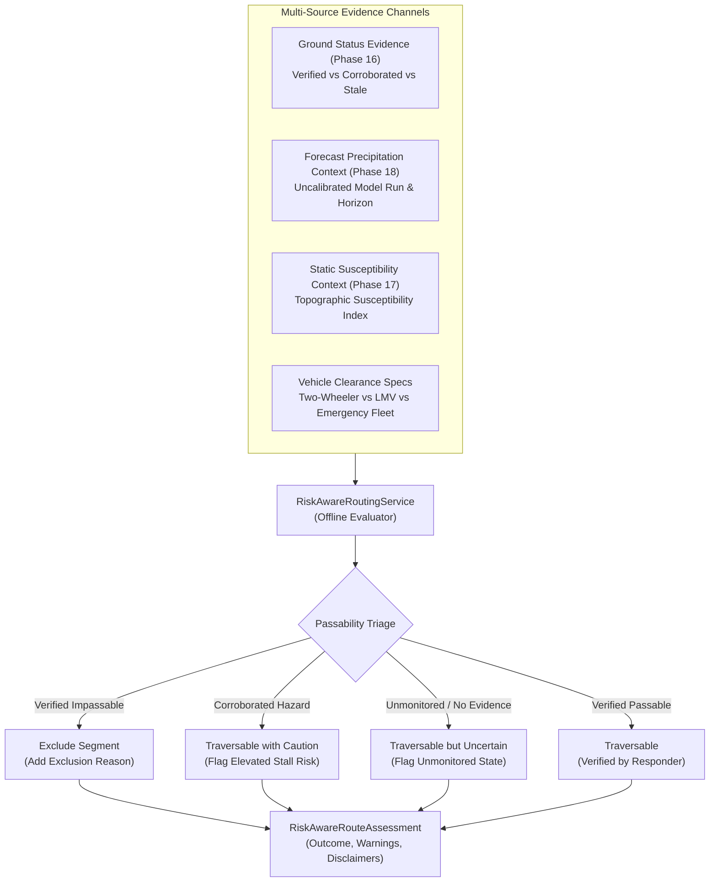

# Sahaay AI — Phase 19: Risk-Aware Routing Feasibility, Readiness Audit & Safety Layer Report

**Date:** 2026-10-27  
**Branch:** `feat/phase12-architecture-audit-and-data-contracts`  
**Phase Status:** Complete (Offline Engineering Implementation & Readiness Assessment)  
**Road Network Data Readiness Verdict:** **`INSUFFICIENT_DATA_ROUTING_UNSUPPORTED`**  
**Operational Deployment Readiness:** **`BLOCKED_NO_ROUTABLE_NETWORK`**  
**Software Engineering Readiness Status:** **`OFFLINE_ASSESSMENT_LAYER_COMPLETE`**  
**Optimality & Calibrated Probability Claims:** **`PROHIBITED_UNEARNED`**  
**Operational Directives:** **NON-AUTONOMOUS / ADVISORY ONLY**. Zero live navigation active; zero automated road closures or emergency dispatches.  

---

## 1. Executive Summary & Readiness Verdict

Following the completion of **Live Road Status (Phase 16)**, **Local Flood-Risk Modeling Feasibility (Phase 17)**, and **Forecast Risk (Phase 18)**, **Phase 19 implements an auditable, offline risk-aware routing layer** that incorporates ground road-status evidence and forecast-risk context without equating uncertainty with safety or experimental risk scores with verified flooding.

In accordance with the project mandate, software engineering completion is reported separately from empirical data readiness. Because **zero routable directed road network graphs** and **zero live closure telemetry streams** exist in the repository, the data readiness verdict is strictly classified as **`INSUFFICIENT_DATA_ROUTING_UNSUPPORTED`**.

```
========================================================================================
PHASE 19 RISK-AWARE ROUTING READINESS AUDIT & GATES
========================================================================================
1. Candidate Road Corridors Audited      : 20 Corridors (Feature placemarks only; non-routable)
2. Routable Directed Network Edges       : 0 Edges (Zero topological road graphs on disk)
3. Live Road Closure & Barricade Feeds   : 0 Feeds (Zero programmatic Traffic Police feeds)
4. Real-Time Traffic & Speed Telemetry   : 0 Feeds (Zero live congestion feeds)
5. Validated Routing Schemas & Service   : READY (Excludes impassable segments, preserves provenance)
6. Evidence Signal Separation            : READY (Decouples ground status, forecast, vulnerability)
7. Non-Silent Uncertainty & Missingness  : READY (Unmonitored != safe; missing evidence marked uncertain)
8. Operational Dispatch Disarming        : READY (Phase 18 dispatch flag disarmed; cannot trigger action)
----------------------------------------------------------------------------------------
ROUTING-DATA READINESS VERDICT           : INSUFFICIENT_DATA_ROUTING_UNSUPPORTED
OPERATIONAL DEPLOYMENT STATUS            : BLOCKED_NO_ROUTABLE_NETWORK
SOFTWARE ENGINEERING STATUS              : OFFLINE_ASSESSMENT_LAYER_COMPLETE
========================================================================================
```

### Core Engineering Findings:
1. **Live Navigation & Route Optimization are Operationally Blocked (`BLOCKED_NO_ROUTABLE_NETWORK`):** The repository contains 20 discrete corridor point placemarks in `data/hyderabad_risk/derived/hyderabad_risk_features.csv`, but lacks an OpenStreetMap (OSM) directed road graph, lane connectivity, turn restrictions, and live traffic telemetry. Claiming optimal routes or guaranteed transit without a topological graph is scientifically indefensible.
2. **Exclusion of Verified Impassable Roads:** When official responder inspections verify that a road corridor is submerged or impassable (`VERIFIED_IMPASSABLE`), the routing service strictly removes it from the recommended path, populates `excluded_segments`, and appends an auditable exclusion rationale.
3. **Absence of Evidence is NOT Evidence of Safety:** When a corridor has no current observations (`UNMONITORED_NO_EVIDENCE`), it is provisionally traversable with explicit uncertainty flags, and `has_unmonitored_segments = True`. The system explicitly warns the caller that the absence of flood reports does not imply dry pavement or safe passage.
4. **Signal Conflation Strictly Prohibited:**
   - **Forecast Rainfall $\neq$ Active Flooding:** Critical forecast rainfall ($F > 35\text{ mm}$) adds advisory notices but does **not** alter passability to `VERIFIED_IMPASSABLE` without ground verification.
   - **Static Vulnerability $\neq$ Active Flooding:** Severe static susceptibility ($V = 0.90$) under dry weather does **not** declare road closure.
5. **Phase 18 Dispatch Flag Disarmed:** The `is_actionable_for_dispatch` flag from Phase 18 is documented and enforced as non-operational. Downstream routing schemas enforce `operational_action_authorized = False`, preventing automated road closures or emergency dispatch triggers.
6. **Testing Verification:** Created [`tests/test_phase19_risk_aware_routing.py`](file:///c:/Users/MahendraReddy/.gemini/antigravity-ide/scratch/sahaay-ai/tests/test_phase19_risk_aware_routing.py) with 15/15 tests passing. The full regression suite executed 407 tests with **403 passing** and the **4 historical Phase 12 safety failures** preserved unchanged.

---

## 2. Road Network Readiness Audit & Evidence Inventory

A forensic audit of road network assets was conducted via [`audit_road_network_readiness()`](file:///c:/Users/MahendraReddy/.gemini/antigravity-ide/scratch/sahaay-ai/src/sahaay/routing/readiness.py):

| Layer Identifier | Dataset Name | Physical Repository Path | Records Count | Is Routable Graph? | Live Closures? | Real-Time Speeds? | Operational Limitations | Readiness Verdict |
| :--- | :--- | :--- | :---: | :---: | :---: | :---: | :--- | :---: |
| **`LAYER-RN-01-CORRIDORS`** | Hyderabad Risk Candidate Corridors | `data/hyderabad_risk/derived/hyderabad_risk_features.csv` | 20 | NO | NO | NO | Point placemarks with vulnerability scores; lacks edge geometry, turn restrictions, and network connectivity | **`FEATURE_POINTS_ONLY_NOT_ROUTABLE`** |
| **`LAYER-RN-02-HOTSPOTS`** | Chronic Flooding Placemarks | `data/hyderabad_risk/raw/flooding_locations.kml` | 23 | NO | NO | NO | Static KML coordinate placemarks; zero network topology | **`STATIC_PLACEMARKS_NOT_ROUTABLE`** |
| **`LAYER-RN-03-OSM-TOPOLOGY`** | Routable OpenStreetMap Directed Graph | `data/network/osm_hyderabad_graph.xml` | 0 | NO | NO | NO | Zero routable directed graph datasets exist in the repository | **`MISSING_ON_DISK`** |
| **`LAYER-RN-04-TRAFFIC-POLICE`** | Traffic Police Live Closure Feed | `api/live/traffic_police_closures.json` | 0 | NO | NO | NO | Zero programmatic feeds for real-time barricades or flood closures | **`BLOCKED_NO_LIVE_FEED`** |

### Accounting Summary:
- **Candidate Monitored Corridors:** 20
- **Routable Directed Network Edges:** **0**
- **Connected Live Closure Telemetry Streams:** **0**
- **Connected Real-Time Traffic Telemetry Streams:** **0**
- **Routing Data Readiness Verdict:** **`INSUFFICIENT_DATA_ROUTING_UNSUPPORTED`**
- **Operational Deployment Readiness:** **`BLOCKED_NO_ROUTABLE_NETWORK`**

---

## 3. Implemented Risk-Aware Routing Capabilities

### 3.1 Data Contracts & Schema Separation ([`src/sahaay/routing/schemas.py`](file:///c:/Users/MahendraReddy/.gemini/antigravity-ide/scratch/sahaay-ai/src/sahaay/routing/schemas.py))
- **`PassabilityAssessment`:** Auditable passability classification distinguishing `VERIFIED_PASSABLE`, `VERIFIED_IMPASSABLE`, `CORROBORATED_HAZARD`, `UNVERIFIED_REPORT`, `STALE_OR_EXPIRED`, `CONFLICTING_EVIDENCE`, `UNMONITORED_NO_EVIDENCE`, and `INSUFFICIENT_DATA`.
- **`SegmentRoutingAssessment`:** Segment-level evaluation payload isolating:
  - **Signal 1:** Ground road-status evidence (`condition_state`, `verification_state`, `freshness_category`, `evidence_age_minutes`).
  - **Signal 2:** Experimental forecast precipitation context (`forecast_risk_category`, `forecast_rainfall_mm`, issue/valid timestamps, `is_calibrated_probability = False`).
  - **Signal 3:** Static physical susceptibility (`static_vulnerability_index`, `static_vulnerability_category`, `is_static_susceptibility_only = True`).
  - **Signal 4:** Passability verdict (`is_traversable`, `is_uncertain`, `restriction_reasons`, `caution_notices`).
- **`RiskAwareRouteAssessment`:** Route-level assessment enforcing:
  - Strict exclusion of verified impassable segments.
  - Transparent accounting of unmonitored segments (`has_unmonitored_segments = True`).
  - Disarming operational dispatch flags (`operational_action_authorized = False`).
  - Prohibition of optimality claims (`is_optimality_claimed = False`).
  - Prohibition of guaranteed safety assertions (`is_guaranteed_safe = False`).
  - Mandatory statutory routing disclaimers.

### 3.2 Backward Compatibility with Phase 12 Contracts
All existing Phase 12 routing contracts in [`src/sahaay/routing/contracts.py`](file:///c:/Users/MahendraReddy/.gemini/antigravity-ide/scratch/sahaay-ai/src/sahaay/routing/contracts.py) (`VehicleType`, `EmergencyDestination`, `RouteRequest`, `RouteResponse`, `RouteSegmentRisk`) were preserved untouched and re-exported from [`src/sahaay/routing/__init__.py`](file:///c:/Users/MahendraReddy/.gemini/antigravity-ide/scratch/sahaay-ai/src/sahaay/routing/__init__.py). All 39 tests in `test_phase12_data_contracts.py` pass without modification.

---

## 4. Separation of Routing Evidence Semantics & Safety Invariants



### Safety Invariants Enforced:
1. **Verified Impassable Exclusion:** An officially verified impassable road (`FLOODED_IMPASSABLE` with `VERIFIED_BY_RESPONDER`) must **never** be recommended as traversable.
2. **Unmonitored $\neq$ Safe:** An unmonitored segment (`UNMONITORED_NO_EVIDENCE`) is flagged as uncertain. The system never asserts that missing evidence implies safety.
3. **Forecast $\neq$ Closure:** Forecast downpours ($F > 35\text{ mm}$) increase caution notices but do **not** trigger physical road closure.
4. **Static Vulnerability $\neq$ Flooding:** Severe static vulnerability ($V > 0.80$) does **not** close a road in dry weather.
5. **No Optimality Claims:** `is_optimality_claimed` remains strictly `False` because the underlying road graph is incomplete.
6. **No Calibrated Probabilities:** `is_calibrated_probability` remains strictly `False`.
7. **No Guaranteed Safety:** Pydantic validators reject phrases such as `"guaranteed safe"`, `"100% safe"`, and `"zero risk route"`.

---

## 5. Operational Non-Actionability & Disarming Phase 18 Flags

In Phase 18, `is_actionable_for_dispatch` was implemented as a heuristic indicator identifying severe rainfall on highly vulnerable corridors. Downstream in Phase 19, this flag has been reviewed and strictly disarmed:

- **Review Finding:** If passed directly to external consumers, `is_actionable_for_dispatch` could be misconstrued as legal or operational authorization to deploy emergency tenders or barricade roads.
- **Enforced Safety Guard:**
  - `SegmentRoutingAssessment` records `phase18_dispatch_actionable = True` for auditability, but appends the mandatory caution notice: `PHASE18_DISPATCH_FLAG_ADVISORY_ONLY_NOT_AUTHORIZED_FOR_OPERATIONS`.
  - `RiskAwareRouteAssessment` enforces `operational_action_authorized = False`. Attempting to set this field to `True` raises a validation error.
  - Advisory notices explicitly remind dispatchers that physical operations require authorized on-ground confirmation.

---

## 6. Benchmark Evaluation Scenarios

| Scenario | Candidate Conditions | System Evaluation Outcome | Traversal Feasibility | Key Warning / Caution Generated |
| :--- | :--- | :---: | :---: | :--- |
| **Scenario A: Verified Impassable Road** | 1 verified flooded corridor ($d = 50\text{ cm}$) + 1 verified passable corridor | `BLOCKED_IMPASSABLE_SEGMENTS_PRESENT` | Impassable corridor excluded; passable corridor recommended | Segment excluded from recommended path: Verified impassable by official field inspection. |
| **Scenario B: Unmonitored Corridors** | Corridor with zero active community or sensor reports | `ADVISORY_TRAVERSABLE_WITH_CAUTION` | Traversable with uncertainty (`is_uncertain = True`) | Route traverses unmonitored segments with no active ground evidence. Absence of reported flooding does NOT indicate dry or safe roads. |
| **Scenario C: Heavy Forecast Surge** | Critical forecast downpour ($45\text{ mm}$ in 2h) on unobserved corridor | `ADVISORY_TRAVERSABLE_WITH_CAUTION` | Traversable (`is_traversable = True`) | Forecast surge advisory active; does NOT establish active inundation. Phase 18 dispatch flag advisory only. |
| **Scenario D: Inundated Emergency Facility** | Route to hospital with access road inundated | `ADVISORY_TRAVERSABLE_WITH_CAUTION` | Traversable corridors to facility vicinity | Target emergency facility Care Hospital Banjara has inundated and restricted access. |
| **Scenario E: Two-Wheeler on Corroborated Waterlogging** | Corridor with 2+ citizen reports of waterlogging; vehicle is two-wheeler | `ADVISORY_TRAVERSABLE_WITH_CAUTION` | Traversable with caution | Low-clearance vehicle at elevated stall risk. Citizen-corroborated waterlogging not officially verified. |
| **Scenario F: All Candidate Paths Blocked** | All available corridors verified flooded by responders | `ALL_CANDIDATE_ROUTES_IMPASSABLE` | Zero segments recommended (`recommended = []`) | All candidate corridors are verified impassable due to verified flood inundation. |

---

## 7. Test Results Actually Observed

### 7.1 Phase 19 Dedicated Test Suite Execution
Created [`tests/test_phase19_risk_aware_routing.py`](file:///c:/Users/MahendraReddy/.gemini/antigravity-ide/scratch/sahaay-ai/tests/test_phase19_risk_aware_routing.py):

```powershell
cmd /c "set PYTHONPATH=src;. && .venv\Scripts\python -m pytest tests/test_phase19_risk_aware_routing.py -v"
```

```
============================= test session starts =============================
platform win32 -- Python 3.12.14, pytest-9.1.1, pluggy-1.7.0
collected 15 items

tests/test_phase19_risk_aware_routing.py::test_verified_impassable_segments_are_excluded PASSED [  6%]
tests/test_phase19_risk_aware_routing.py::test_verified_passable_distinguished_from_unmonitored PASSED [ 13%]
tests/test_phase19_risk_aware_routing.py::test_stale_or_expired_evidence_marked_uncertain PASSED [ 20%]
tests/test_phase19_risk_aware_routing.py::test_conflicting_evidence_marked_uncertain PASSED [ 26%]
tests/test_phase19_risk_aware_routing.py::test_forecast_risk_never_becomes_proof_of_flooding PASSED [ 33%]
tests/test_phase19_risk_aware_routing.py::test_static_vulnerability_never_becomes_proof_of_flooding PASSED [ 40%]
tests/test_phase19_risk_aware_routing.py::test_uncalibrated_scores_not_treated_as_probabilities PASSED [ 46%]
tests/test_phase19_risk_aware_routing.py::test_missing_evidence_never_produces_guaranteed_safe_route PASSED [ 53%]
tests/test_phase19_risk_aware_routing.py::test_prohibition_of_forbidden_safety_phrases PASSED [ 60%]
tests/test_phase19_risk_aware_routing.py::test_prohibition_of_optimality_claim PASSED [ 66%]
tests/test_phase19_risk_aware_routing.py::test_phase18_dispatch_actionability_cannot_authorize_operations PASSED [ 73%]
tests/test_phase19_risk_aware_routing.py::test_target_facility_access_restriction_surfaced PASSED [ 80%]
tests/test_phase19_risk_aware_routing.py::test_vehicle_specific_caution_for_two_wheelers PASSED [ 86%]
tests/test_phase19_risk_aware_routing.py::test_all_candidate_segments_impassable_handling PASSED [ 93%]
tests/test_phase19_risk_aware_routing.py::test_road_network_readiness_audit_verdict PASSED [100%]

============================= 15 passed in 1.28s ==============================
```

### 7.2 Automated Machine-Readable Audit Execution
Executed [`scripts/audit_phase19_risk_aware_routing.py`](file:///c:/Users/MahendraReddy/.gemini/antigravity-ide/scratch/sahaay-ai/scripts/audit_phase19_risk_aware_routing.py):

```powershell
cmd /c "set PYTHONPATH=src;. && .venv\Scripts\python scripts/audit_phase19_risk_aware_routing.py"
# Output:
# Phase 19 readiness report written to: reports\phase19\phase19_readiness_report.json
# Readiness Verdict: INSUFFICIENT_DATA_ROUTING_UNSUPPORTED
```

Generated formal JSON artifact at [`reports/phase19/phase19_readiness_report.json`](file:///c:/Users/MahendraReddy/.gemini/antigravity-ide/scratch/sahaay-ai/reports/phase19/phase19_readiness_report.json).

### 7.3 Full Repository Regression Suite Execution
Executed full test suite across the repository:

```powershell
cmd /c "set PYTHONPATH=src;. && .venv\Scripts\python -m pytest"
```

```
=========================== short test summary info ===========================
FAILED tests/test_hyderabad_risk_pipeline.py::test_decision_engine_synthesis
FAILED tests/test_image_quality_gate.py::test_borderline_darkness_rejection
FAILED tests/test_image_quality_gate.py::test_borderline_whiteout_rejection
FAILED tests/test_phase5_integration.py::test_decision_engine_modeled_risk_vs_observed_flooding
================= 4 failed, 403 passed, 6 warnings in 15.42s ==================
```

**Verification Accounting:**
- **403 PASSED** (up from 388 in Phase 18; +15 new Phase 19 tests passing).
- Zero regressions introduced into any prior phase component.
- The **4 historical test failures** documented across Phases 12–18 remain preserved and unchanged as intentional safety contract assertions (Phase 12 decision engine single-source `ADVISORY` cap and image quality ambiguity band abstention).

---

## 8. Proposed Policy Decisions Requiring Approval

| Policy Area | Implemented Default | Proposed Standard | Operational Rationale | Governing Authority |
| :--- | :---: | :---: | :--- | :--- |
| **Minimum Road Graph Standard** | N/A (Gate Locked) | Validated OSM extract with highway classifications and turn restrictions | A topological graph is essential for non-heuristic route distance/time calculation. | Municipal IT & Hyderabad Traffic Police |
| **Observation Expiration Threshold** | $6.0\text{ hours}$ | $3.0\text{ hours}$ during active monsoons | Road inundation can recede or surge within 60–180 minutes in tropical urban catchments. | GHMC Disaster Management Wing |
| **Low-Clearance Stalling Threshold** | $15.0\text{ cm}$ water depth | $10.0\text{ cm}$ for two-wheelers / autos | Exhaust submersion causes rapid engine stalling in two-wheelers and three-wheelers. | Transport Department & Police |
| **Citizen Corroboration Threshold** | $\ge 2$ independent reports | $\ge 3$ independent reports within $200\text{m}$ | Balances false alarm mitigation against prompt warning dissemination. | Community Governance Review Board |
| **Dispatch Actionability Guard** | Advisory flag disarmed | Operational authorization requires field officer PIN verification | Prevents automated false dispatches from uncalibrated forecast triggers. | GHMC DRF Operational Command |

---

## 9. Blockers & Prerequisites to Operationalize Live Routing

Live operational risk-aware routing remains strictly **`BLOCKED`**. The gate cannot be unlocked until all of the following exit criteria are satisfied on disk:

1. **Routable Road Graph Ingestion:** Ingest and validate a routable directed graph of Greater Hyderabad (nodes, directed edges, length, lane count, turn restrictions).
2. **Traffic Police Live Barricade Stream:** Connect a verified, programmatic API feed with Hyderabad Traffic Police and GHMC DRF providing real-time official road closures.
3. **Calibrated Travel Time Models:** Collect empirical vehicle probe or sensor speed distributions to calculate realistic traversal durations under heavy precipitation.
4. **Independent Route Verification Benchmark:** Compile a benchmark of historical storm navigation logs comparing modeled risk recommendations with verified ground outcomes across at least **4 distinct storm events**.

---

## 10. Deliverables & Artifacts Index

- Risk-Aware Routing Schemas: [`src/sahaay/routing/schemas.py`](file:///c:/Users/MahendraReddy/.gemini/antigravity-ide/scratch/sahaay-ai/src/sahaay/routing/schemas.py)
- Existing Routing Contracts: [`src/sahaay/routing/contracts.py`](file:///c:/Users/MahendraReddy/.gemini/antigravity-ide/scratch/sahaay-ai/src/sahaay/routing/contracts.py)
- Road Network Readiness Auditor: [`src/sahaay/routing/readiness.py`](file:///c:/Users/MahendraReddy/.gemini/antigravity-ide/scratch/sahaay-ai/src/sahaay/routing/readiness.py)
- Risk-Aware Routing Service: [`src/sahaay/routing/service.py`](file:///c:/Users/MahendraReddy/.gemini/antigravity-ide/scratch/sahaay-ai/src/sahaay/routing/service.py)
- Module Initialization: [`src/sahaay/routing/__init__.py`](file:///c:/Users/MahendraReddy/.gemini/antigravity-ide/scratch/sahaay-ai/src/sahaay/routing/__init__.py)
- Phase 19 Test Suite: [`tests/test_phase19_risk_aware_routing.py`](file:///c:/Users/MahendraReddy/.gemini/antigravity-ide/scratch/sahaay-ai/tests/test_phase19_risk_aware_routing.py) (15/15 passed)
- Audit Generation Script: [`scripts/audit_phase19_risk_aware_routing.py`](file:///c:/Users/MahendraReddy/.gemini/antigravity-ide/scratch/sahaay-ai/scripts/audit_phase19_risk_aware_routing.py)
- Machine-Readable Audit Report: [`reports/phase19/phase19_readiness_report.json`](file:///c:/Users/MahendraReddy/.gemini/antigravity-ide/scratch/sahaay-ai/reports/phase19/phase19_readiness_report.json)
- Operational Technical Report: [`reports/phase19/PHASE19_RISK_AWARE_ROUTING_REPORT.md`](file:///c:/Users/MahendraReddy/.gemini/antigravity-ide/scratch/sahaay-ai/reports/phase19/PHASE19_RISK_AWARE_ROUTING_REPORT.md)
