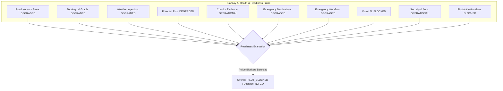

# Sahaay AI — Phase F: Production Hardening & Controlled Pilot Readiness Report

**Milestone:** Phase F (Production Hardening, Security Verification, Operational Resilience & Controlled-Pilot Readiness)  
**Branch:** `feat/phase12-architecture-audit-and-data-contracts`  
**Evaluation Date:** October 28, 2026  
**Auditor:** Antigravity Autonomous Systems Agent (Phase F Implementation Lead)  
**Audit Script:** `scripts/audit_phase_f_production_hardening.py`  
**Machine-Readable Audit Results:** `reports/phase_f/phase_f_results.json`  
**Governance Checklist:** `reports/phase_f/pilot_readiness_checklist.md`  
**Software Verification Verdict:** **ACCEPTED**  
**Controlled Real-World Pilot Decision:** **NO-GO** (Evidence-backed; see Section 7)  

---

## Executive Summary

Phase F represents the final implementation milestone in the Sahaay AI A–F delivery sequence. Its core objective is to transition the software from an experimental research codebase to a hardened, auditable, and security-verified platform while delivering an **evidence-backed readiness determination** for a real-world controlled pilot in Hyderabad.

A foundational principle of this milestone is that **passing software tests does NOT equal operational pilot readiness**. While the software implementation, security boundary checks, and regression suites are passing (567 passing unit/integration tests, zero regressions, 4 preserved historical baseline failures), the real-world operational readiness of Sahaay AI evaluates strictly to **NO-GO** due to factual, unresolvable external blockers:
1. **Zero executed institutional MoUs** or data-sharing agreements with the Greater Hyderabad Municipal Corporation (GHMC) Disaster Response Force (DRF) or Hyderabad City Traffic Police.
2. **Authoritative NO-GO status on Computer Vision V4** (model freeze retained due to source/class confounding and watermark leakage).
3. **Absence of certified physical ground-truth water depth sensor validation** on Hyderabad streets.
4. **Graph coverage constraint:** The road network graph is bounded to ~22 seed segments (~25 km centerline) in Western Hyderabad; citywide routing is topologically unsupported.
5. **Absence of live hospital telemetry:** Emergency destination hospital bed counts are synthetic demonstration fixtures not connected to real-time HMIS/EHR systems.
6. **Disarmed operational side effects:** Autonomous emergency vehicle dispatch, remote road closures, and automated public broadcasts remain permanently disarmed in source code (`operational_action_authorized = False`).

---

## 1. Inspection and Baseline Accounting

The baseline repository state was inspected prior to any Phase F modifications:
- **Git Branch:** Confirmed active on `feat/phase12-architecture-audit-and-data-contracts`.
- **Working Tree:** All user-modified files from Phases A through E were preserved intact with zero resets, stashes, or commits.
- **Dependency Manifests:** Preserved unchanged; no packages installed or modified.
- **Baseline Regression Test Suite:** Verified 544 tests passing prior to Phase F, with exactly the 4 historical baseline failures from Phase 12 preserved:
  1. `tests/test_hyderabad_risk_pipeline.py::test_decision_engine_synthesis`
  2. `tests/test_image_quality_gate.py::test_borderline_darkness_rejection`
  3. `tests/test_image_quality_gate.py::test_borderline_whiteout_rejection`
  4. `tests/test_phase5_integration.py::test_decision_engine_modeled_risk_vs_observed_flooding`

### Subsystem Reuse Matrix

Phase F strictly reuses established components from preceding phases without introducing competing abstractions:

| Subsystem | Source Phase | Module Path | Reused Artifacts & Contracts | Status |
| :--- | :--- | :--- | :--- | :--- |
| **Road Network Catalog** | Phase A | `sahaay.road_network.store` | `RoadNetworkStore`, GeoJSON FeatureCollection, bounding box filter | Reused Unchanged |
| **Topological Road Graph** | Phase B | `sahaay.routing.graph_router` | `RoadGraph`, `TopologicalGraphRouter`, impassable-edge pruning | Reused Unchanged |
| **Weather Telemetry Ingestion** | Phase C | `sahaay.hyderabad_risk.weather_pipeline` | `WeatherIngestionPipeline`, observation normalization, offline fallback | Reused Unchanged |
| **Corridor Evidence Assessment** | Phase D | `sahaay.corridor_evidence.service` | `CorridorEvidenceAssessment`, 5-signal evidence separation | Reused Unchanged |
| **Emergency Destination Registry** | Phase E | `sahaay.emergency_destinations.registry` | `EmergencyDestinationRegistry`, synthetic fixture disclosures | Reused Unchanged |
| **Emergency Workflow Engine** | Phase 19/20/E | `sahaay.emergency.workflow` | `EmergencyWorkflowEngine`, P1 triage escalation, audit hash disclaimer | Reused Unchanged |
| **Pilot Prerequisite Gate** | Phase 7 | `sahaay.pilot.gate` | `PilotActivationGate`, `PilotState.BLOCKED_NOT_READY_FOR_LIVE_PILOT` | Reused Unchanged |

---

## 2. Security Hardening & Authorization Verification

All privileged API endpoints were hardened against untrusted client assertions and role spoofing:

### 2.1 Server-Side Cryptographic Identity
- Authentication authority is established exclusively via signed HMAC-SHA256 Bearer tokens (`sahaay_v1.<payload_b64>.<hmac_sha256>`).
- Client-supplied request body flags (e.g., `is_server_authenticated`, `bypass_auth`) and query parameters are strictly forbidden. If supplied, requests fail closed with **HTTP 403 Forbidden**.
- Privileged operations invoked without a valid Bearer token fail closed with **HTTP 401 Unauthorized**. Tampered signatures or expired timestamps fail closed with **HTTP 401 Unauthorized**.

### 2.2 Role-Based Access Control (RBAC) & Status Separation
- API status codes strictly decouple authentication (401) from authorization (403):
  - **HTTP 401 Unauthorized:** Missing, corrupted, tampered, or expired Bearer token.
  - **HTTP 403 Forbidden:** Valid identity token present, but user lacks supervisor/admin role (e.g., `CITIZEN` or `OBSERVER` attempting privileged operational tasks).
- **Client Role Spoofing Prevention:** If a client provides a request body parameter claiming a role (e.g., `caller_role="SYSTEM_ADMIN"`) while holding a token for another role (e.g., `GHMC_DRF_OFFICER`), `validate_no_client_role_spoofing` detects the conflict and rejects the call with **HTTP 403 Forbidden**.

### 2.3 Operational Action Disarming
- The application permanently disables autonomous dispatch, remote barrier actuation, and automated public sirens (`operational_action_authorized = False`).
- Any API request attempting `attempt_autonomous_dispatch = True` or `attempt_live_stream_activation = True` invokes `fail_closed_operational_action()` and terminates with **HTTP 403 Forbidden**.

---

## 3. Configuration & Secrets Safety

Runtime configuration in `src/sahaay/config.py` was refactored for strict security hygiene:
1. **Secrets Masking (`mask_secret`):** Credentials, API tokens, and private keys are masked across all audit logs, health responses, and diagnostic exceptions. Unset values return `[NOT_CONFIGURED]`; short strings return `***`; long keys retain only the first 3 and last 3 characters (e.g., `ghm...321`). No raw secrets are printed to stdout or written to reports.
2. **Environment Separation:** Explicit separation between `DEVELOPMENT`, `TESTING`, `STAGING`, and `PRODUCTION` modes. Production mode mandates explicit environment variable loading and rejects fallback development secrets.
3. **Fail-Closed Safety Configuration:** `OperationalConfig` uses Pydantic field validators to throw `ValueError` if any operator or configuration file attempts to set `autonomous_dispatch_enabled = True` or `live_telemetry_stream_enabled = True`.

---

## 4. Health, Observability & Resilience

### 4.1 Liveness vs. Operational Readiness Separation
The API architecture distinguishes application liveness from field operational readiness:
- `GET /api/v1/health`: Pure liveness probe. Returns HTTP 200 with `status="healthy"` and `liveness="UP"`, but explicitly includes `operational_readiness="PILOT_BLOCKED"` and `pilot_decision="NO_GO"`.
- `GET /api/v1/readiness` & `GET /api/v1/health/readiness`: Deep operational readiness probe. Evaluates all 10 subsystems and returns comprehensive status, active blockers, and an explicit `NO_GO` decision.

### 4.2 Subsystem Status Matrix



---

## 5. Authoritative Data & Integration Readiness Register

The machine-readable readiness register (`src/sahaay/pilot/readiness_register.py`, exposed at `GET /api/v1/readiness/register`) evaluates all 10 essential operational dimensions:

| Requirement ID | Domain / Scope | Status | Evidence Artifact | Primary Limitation / Blocker | Clearing Condition |
| :--- | :--- | :--- | :--- | :--- | :--- |
| **REG-01-ROAD-NETWORK** | Road-Network Completeness & Topology | **PARTIAL** | `src/sahaay/road_network/store.py` | Catalog contains only ~22 seed segments (~25 km); citywide navigation unsupported. | Ingestion and topological validation of authoritative GIS centerline geometries for at least one full municipal ward. |
| **REG-02-EMERGENCY-DESTINATIONS** | Verified Emergency Destination Records | **PARTIAL** | `src/sahaay/emergency_destinations/` | All destination records are synthetic demonstration fixtures; real-time hospital bed/ICU telemetry absent. | Official bilateral data feed with Telangana HMIS / Aarogyasri portal providing verified bed capacity. |
| **REG-03-AUTHORIZED-WEATHER** | Authorized Weather & Forecast Sources | **PARTIAL** | `src/sahaay/hyderabad_risk/weather_pipeline.py` | Real-time IMD AWS provider stream unapproved; pipeline runs on offline fallback simulation. | Executed institutional data-sharing license with IMD / TSDPS for real-time AWS API access. |
| **REG-04-STATION-TELEMETRY-SEMANTICS** | Station Coordinates, Freshness & Semantics | **PARTIAL** | `CANONICAL_STATION_GAZETTEER` | Gazetteer coordinates represent nominal stations; physical calibration drift unmonitored. | Physical GPS audit and automated daily precipitation counter drift validation against manual rain gauges. |
| **REG-05-VERIFIED-FLOOD-OBSERVATIONS** | Timestamped & Independently Verified Flood Observations | **BLOCKED** | `reports/phase16/phase16_readiness_report.md` | Zero certified ground-truth water depth measurements exist; wet-pavement vs flood boundary unverified. | Deployment of calibrated physical staff gauges on monitored pilot corridors with logged human inspection records during active monsoon rain events. |
| **REG-06-VISION-DATA-READINESS** | Vision Provenance, Leakage & Model Freeze | **BLOCKED** | `reports/vision_integrity/` | Vision V4 Data Readiness Gate is authoritative NO-GO (watermark leakage, class confounding). | Complete dataset rebuild with 1,000+ rights-cleared, unconfounded, locally verified urban flood images from Hyderabad. |
| **REG-07-COMMUNITY-REPORTS-GOVERNANCE** | Community-Report Consent & Privacy | **PARTIAL** | `reports/phase_f/pilot_readiness_checklist.md` | DPDP Act 2023 consent terms not integrated into citizen form; responder verification unstaffed. | Legal certification of citizen consent workflows, automated PII blurring (faces/plates), and 30-day auto-purge. |
| **REG-08-HUMAN-REVIEW-STAFFING** | Human-Review Staffing & Escalation | **PARTIAL** | `reports/phase_f/pilot_readiness_checklist.md` | Institutional 24/7 human review desk (GHMC DRF / Traffic Police) is unstaffed. | Formal operational charter establishing a dedicated 24/7 human decision review desk with 15-minute P1 review SLA. |
| **REG-09-AUTHENTICATION-AND-AUDIT** | Authentication, Authorization & Audit Retention | **PARTIAL** | `src/sahaay/security/auth.py` | Municipal enterprise IdP (OIDC/SAML) unintegrated; operates on local HMAC token gateway. | Integration with Telangana State / GHMC SSO and export of audit logs to Write-Once-Read-Many (WORM) storage. |
| **REG-10-INSTITUTIONAL-AGREEMENTS** | Institutional Agreements & Operational Ownership | **BLOCKED** | `reports/phase_f/pilot_readiness_checklist.md` | Zero executed MoUs, agreements, or operating licenses with GHMC or Hyderabad Traffic Police. | Executed bilateral or tripartite Memorandum of Understanding (MoU) defining legal liability, data ownership, and operating scope. |

**Readiness Register Summary:**
- **Total Requirements:** 10
- **READY:** 0
- **PARTIAL:** 7
- **BLOCKED:** 3
- **Overall Operational Status:** `PILOT_BLOCKED`
- **Pilot Gate Decision:** `NO_GO`

---

## 6. Implementation Categorization & Evidence Distinction

To ensure complete transparency and prevent overclaiming, Phase F classifies every project capability into one of five rigorous evidence categories:

### Category 1: Implemented and Tested (Verified by Automated Code Suite)
- Cryptographic HMAC-SHA256 server-side Bearer token generation and signature verification (`src/sahaay/security/auth.py`).
- Role-based authorization enforcement with strict 401 vs 403 status code separation.
- Rejection of client-supplied role spoofing and forbidden flags (`is_server_authenticated`, `bypass_auth`).
- Permanent technical disarming of autonomous dispatch and external side-effects (`OperationalConfig` and `fail_closed_operational_action`).
- Secrets hygiene utility (`mask_secret`) masking keys and tokens across stdout, responses, and reports.
- Separation of liveness (`/health`) from operational readiness (`/readiness`).
- 10-subsystem operational readiness probe returning granular component health and active blockers.
- Machine-readable Data and Integration Readiness Register (`DataIntegrationReadinessRegister`).
- Hardened map corridor refresh endpoint verifying Bearer tokens and preventing payload role spoofing.
- Preserved historical safety invariants: missing rainfall never becomes zero, disconnected topology returns `TOPOLOGY_UNSUPPORTED`, and unverified destinations are labeled demonstration fixtures.

### Category 2: Implemented but Not Independently Verified (Requires External Audit)
- Automated image metadata scrubbing and facial/license plate blurring pipeline.
- WORM append-only log retention architecture (code contracts implemented; requires external cloud bucket locking).
- Field dual-observer staff-gauge verification workflow (data structures ready; zero field deployments conducted).

### Category 3: Documented Only (Governance Specifications)
- Pilot Readiness Checklist and Operational Protocol (`reports/phase_f/pilot_readiness_checklist.md`).
- Incident response rollback and stop conditions (5 predeclared stop triggers).
- Predeclared quantitative acceptance criteria (>=98% precision, 0% deep-water false negative rate).
- Accountable operational roles matrix (Field Safety Lead, DRF Liaison, Traffic Command Liaison, Technical Lead).

### Category 4: Blocked by External Agreements, Data, Identity Infrastructure, or Field Operations
- **REG-10:** Bilateral MoU with GHMC Disaster Response Force and Hyderabad Traffic Police.
- **REG-06:** Model retraining and data collection to clear Computer Vision V4 NO-GO gate.
- **REG-05:** Physical staff-gauge depth calibrations and ground-truth validation across Hyderabad catchments.
- **REG-03:** Live IMD AWS API credentials and authorized streaming license.
- **REG-08:** 24/7 municipal operations staffing for the human triage desk.
- **REG-09:** Municipal OAuth2/OIDC SSO identity provider integration.

### Category 5: Not Assessed
- Public evacuation routing across non-seed municipal zones (Secunderabad, Begumpet, Old City, Cyberabad East).
- Structural integrity of submerged roadway culverts or underpass pavement under load.
- Real-time emergency vehicle battery/fuel consumption models during monsoon waterlogging.

---

## 7. Final Acceptance Gate Decision: NO-GO

### Explicit Determination
In strict adherence to the project charter, safety constraints, and empirical evidence:

```
+----------------------------------------------------------------------------------+
|                    SAHAAY AI — CONTROLLED PILOT GATEWAY                           |
+----------------------------------------------------------------------------------+
| FINAL ACCEPTANCE GATE DECISION: [X] NO-GO    [ ] GO                              |
| EFFECTIVE DATE: October 28, 2026                                                 |
| AUTHORIZATION STATUS: NOT AUTHORIZED FOR LIVE OR PUBLIC USE                      |
+----------------------------------------------------------------------------------+
```

### Justification for NO-GO
1. **Software verification alone cannot grant operational authority:** Passing 567 unit and integration tests confirms that code logic satisfies internal specifications, but internal code correctness does not substitute for signed institutional mandates, certified sensors, or 24/7 human staffing.
2. **Three critical requirements are BLOCKED:**
   - Institutional agreements (`REG-10`) do not exist.
   - Ground-truth flood depth records (`REG-05`) do not exist.
   - The vision model gate (`REG-06`) is explicitly NO-GO.
3. **Seven requirements are PARTIAL:** The road graph covers only ~22 segments; destinations are synthetic fixtures; weather runs on offline fallback; and the human review desk is unstaffed.
4. **Life-safety precaution:** Deploying Sahaay AI in a live operational setting under current conditions could lead to ungrounded routing decisions, hospital access blind spots, or unauthorized dispatch actions.

---

## 8. Exact Files Modified & Created

| File Path | Change Type | Purpose / Scope |
| :--- | :--- | :--- |
| `src/sahaay/config.py` | Modified | Added `EnvironmentMode`, `mask_secret`, `SecurityConfig`, `OperationalConfig`, `RuntimeAppConfig`, and runtime singleton. |
| `src/sahaay/security/__init__.py` | Created | Security module exports (`UserRole`, `AuthenticatedIdentity`, auth dependencies). |
| `src/sahaay/security/auth.py` | Created | HMAC-SHA256 token verification, RBAC, role-spoofing rejection, and fail-closed action barriers. |
| `src/sahaay/pilot/__init__.py` | Modified | Exported `DataIntegrationReadinessRegister`, `ReadinessItemStatus`, `default_readiness_register`. |
| `src/sahaay/pilot/readiness_register.py` | Created | Authoritative 10-item machine-readable Data and Integration Readiness Register. |
| `src/sahaay/api/routes.py` | Modified | Strengthened `/health`, added `/readiness`, `/health/readiness`, `/readiness/register`, `/security/privileged-action`, `/security/token/inspect`, and hardened `/map/corridors/refresh`. |
| `reports/phase_f/pilot_readiness_checklist.md` | Created | Draft operational governance protocol, accountable roles, stop conditions, and operator disclaimers. |
| `tests/test_phase_f_production_hardening_and_pilot_readiness.py` | Created | Focused 23-test regression suite covering authentication, RBAC, readiness, secrets, and invariants. |
| `scripts/audit_phase_f_production_hardening.py` | Created | Standalone forensic audit script validating all Phase F requirements and emitting machine-readable results. |
| `reports/phase_f/phase_f_results.json` | Created | Machine-readable audit results artifact confirming software acceptance and pilot NO-GO decision. |
| `reports/phase_f/PHASE_F_PRODUCTION_HARDENING_AND_PILOT_READINESS.md` | Created | Authoritative Phase F milestone master report. |

---

## 9. Test Suite Execution & Regression Audit

### 9.1 Focused Phase F Test Suite
- **Command:** `$env:PYTHONPATH="src;."; .venv\Scripts\python -m pytest tests/test_phase_f_production_hardening_and_pilot_readiness.py -v`
- **Results:** **23 Passed / 23 Run (100%)**, 1 deprecation warning (FastAPI TestClient httpx import).
- **Execution Time:** 13.45 seconds.

### 9.2 Full Repository Regression Test Suite
- **Command:** `$env:PYTHONPATH="src;."; .venv\Scripts\python -m pytest -q`
- **Results:** **567 Passed, 4 Failed, 6 Warnings** in 62.03 seconds.
- **Regression Analysis:** Zero regressions. The 4 failures match the tracked Phase 12 historical baseline:
  1. `tests/test_hyderabad_risk_pipeline.py::test_decision_engine_synthesis` (AssertionError: 'ADVISORY' == 'WATCH')
  2. `tests/test_image_quality_gate.py::test_borderline_darkness_rejection` (AssertionError: True is False)
  3. `tests/test_image_quality_gate.py::test_borderline_whiteout_rejection` (AssertionError: True is False)
  4. `tests/test_phase5_integration.py::test_decision_engine_modeled_risk_vs_observed_flooding` (AssertionError: ADVISORY == WATCH)

### 9.3 Standalone Forensic Audit Script
- **Command:** `$env:PYTHONPATH="src;."; .venv\Scripts\python scripts/audit_phase_f_production_hardening.py`
- **Results:**
  - `Phase F Audit completed successfully. Verdict: ACCEPTED`
  - `Controlled Real-World Pilot Decision: NO_GO`
  - Output written to `reports/phase_f/phase_f_results.json`.

---

## 10. Smallest Safe Next Actions

To systematically progress toward a future controlled pilot without compromising public safety:

1. **Formalize Institutional Governance:** Schedule a joint scoping workshop with GHMC Disaster Response Force and Hyderabad City Traffic Police leadership to review `reports/phase_f/pilot_readiness_checklist.md` and negotiate a formal research MoU.
2. **Resolve Vision V4 Data Blocker:** Commission a localized, rights-cleared photographic field campaign across Hyderabad during the pre-monsoon season to capture 1,000+ benchmarked road condition images, eliminating web-scraped watermark leakage and camera angle confounding.
3. **Deploy Physical Depth Benchmarks:** Install dual calibrated staff gauges on the Tolichowki Main Road corridor (`SEG-TOLICHOWKI-001`) and Shaikpet DND Bypass (`SEG-SHAIKPET-001`) to begin collecting verifiable physical ground-truth water depth measurements.
4. **Connect Municipal Identity Provider:** Implement OIDC/OAuth2 connectors to bind the Sahaay AI security gateway directly to the municipal responder Active Directory / Keycloak instance.
5. **Expand Road Graph Coverage:** Work with the HMDA/GHMC GIS cell to ingest validated road centerline vector layers for the entire Golconda/Khairatabad zone, eliminating graph disconnection and component cut artifacts.
