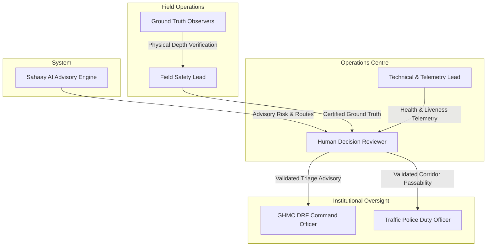
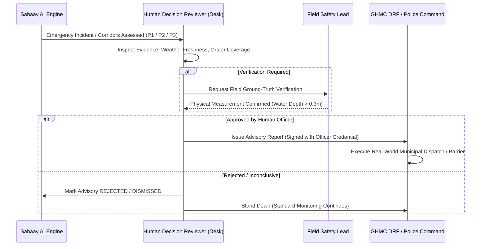

# Sahaay AI — Pilot Readiness Checklist & Operational Protocol

**DOCUMENT CLASSIFICATION:** DRAFT OPERATIONAL GOVERNANCE PROTOCOL  
**AUTHORIZATION STATUS:** **NOT AUTHORIZED UNTIL APPROVED BY RELEVANT INSTITUTIONS**  
**EVALUATION MILESTONE:** Phase F — Production Hardening & Controlled Pilot Readiness  
**TARGET JURISDICTION:** Hyderabad Metropolitan Area (GHMC / Hyderabad Traffic Police)  
**EFFECTIVE STATUS:** PENDING FORMAL INSTITUTIONAL RATIFICATION (CURRENT VERDICT: **NO-GO**)  

---

> [!CAUTION]
> ### STRICT PROHIBITION AGAINST AUTONOMOUS OPERATIONAL USE
> Sahaay AI is an experimental decision-support research platform. It is **NOT AUTHORIZED** as the sole basis for emergency vehicular dispatch, barrier activations, road closures, public evacuation alerts, or life-safety decisions. All autonomous external actuation is cryptographically and logically disarmed in source code (`operational_action_authorized = False`). Any operational directive must be independently evaluated, confirmed, and executed by sworn, designated officers of the Greater Hyderabad Municipal Corporation (GHMC) Disaster Response Force (DRF) and Hyderabad City Traffic Police.

---

## 1. Executive Summary & Purpose

This Pilot Readiness Checklist and Operational Protocol defines the mandatory prerequisites, governance structures, geographic boundaries, human review workflows, and stop/rollback conditions required prior to any future controlled real-world pilot deployment of Sahaay AI.

Passing software integration tests and achieving internal code hardening is necessary but **not sufficient** for field deployment. A controlled pilot requires verified institutional agreements, certified telemetry, field-calibrated ground truth, independent legal/privacy vetting under the Digital Personal Data Protection (DPDP) Act 2023, and dedicated 24/7 human operations staffing. Because these external prerequisites are currently unmet, this document serves as a binding governance baseline and declares the operational pilot status as **NO-GO**.

---

## 2. Accountable Operational Roles & Institutional Mandate

Before any pilot operations may commence, the following operational roles must be formally chartered, staffed, and trained under executed administrative orders. **No named individuals, appointments, staffing commitments, or deployment dates are fabricated in this document; all roles remain unassigned.**



### 2.1 Role Matrix & Required Qualifications

| Operational Role | Accountable Entity | Core Mandate & Authority | Prerequisite Qualifications | Current Status |
| :--- | :--- | :--- | :--- | :--- |
| **Field Safety Lead (FSL)** | GHMC DRF / Field Command | Ultimate on-scene authority for field personnel safety, ground-truth measurement validation, and immediate pilot suspension in hazardous conditions. | Minimum 5 years field disaster response experience; certified in urban flood safety and incident command. | **UNASSIGNED (External Dependency)** |
| **Municipal DRF Liaison Officer** | GHMC Disaster Response Force | Reviews escalated P1 emergency incidents; authorizes DRF operational dispatch outside of Sahaay AI systems. | Gazetted officer rank; authorized municipal dispatch authority. | **UNASSIGNED (External Dependency)** |
| **Traffic Command Liaison** | Hyderabad City Traffic Police | Receives corridor impassability advisories; authorizes manual traffic diversions and physical barricade placement. | Inspector rank or above; authorized traffic control room jurisdiction. | **UNASSIGNED (External Dependency)** |
| **Human Decision Reviewer (HDR)** | Pilot Operations Desk | 24/7 human-in-the-loop review of all system alerts, evidence cards, and routing advisories prior to municipal sharing. | Trained on Sahaay AI decision engine, sensor interpretation, and hydrological limits. | **UNASSIGNED (External Dependency)** |
| **Technical & Telemetry Lead (TTL)** | Engineering Team | Real-time monitoring of system health, IMD telemetry freshness, graph integrity, model drift, and security audit logs. | Systems reliability engineer with direct access to application telemetry and incident shutdown switches. | **INTERNAL APPOINTED (Engineering Only)** |
| **Dual Ground-Truth Observers** | Field Survey Unit | Conducts paired, independent staff-gauge physical water depth readings along pilot corridors during precipitation events. | Calibrated physical measuring training; water safety equipment certified. | **UNASSIGNED (External Dependency)** |

---

## 3. Geographic Scope & Corridor Selection Criteria

### 3.1 Strict Geographic Boundary: Seed Pilot Corridors Only

Operational evaluation is strictly confined to the pre-verified seed road network of 22 segments in Western Hyderabad. **Citywide deployment is technically impossible and strictly prohibited** due to graph sparseness.

```
+----------------------------------------------------------------------------------+
| PILOT ZONE: Western Hyderabad Seed Drainage Basins                                |
| 1. Tolichowki Main Road Corridor:                                                |
|    - Segments: SEG-OLD-MUMBAI-001, SEG-OLD-MUMBAI-002,                           |
|                SEG-TOLICHOWKI-001, SEG-TOLICHOWKI-002                            |
| 2. Shaikpet DND Bypass Corridor:                                                 |
|    - Segments: SEG-SHAIKPET-001, SEG-SHAIKPET-002, SEG-SHAIKPET-003             |
+----------------------------------------------------------------------------------+
| EXCLUDED ZONES: All remaining GHMC circles, ORR, Old City, Cyberabad East,       |
|                 Secunderabad, and Begumpet (Graph Topology Unsupported).         |
+----------------------------------------------------------------------------------+
```

### 3.2 Corridor Qualification Criteria

A corridor segment may only be included in an authorized pilot if it satisfies all of the following technical criteria:
1. **Topological Representation:** Segment is fully represented in the directed road graph with validated bidirectional or one-way edges and validated connected component assignment.
2. **Physical Staff Gauge Benchmarks:** Dual calibrated physical staff gauges installed with clear 0.05m graduation markers visible to ground observers.
3. **Continuous Telemetry Coverage:** Located within a 4.0 km radial distance of an operational AWS/ARG station with demonstrated telemetry freshness under 30 minutes.
4. **Reliable Cellular Connectivity:** Verified 4G/5G mobile data coverage along the entire corridor with ping latencies under 250ms for responder upload transmission.
5. **Safe Turnaround Access:** Identified emergency vehicle turnaround bays prior to every known historical depression or underpass inundation point.

---

## 4. Privacy, Consent & Data Governance (DPDP Act Compliance)

All telemetry, citizen reports, and administrative logs must adhere to the **Digital Personal Data Protection (DPDP) Act 2023** of India and municipal data confidentiality standards.

### 4.1 Citizen Telemetry & Report Consent
- **Purpose Limitation:** Community flood reports, waterlogging observations, and hazard photos are collected solely for humanitarian flood mitigation and emergency routing decision support.
- **Explicit Informed Consent:** Mobile web forms and citizen intake interfaces must mandate an affirmative checkbox explicitly consenting to geolocation extraction and anonymized municipal dissemination.
- **No Monetization or Commercial Reuse:** Citizen data must never be shared with commercial third parties or advertising brokers.

### 4.2 PII Redaction & Cryptographic Masking
- **Phone Number Masking:** Contact numbers provided by reporting citizens must be masked across all logs, databases, and UI cards using standard pseudonymization (e.g., `+91-XXXXX-98765`). Raw phone numbers must be encrypted with AES-256-GCM using keys stored exclusively in a secure key vault.
- **EXIF Metadata Stripping:** Citizen photos must undergo automated EXIF extraction: GPS coordinates and timestamp are validated against report claims, following which all raw EXIF headers (including camera serial numbers and user metadata) are permanently stripped.
- **Facial & License Plate Anonymization:** Prior to displaying user-submitted imagery on any dashboard, automated blurring must be applied to human faces and vehicle registration plates.
- **Log Hygiene:** Authentication tokens, API keys, and session cookies must be masked using `mask_secret()` (rendering format `ghmc_...3a9f`). Raw credentials in stdout or text logs are strictly prohibited.

### 4.3 Data Retention & Audit Storage
- **Operational Report Retention:** Raw multimedia uploads must be permanently purged after **30 days** post-event.
- **Audit Ledger Retention:** Immutable JSONL audit ledgers containing non-PII operational events (triage decisions, route requests, provider status transitions) must be archived in Write-Once-Read-Many (WORM) storage for **1 year** for forensic safety evaluations.

---

## 5. Ground-Truth Collection & Verification Protocols

Model predictions and citizen submissions cannot be utilized for life-safety assessments without rigorous, independent ground-truth calibration.

### 5.1 Dual-Observer Physical Depth Measurement Protocol
- During active rainfall alerts, a designated Field Survey Unit consisting of two trained observers must be deployed to candidate seed corridor checkpoints.
- Depth measurements must be recorded using fixed staff gauges mounted to non-yielding infrastructure (bridge piers, culvert headwalls).
- Both observers must independently read and log the water depth in meters. The agreed value is recorded only if discrepancy is $\le 0.03\,\text{m}$. If discrepancy exceeds $0.03\,\text{m}$, the reading is flagged as `DISPUTED` and discarded.
- A physical confirmation timestamp and geotagged reference photograph must accompany every ground-truth entry.

### 5.2 Sensor Calibration Drift Checks
- Telemetry from automatic weather stations (IMD/TSDPS AWS) must be compared against manual rain-gauge collection vessels at least once weekly during the pilot phase.
- Discrepancies exceeding $\pm 10\%$ in cumulative 24-hour rainfall require immediate administrative tagging of the sensor as `DEGRADED_UNVERIFIED` in the station registry.

### 5.3 Prohibited Validation Practices
- Single-witness unverified citizen social media posts or chat messages must **never** be logged as ground truth.
- Synthetic sensor fixtures, mock data adapters, or AI vision model inferences must **never** be substituted for physical hydrological observations.

---

## 6. Human Review, Triage SLA & Escalation Protocol

Sahaay AI operates solely under a **Human-in-the-Loop (HITL)** architecture. No algorithmic score or routing suggestion may bypass human evaluation.



### 6.1 Triage Priority Levels and Review SLAs

| Incident Priority | Trigger Condition | Mandatory Human Action | Service Level Agreement (SLA) |
| :--- | :--- | :--- | :--- |
| **P1 — URGENT VERIFIED** | Segment water depth $\ge 0.30\,\text{m}$, critical hospital access corridor inundated, or high-velocity urban runoff reported. | Immediate desk review; contact Field Safety Lead; escalate advisory to GHMC DRF Liaison. | **$\le 15$ Minutes** from ingestion to review completion. |
| **P2 — MODERATE CONCERN** | Water pooling $0.10\,\text{m} \le \text{depth} < 0.30\,\text{m}$, slow traffic flow, or NWP heavy rain alert active. | Verify station telemetry; cross-reference CCTV feeds; prepare standby detour advisory. | **$\le 45$ Minutes** from ingestion to review completion. |
| **P3 — ADVISORY MONITORING** | Static vulnerability zone with light rain ($< 10\,\text{mm/hr}$), no confirmed surface accumulation. | Monitor telemetry refresh; maintain routine audit logging. | **$\le 120$ Minutes** from ingestion. |

### 6.2 Escalation Logging & Audit Traceability
- Every human review action must record:
  1. `reviewer_identity_hash`: Verified cryptographic HMAC of the reviewer's authenticated session.
  2. `reviewed_incident_id`: Unique identifier of the incident.
  3. `review_action`: One of `ACCEPTED_FOR_ADVISORY`, `MODIFIED`, `REJECTED_FALSE_POSITIVE`, `ESCALATED_FIELD_CHECK`.
  4. `review_rationale`: Mandated textual explanation (minimum 25 characters) justifying the human determination.
  5. `timestamp_utc`: Authoritative server-side NTP timestamp.

---

## 7. Known System Limitations & Operator Disclaimers

Every user interface, console, and API payload generated by Sahaay AI must display the following mandatory operator disclaimers:

1. **Graph Coverage Limitation:** The current road network model is restricted to a curated 22-segment demonstration corridor in Western Hyderabad. Routing outside this boundary returns `TOPOLOGY_UNSUPPORTED` and must never be interpreted as an absence of flood risk.
2. **Offline Emergency Facilities:** Destination hospital facilities and bed availability in the registry are static demonstration records and are **not connected to live HMIS/EHR hospital capacity feeds**. Operators must contact facilities by radio/phone before directing emergency transport.
3. **Weather Missingness Invariant:** In the absence of live IMD AWS telemetry, the system degrades to offline cached records. **Missing rainfall telemetry never indicates zero rainfall or dry pavement.**
4. **Vision Model Operational Restriction:** In compliance with the Vision V4 Data Readiness Gate, computer vision water-depth estimation models are **strictly non-operational** due to class confounding and lens distortion risks. All vision inference cards are advisory metadata only.
5. **No Synthetic Guarantees:** Disconnected road graph components are strictly unroutable; the system will never hallucinate a connecting road or bridge to force a path.

---

## 8. Incident Response, Rollback & Stop Conditions

The pilot must be **immediately halted and rolled back** upon the occurrence of any of the following predeclared Stop Triggers.

### 8.1 Predeclared Stop Triggers (Automatic Rollback)

```
+----------------------------------------------------------------------------------+
|                    MANDATORY PILOT SUSPENSION TRIGGERS                           |
+----------------------------------------------------------------------------------+
| TRIGGER 1: LIFE-SAFETY FALSE NEGATIVE                                            |
| An inundated segment (water depth >= 0.30m) is classified as PASSABLE or routed  |
| through by the decision engine without human override.                           |
| ACTION: IMMEDIATE PILOT TERMINATION. REVERT TO MUNICIPAL SOP.                     |
+----------------------------------------------------------------------------------+
| TRIGGER 2: TELEMETRY OUTAGE EXCEEDING THRESHOLD                                  |
| Live weather telemetry from AWS/IMD fails to refresh for > 30 minutes during an  |
| active monsoon alert (NWP warning level YELLOW, ORANGE, or RED).                 |
| ACTION: IMMEDIATE SUSPENSION OF WEATHER-DEPENDENT ROUTING ADVISORIES.            |
+----------------------------------------------------------------------------------+
| TRIGGER 3: HOSPITAL INUNDATION BLIND SPOT                                        |
| An emergency destination access corridor becomes submerged, but the system fails |
| to generate a P1 triage escalation within 15 minutes.                            |
| ACTION: SUSPENSION OF DESTINATION-AWARE ROUTING MODULE.                          |
+----------------------------------------------------------------------------------+
| TRIGGER 4: SECURITY OR IDENTITY COMPROMISE                                       |
| Detection of unauthorized administrative access, token forging, or client-side   |
| role spoofing attempt successfully reaching privileged endpoints.                |
| ACTION: IMMEDIATE REVOCATION OF API GATEWAY TOKENS AND GATEWAY SHUTDOWN.         |
+----------------------------------------------------------------------------------+
| TRIGGER 5: HUMAN REVIEW DESK UNSTAFFED                                           |
| Human Decision Review Desk remains unstaffed or fails to respond to P1 triage   |
| within the 15-minute SLA during an active flood watch.                           |
| ACTION: SYSTEM ENTERS FAIL-CLOSED LOCKDOWN. ADVISORIES HALTED.                   |
+----------------------------------------------------------------------------------+
```

### 8.2 Rollback Execution Protocol
1. **Notice Dissemination:** Field Safety Lead broadcasts immediate verbal and digital suspension notification to GHMC DRF and Traffic Police command channels: *"SAHAAY AI PILOT SUSPENDED — REVERT ENTIRELY TO STANDARD MUNICIPAL PROTOCOLS."*
2. **API Lockdown:** Technical Lead sets `operational_readiness_override = "HALTED"` in the application gateway, immediately returning HTTP 503 Service Unavailable with descriptive advisory codes to all connected client consoles.
3. **Log Preservation:** Forensic snapshot of all Redis state, Postgres transaction tables, and JSONL audit logs is taken and locked with a SHA-256 integrity seal for joint institutional investigation.

---

## 9. Evaluation Metrics & Predeclared Acceptance Criteria

A controlled pilot may only be deemed successful if it meets or exceeds all of the following predeclared quantitative acceptance criteria across a minimum 30-day operating window:

| Evaluation Metric | Target Threshold | Measurement Methodology | Minimum Required Sample Size |
| :--- | :--- | :--- | :--- |
| **Passability Classification Precision** | $\ge 98.0\%$ | Physical staff gauge ground truth vs. system advisory. | $\ge 50$ dual-observer readings. |
| **Passability False Negative Rate** | **$0.0\%$ (Strict Zero Tolerance)** | Segments reported passable that actually had water depth $\ge 0.30\,\text{m}$. | Must be 0 occurrences. |
| **Routing Safety Compliance** | **$100.0\%$** | Zero route geometries generated that traverse segments flagged `VERIFIED_IMPASSABLE`. | 100% of generated route plans. |
| **Triage Escalation Latency (P1)** | $\le 5.0\,\text{minutes}$ | Ingestion timestamp to human review desk alert dispatch. | 100% of P1 events. |
| **Human Review Completion Rate** | $100.0\%$ | Every P1 incident reviewed and signed by human officer before advisory release. | 100% of dispatched advisories. |
| **Telemetry Pipeline Availability** | $\ge 99.5\%$ | Continuous uptime of weather ingestion and normalization. | Continuous 30-day monitoring. |
| **Security & Privacy Violations** | **$0$ Incidents** | Zero unauthorized endpoint bypasses, zero unmasked PII leaks in logs or APIs. | Continuous automated log audit. |

---

## 10. Operational Readiness Checklist (Go / No-Go Gate)

The following checklist must be completed and signed by authorized representatives of all partner institutions prior to authorizing real-world pilot operations.

```
OPERATIONAL READINESS CHECKLIST (MANDATORY GATEWAY)
--------------------------------------------------------------------------------
[ ] 1. Institutional Governance:
    [ ] Formal bilateral MoU executed between GHMC, Traffic Police, and Project.
    [ ] Legal liability allocation and public liability insurance verified.
    [ ] Designated Field Safety Lead appointed via gazetted order.

[ ] 2. Telemetry & Infrastructure:
    [ ] Official authenticated API agreement executed with IMD / TSDPS.
    [ ] Backup cellular telemetry links established for primary AWS stations.
    [ ] Dual physical staff gauges installed and calibrated on all 22 seed segments.

[ ] 3. Data Protection & Privacy:
    [ ] DPDP Act 2023 compliance certification completed by independent counsel.
    [ ] Automated face/license plate redaction pipeline tested and operational.
    [ ] 30-day multimedia auto-purge and WORM audit logging enabled.

[ ] 4. Security & Access Control:
    [ ] Institutional SSO / Identity Provider integrated (OAuth2/OIDC).
    [ ] Role-based access control hardened with cryptographic server-side tokens.
    [ ] Client-side role spoofing and autonomous action routes strictly blocked.

[ ] 5. Operations & Staffing:
    [ ] 24/7 Human Decision Review Desk staffed with trained certified reviewers.
    [ ] Direct radio/telephony dispatch links between Desk and GHMC DRF active.
    [ ] Emergency Stop Protocol trained and rehearsed with field teams.

--------------------------------------------------------------------------------
OVERALL PILOT AUTHORIZATION STATUS: [ ] GO    [X] NO-GO
CURRENT DATE: October 28, 2026
REASON FOR NO-GO: Zero institutional MoUs, unstaffed review desk, uncertified
                  live weather API, Vision V4 readiness gate blocked.
--------------------------------------------------------------------------------
```

---

## 11. Concluding Governance Directive

Until every item on the Operational Readiness Checklist is verified by signed institutional documentation and independently audited:
1. The Sahaay AI platform remains in **RESEARCH & DEVELOPMENT MODE ONLY**.
2. No operational dispatch or road closure authority may be delegated to this software.
3. The system's operational readiness status shall report **`PILOT_BLOCKED`** and the pilot decision shall remain **`NO_GO`**.
